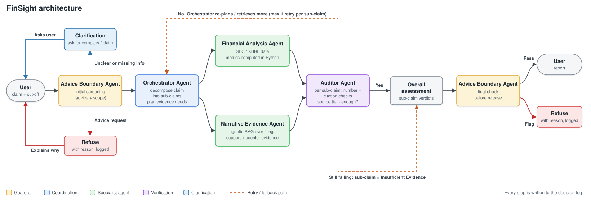

# FinSight

FinSight is a multi-agent system (SMU MITB group project). It stress-tests a **company-level
investment claim**, often from a finfluencer, against evidence available as of a cut-off date.
It splits the claim into sub-claims and gathers both supporting and challenging evidence. Numbers are
checked by calculation and narrative sub-claims by citation. Every verdict is limited by a source-tier rule.
The output is a structured assessment, never personalized investment advice.

| Tier | Sources |
|---|---|
| Tier 1 | SEC filings / XBRL (10-K, 10-Q) |
| Tier 2 | Earnings releases, investor-relations remarks |
| Tier 3 | Frozen news articles (can never raise a verdict) |

**Terminology:** the **claim** is what the user pastes in, e.g. "Company X's revenue growth proves
it is the biggest winner from AI demand". FinSight splits it into **sub-claims** (`sc1`, `sc2`, …),
one checkable statement each, and gives each sub-claim its own verdict. In code: `ClaimRequest` /
`raw_claim` for the input; `SubClaim`, `sub_claim_id`, `SubClaimType` and `sub_claim_results` for the
parts. (Before schema v0.3 these were called "thesis" and "claim".)

The pasted claim is **never** evidence. Per-sub-claim verdicts: `SUPPORTED`, `PARTIALLY_SUPPORTED`,
`CONTRADICTED`, `INSUFFICIENT_EVIDENCE`.

**Status:** the orchestrator, contracts, baselines and evaluation are built. Every other agent is a
**placeholder stub** returning fake data for a fictional "Company X", so the whole pipeline runs
end to end today. Each teammate replaces their own stub; see [CONTRIBUTING.md](CONTRIBUTING.md).

## Team and ownership

| Person | Owns | Folder(s) | Status |
|---|---|---|---|
| Person 1, Venes | Financial Analysis Agent + deterministic XBRL tools | `finsight/agents/financial/`, `finsight/data/xbrl_facts.json` | ⏳ Placeholder stub in place; replace with the real agent |
| Person 2, Stella | Narrative Evidence Agent, vector DB, Basic RAG retriever | `finsight/agents/narrative/` | ⏳ Placeholder stubs in place; replace with the real agent + retriever |
| Person 3, Amelia | Claim Decomposition + Verification/Auditor Agent; Accuracy / Macro-F1 | `finsight/agents/decomposition/`, `finsight/agents/auditor/` | ⏳ Placeholder stubs in place; replace with the real agents |
| Person 4, Irine | Source-tier rules, knowledge-layer content, Advice Boundary Agent, UI | `finsight/agents/tier_policy/`, `finsight/agents/advice_boundary/`, `finsight/knowledge/knowledge_layer.yaml`, UI | ⏳ Placeholder stubs in place; replace them, confirm the knowledge layer, build the UI |
| Person 5, Hung | Orchestrator, shared contracts, repo, LLM client, decision log, baselines, evaluation | everything else | ✅ **Done:** orchestrator (matches the architecture diagram), contracts v0.3, LLM client with mock / paid modes and spend tracking, decision log, Direct LLM + Basic RAG baselines, evaluation harness, CI pipeline, docs<br>⏳ **Remaining:** build and freeze the real heldout set (with Amelia); review and merge teammates' PRs; final `gpt-5.4` evaluation run and results write-up |

**Shared files you must not change without telling Hung:** `finsight/contracts/schemas.py`,
`finsight/contracts/interfaces.py`, and `finsight/agents/orchestrator/`. Everyone imports the
contracts, so a silent change breaks every teammate.

## Setup (once per machine)

Requires **Python 3.11+** and Git.

**Windows (PowerShell):**

```powershell
git clone git@github.com:hungdp123/GenAI-group-project.git
cd GenAI-group-project
python -m venv .venv
.venv\Scripts\Activate.ps1          # if blocked: Set-ExecutionPolicy -Scope CurrentUser RemoteSigned
pip install -e ".[dev]"
pytest                              # should end with "passed", no failures
```

**macOS / Linux:**

```bash
git clone git@github.com:hungdp123/GenAI-group-project.git
cd GenAI-group-project
python3 -m venv .venv
source .venv/bin/activate
pip install -e ".[dev]"
pytest
```

`pip install -e` installs the project in editable mode: your code edits take effect immediately,
and you get the `finsight` command. Re-activate the virtual environment in every new terminal.

## Quick start

### Narrative RAG: cited evidence preparation

Narrative uses an LLM to select relevant source passages, extract exact facts and
write a cited evidence summary, without stance labels or a claim verdict. See
[the Narrative handoff](docs/narrative/workflow/orchestrator_narrative_handoff.md#llm-evidence-preparation-without-stance-or-verdict)
and [Week 2 Section 10](docs/narrative/workflow/summary_week_2.md#10-current-narrative-rag-output-cited-evidence-without-stance-or-verdict)
for commands, required data, provider settings and output fields. Configuration
examples are in [config.example.yaml](config.example.yaml). BM25/dense/hybrid
search and LLM evidence processing are separate steps. The auditor/policy handoff
still needs updating to assess evidence; the current demo decomposer/auditor
remain limitations. Explicit retrieval-only mode is available when desired.

### Offline demo

```bash
finsight run "A finfluencer I follow said Company X's revenue growth proves it is the biggest winner from AI infrastructure demand, and that this growth is just getting started." --cutoff 2025-07-31
finsight trace <request_id>      # the decision log for the run above (id is printed at the bottom)
```

Expected with the stubs: 4 sub-claims.

- Revenue growth: SUPPORTED (Tier 1, +14% YoY).
- AI demand attribution and "just getting started": PARTIALLY_SUPPORTED (knowledge-layer caps, with challenging evidence shown).
- "Biggest winner": INSUFFICIENT_EVIDENCE (peers are out of scope).
- Overall: PARTIALLY_SUPPORTED.

## Command reference

| Command | What it does |
|---|---|
| `finsight run "<claim>" [--cutoff YYYY-MM-DD] [--json] [--no-evidence]` | Evaluate a claim and print the assessment |
| `finsight run "<claim>" --stages` | Also print what each pipeline stage did, as it runs (gates, sub-claims, plan, evidence, audit, retries, verdicts) |
| `finsight run "<claim>" --technical` | Developer view: sub-claim types, tiers, retries, audit rationale (the reader view is the default) |
| `finsight run "<claim>" --company CMPX` | Answer a "which company?" clarification |
| `finsight trace <request_id> [--json]` | Print the decision log of a past run (`logs/<request_id>.json`) |
| `finsight eval --system {direct,rag,finsight,all} --split dev` | Run the evaluation (see below) |
| `finsight eval --validate` | Check both dataset files for mistakes |
| `finsight eval --freeze` | Lock the heldout split (once, when labels are final) |
| `finsight mode [mock\|paid] [--model M]` | Show or switch the LLM mode |
| `finsight usage` | Paid LLM spend recorded on this machine vs the $150 credit |
| `finsight graph` | Regenerate `docs/orchestrator_graph.md` |
| `python scripts/check.py [--quick]` | Run every check locally (same as CI + scenario smoke test), mock mode |

If `finsight` is not found, activate the virtual environment, or use `python -m finsight ...`.

## LLM modes: mock (free) vs paid

**Mock mode is the default and costs nothing.** LLM calls return canned responses, so you can
build and test without an API key. Stay in mock mode unless you need a real model.

Paid mode uses the team's OpenAI course credit ($150, shared by everyone):

1. `pip install -e ".[dev,openai]"`
2. Copy `config.example.yaml` to `config.yaml` and paste the key. Get the key from Hung privately.
   `config.yaml` is gitignored: never commit it, and never paste the key in group chat or code.
3. Switch modes. The setting is saved in your `config.yaml`:

```bash
finsight mode                         # show the current mode
finsight mode paid                    # OpenAI, gpt-5.4-nano (cheap testing)
finsight mode paid --model gpt-5.4    # OpenAI, course model (final reported runs only)
finsight mode mock                    # back to free
```

Budget rules:

- Test with `gpt-5.4-nano` (about 12x cheaper than `gpt-5.4`).
- Each process stops at `FINSIGHT_SPEND_LIMIT_USD` (default $2).
- `pytest` never spends money.
- Check the team total on the OpenAI dashboard: https://platform.openai.com/usage

### Environment variables (optional overrides)

PowerShell: `$env:NAME="value"`. bash: `export NAME=value`, or put `NAME=value` before the command.

| Variable | Default | Meaning |
|---|---|---|
| `FINSIGHT_LLM_PROVIDER` | `mock` | `mock`, `openai` or `anthropic`; overrides `llm_provider` in `config.yaml` |
| `FINSIGHT_LLM_MODEL` | per provider | model name; must be in `config.PRICE_TABLE` |
| `FINSIGHT_SPEND_LIMIT_USD` | `2.00` | per-process spend cap for paid calls |
| `FINSIGHT_IMPL_<SLOT>` | from `config.py` | try your agent without editing code, e.g. `FINSIGHT_IMPL_FINANCIAL=finsight.agents.financial.agent:FinancialAgent` |
| `FINSIGHT_MAX_RETRIES` | `1` | evidence re-gathers per sub-claim after a failed audit |
| `FINSIGHT_CORPUS_AS_OF` | `2025-07-31` | default cut-off when none is given |
| `FINSIGHT_LOGS_DIR` | `logs` | where decision logs are written |
| `FINSIGHT_STUB_FAIL_SUB_CLAIMS` | empty | stub auditor only: `sc1` fails once, `sc1:2` fails twice (retry testing) |
| `FINSIGHT_USAGE_LEDGER` | `logs/llm_usage.jsonl` | local record of every paid call |
| `FINSIGHT_SECRETS_FILE` | `config.yaml` | where keys and the LLM mode are stored |
| `FINSIGHT_REASONING_EFFORT` | unset | optional `reasoning_effort` for GPT-5 models |

## Team workflow (Git)

1. **Start from the latest `main`**, on your own branch. Use `<name>-<topic>` names: on Windows,
   `hung/x` cannot coexist with a branch called `Hung`.
   ```bash
   git checkout main
   git pull origin main
   git checkout -b venes-financial-agent
   ```
2. **Work only in your own folders.** The one shared line you edit is your slot in
   `DEFAULT_IMPLEMENTATIONS` in `finsight/config.py`.
3. **Before opening a PR,** bring in the latest `main` and run the checks:
   ```bash
   git pull origin main
   python scripts/check.py               # everything CI checks + a scenario smoke test (~15 s, free)
   git status                            # config.yaml, logs/, results/, data/ must NOT appear
   ```
   `scripts/check.py` runs, in mock mode:
   - lint, the secrets check, the full test suite and dataset validation;
   - a check that the graph doc is current;
   - one smoke run per path in the architecture (demo, refusals, clarification, injection, cut-off, retry);
   - the dev evaluation.

   It ends with `All good` or a list of what failed. Use `--quick` to skip the test suite and the evaluation.
4. **Open a PR into `main`** and ask one teammate to review. Use the checklist in
   [CONTRIBUTING.md](CONTRIBUTING.md#pull-request-checklist). Never push directly to `main`.

### Continuous integration (GitHub Actions)

Every push and every PR into `main` runs [.github/workflows/ci.yml](.github/workflows/ci.yml).
The results show on the PR and in the repo's **Actions** tab. A PR should only be merged when all checks are green.

| Check | What it does | If it fails |
|---|---|---|
| Lint (ruff) | Catches unused imports, undefined names, lines over 120 chars | Run `ruff check finsight tests --fix`, fix the rest |
| No secrets committed | Fails if `config.yaml` / `.env` is tracked or an API key appears in any file | Remove the file (`git rm --cached config.yaml`) and **rotate the key** |
| Tests (Ubuntu 3.11 + 3.12, Windows 3.12) | `pytest`, `finsight eval --validate`, a demo run, and the graph doc is current | Run the same command locally; for the graph doc run `finsight graph` and commit |

CI always runs in **mock mode**: it never uses an API key and never spends OpenAI credit.
Changes to `finsight/contracts/`, the orchestrator, `config.py` or `.github/` automatically request
Hung's review ([.github/CODEOWNERS](.github/CODEOWNERS)).

Files that conflict most often, and how to avoid it:

| File | Rule |
|---|---|
| `finsight/config.py` | Change only your own line in `DEFAULT_IMPLEMENTATIONS`. Ask Hung before changing anything else (corpus companies, prices) |
| `finsight/contracts/*.py` | Hung only. Request changes as described in [CONTRIBUTING.md](CONTRIBUTING.md#changing-the-shared-contracts) |
| `pyproject.toml` | If you add a dependency, add one line to `dependencies` and mention it in your PR |
| `finsight/knowledge/knowledge_layer.yaml` | Irine only |
| `finsight/eval/datasets/*.jsonl` | Coordinate with Hung and Amelia. Never edit the heldout file after it is frozen |

## Data files

- **Small fixtures** (KB-size JSON or YAML that tests need) go inside the package, e.g. `finsight/data/`.
- **Large corpus files** (filings, news dumps, vector DB indexes) go in the top-level `data/`
  folder, which is gitignored. Share them through the team drive, and commit a small script that
  rebuilds them instead of the files themselves.
- Every document needs a **publication date**. The orchestrator drops evidence published after
  the cut-off and logs it as a violation.

## Calling FinSight from the UI (Irine)

```python
from finsight import run_finsight, execute
from finsight.agents.orchestrator.render import render_assessment

assessment = run_finsight(claim_text, cutoff=None)   # FinalAssessment (Pydantic model)
assessment.status            # COMPLETED | REFUSED | FAILED | NEEDS_CLARIFICATION
assessment.refusal_reason    # show this when REFUSED / FAILED
assessment.clarification_question   # show this when NEEDS_CLARIFICATION, then resubmit (below)
assessment.summary            # plain-language overall summary: show this FIRST
assessment.overall_verdict
assessment.sub_claim_results  # each: sub_claim, verdict, explanation (plain 'why'), supporting, challenging, ...
assessment.as_of_date, assessment.cutoff_was_defaulted, assessment.boundary_disclaimer   # always display these
render_assessment(assessment)                          # reader view: summary, then details
# Labels for your own layout: explain.verdict_label(v) -> "Partly supported",
# explain.source_label(e) -> "Quarterly report (10-Q) filed with the SEC, 25 Jul 2025 (Tier 1: ...)"
# (from finsight.agents.orchestrator import explain)
assessment.model_dump_json()                           # JSON for a web front end

run = execute(claim_text, cutoff=None)                # also returns the decision log
run.assessment, run.decision_log
```

The disclaimer must always be shown. `run_finsight` never raises: problems come back as
`status=FAILED` with a reason. To see the full JSON shape, run `finsight run "<claim>" --json`.

**Clarification loop** (the diagram's "Clarification → asks user" arrow):

```python
a = run_finsight("Its revenue growth is just getting started.")
if a.status == "NEEDS_CLARIFICATION":
    answer = ask_user(a.clarification_question)          # e.g. "Company X" / "CMPX"
    a = run_finsight(claim_text, company_ticker="CMPX")   # "which company?" -> pass the ticker
    # "nothing specific to check" -> resubmit an edited claim instead
```

A ticker outside the corpus comes back REFUSED, with the list of covered companies.

## Evaluation

```bash
finsight eval --system all --split dev                  # iterate on dev
finsight eval --system all --split heldout --final      # final reported run only
```

Results go to `results/{timestamp}/` (gitignored):

- `summary.md`: comparison table for Direct LLM, Basic RAG and FinSight
- `sub_claims.csv`: per-sub-claim predicted vs gold verdicts, for Accuracy / Macro-F1 (Amelia)
- `records.jsonl`, `raw/`, `logs/`

Two safeguards for the heldout split:

- It must be frozen first (`finsight eval --freeze`), and `--final` refuses to run if the file changed after that.
- In paid mode, final runs must use `gpt-5.4`.

Dataset format and labeling rules are in [docs/eval_dataset_guide.md](docs/eval_dataset_guide.md).

### Per-agent evaluation

The commands above score the **whole system**. To score **each agent on its own** (whichever
implementation is registered, stub or real):

```bash
finsight eval --agents all                 # or e.g. --agents auditor,financial
```

| Agent | Measured on | Key metrics |
|---|---|---|
| decomposer | Dev claims' gold sub-claims | Type precision / recall / F1, count accuracy, advice detection |
| financial | Sub-claims with known XBRL answers | Number accuracy, metric, stance, Tier 1 label, "no data" before filing, cut-off leaks, citations |
| narrative | Sub-claims with known relevant passages | Evidence recall / precision, stance, finds counter-evidence, cut-off leaks, citations |
| retriever | Queries with known relevant passages | Recall@3, MRR, cut-off leaks |
| auditor | Correct evidence + auto-generated broken copies (13 mistake types) | Catch rate (per type), false-alarm rate |
| advice_boundary | Labelled inputs / outputs | Recall, precision, F1 at input and output |
| tier_policy | Cases generated from `knowledge_layer.yaml` | Agreement with the rules, illegal verdict raises |

Results: `results/{timestamp}/agents/summary.md` plus `<agent>.json` listing every case.
The cases live in `finsight/eval/agent_eval/datasets/`; each owner should add real-corpus cases.
Scores for the stubs as of 2 Oct 2026: [docs/results/2026-10-02_agent_eval_stubs.md](docs/results/2026-10-02_agent_eval_stubs.md).

## Architecture

The code follows the team architecture diagram ([docs/architecture.svg](docs/architecture.svg), editable SVG):



How the diagram's boxes map to the code (`finsight/agents/orchestrator/`):

| Diagram | Graph node(s) | Notes |
|---|---|---|
| Advice Boundary Agent: initial screening (advice + scope) | `advice_gate_input`, `scope_check` | Advice: Irine's agent. Scope: deterministic rules (price predictions, macro claims, companies outside the corpus are refused) |
| Clarification: ask for company / claim | `clarification` | Status `NEEDS_CLARIFICATION` with a question; triggered by an empty claim, no company named, or no checkable sub-claim |
| Orchestrator Agent: decompose the claim into sub-claims, plan evidence needs | `decompose`, `plan` | Decomposer is Amelia's agent; the plan comes from the knowledge layer |
| Financial / Narrative agents | `gather_evidence` | Sub-claims in parallel; only the planned collectors; post-cut-off evidence dropped and logged |
| Auditor: number + citation checks, source tier enough? | `audit`, `retry_or_accept` | Audit is Amelia's agent; the tier-sufficiency check is in `routing.tier_shortfall` |
| "No": re-plan / retrieve more (max 1 retry) | `retry_or_accept` → `gather_evidence` | Adds the rule's `retry_collectors` and passes feedback; limit `FINSIGHT_MAX_RETRIES` |
| Still failing: sub-claim = Insufficient Evidence | `retry_or_accept` | Only that sub-claim is downgraded; the rest of the answer is kept |
| Overall assessment | `apply_tier_policy`, `assemble` | Irine's tier policy + orchestrator caps; overall rule in `aggregation.py` |
| Advice Boundary: final check, pass / flag | `advice_gate_output`, `finalize` | Flag replaces the answer with a refusal |
| Every step is written to the decision log | all nodes | `logs/<request_id>.json`, view with `finsight trace` |

The exact generated graph is in [docs/orchestrator_graph.md](docs/orchestrator_graph.md); regenerate it with `finsight graph`.

Safety rules enforced by the orchestrator:

- Verdicts come only from audit, tier policy and the orchestrator's guards, never from input text.
- Untrusted text goes only inside `data_block()` and is never placed in a system prompt.
- Evidence published after the cut-off is dropped and logged.
- Tier 3 evidence can never raise a verdict, and a tier policy that tries to raise one is ignored.
- If an agent fails, its sub-claim becomes INSUFFICIENT_EVIDENCE instead of crashing the run.

## Documentation

| Document | Read it when |
|---|---|
| [docs/progress_report.md](docs/progress_report.md) | You want to know what is built, what is next, and what is waiting on you |
| [CONTRIBUTING.md](CONTRIBUTING.md) | You are replacing your stub or opening a PR |
| [docs/architecture.svg](docs/architecture.svg) | You need the architecture diagram (for the report or slides) |
| [docs/decisions.md](docs/decisions.md) | You need the design decisions, the ones awaiting team sign-off, and known limitations |
| [docs/eval_dataset_guide.md](docs/eval_dataset_guide.md) | You are writing or labeling evaluation items |
| [docs/orchestrator_graph.md](docs/orchestrator_graph.md) | You need the exact pipeline graph |
| [docs/results/](docs/results/) | You want past evaluation runs kept for the report |

## Troubleshooting

| Problem | Fix |
|---|---|
| `finsight: command not found` | Activate the virtual environment, or use `python -m finsight` |
| `No module named 'langgraph'` (or `pydantic`, `ruff`, …) | You're using the system Python, not the project's. Run `.venv\Scripts\Activate.ps1` (macOS: `source .venv/bin/activate`), or call `.venv\Scripts\python ...` directly |
| PowerShell won't run `Activate.ps1` | `Set-ExecutionPolicy -Scope CurrentUser RemoteSigned`, then retry |
| `MissingAPIKey` | You are in paid mode without `config.yaml`. Run `finsight mode mock`, or add the key |
| `SpendLimitExceeded` | Intended safety stop. Raise `FINSIGHT_SPEND_LIMIT_USD` only if the spend is deliberate |
| `No price for '<model>'` | Use a model listed in `config.PRICE_TABLE`, or ask Hung to add its price |
| `KnowledgeLayerError` | `knowledge_layer.yaml` has an unknown sub-claim type, verdict or field; the message names it |
| `TypeError: ... does not implement the <slot> protocol` | Your class's method name or arguments differ from `contracts/interfaces.py` |
| `pip install` fails with `OSError ... No such file or directory` and a "Long Path" hint (Windows) | The folder path is too long. Clone into a short path such as `C:\dev\GenAI-group-project` (not deep inside OneDrive), or enable Windows long paths |
| Git warns "LF will be replaced by CRLF" | Harmless on Windows |
