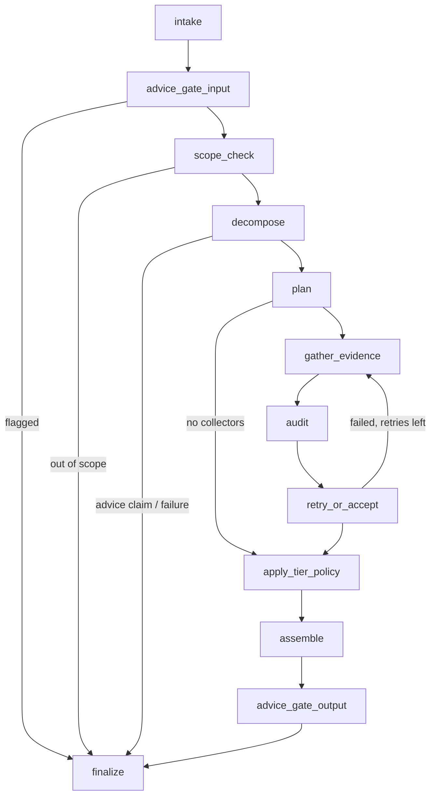

# FinSight

FinSight is a multi-agent system (SMU MITB group project). It stress-tests a **company-level
investment thesis**, often a finfluencer claim, against evidence available as of a cut-off date.
It splits the thesis into claims and gathers both supporting and challenging evidence. Numbers are
checked by calculation and narrative claims by citation. Every verdict is limited by a source-tier rule.
The output is a structured assessment, never personalized investment advice.

| Tier | Sources |
|---|---|
| Tier 1 | SEC filings / XBRL (10-K, 10-Q) |
| Tier 2 | Earnings releases, investor-relations remarks |
| Tier 3 | Frozen news articles (can never raise a verdict) |

The pasted thesis is **never** evidence. Per-claim verdicts: `SUPPORTED`, `PARTIALLY_SUPPORTED`,
`CONTRADICTED`, `INSUFFICIENT_EVIDENCE`.

## Setup

```bash
python -m venv .venv
.venv/Scripts/activate            # Windows  (macOS/Linux: source .venv/bin/activate)
pip install -e ".[dev]"           # add ,anthropic or ,openai for a real LLM provider
pytest
```

Requires Python 3.11+.

## Mock mode (default)

Mock mode is the default and needs no API key. `FINSIGHT_LLM_PROVIDER=mock` returns canned
LLM responses, and every non-orchestrator agent is a deterministic placeholder stub, so the whole
pipeline runs today.

| Env var | Default | Meaning |
|---|---|---|
| `FINSIGHT_LLM_PROVIDER` | `mock` | `mock`, `anthropic` or `openai`; overrides `llm_provider` in config.yaml |
| `FINSIGHT_LLM_MODEL` | per provider | model name (prices in `config.PRICE_TABLE`) |
| `FINSIGHT_MAX_RETRIES` | `1` | evidence re-gathers per claim after a failed audit |
| `FINSIGHT_CORPUS_AS_OF` | `2025-07-31` | default cut-off when none is given |
| `FINSIGHT_LOGS_DIR` | `logs` | where decision logs are written |
| `FINSIGHT_IMPL_<SLOT>` | stub | swap an agent, e.g. `FINSIGHT_IMPL_FINANCIAL=pkg.module:Class` |
| `FINSIGHT_STUB_FAIL_CLAIMS` | empty | stub auditor: `c1` fails once, `c1:2` fails twice (retry testing) |
| `FINSIGHT_SPEND_LIMIT_USD` | `2.00` | a process stops making real LLM calls after spending this much |
| `FINSIGHT_USAGE_LEDGER` | `logs/llm_usage.jsonl` | append-only record of every real LLM call |
| `FINSIGHT_SECRETS_FILE` | `config.yaml` | gitignored file holding `openai_api_key` |
| `FINSIGHT_REASONING_EFFORT` | unset | optional `reasoning_effort` for GPT-5 / o-series models |

## Real LLM (OpenAI)

```bash
pip install -e ".[dev,openai]"
cp config.example.yaml config.yaml        # then paste your key; config.yaml is gitignored
```

Switch between free mock mode and paid API calls with one command. The setting is saved in `config.yaml`:

```bash
finsight mode                         # show the current mode
finsight mode paid                    # OpenAI, gpt-5.4-nano (cheap testing)
finsight mode paid --model gpt-5.4    # OpenAI, course model (final reported runs)
finsight mode mock                    # back to free
```

For a one-off run you can also override the saved mode with environment variables:

```bash
FINSIGHT_LLM_PROVIDER=openai finsight eval --system direct --split dev                    # testing: gpt-5.4-nano
FINSIGHT_LLM_PROVIDER=openai FINSIGHT_LLM_MODEL=gpt-5.4 finsight eval --split heldout --final   # reported numbers
finsight usage                            # spend so far vs the $150 course credit
```

On Windows PowerShell, set the variables first with `$env:FINSIGHT_LLM_PROVIDER="openai"`.

- **Testing model:** `gpt-5.4-nano` is the default, about 12x cheaper than the course model. Mock mode (the default provider) is free.
- **Reported model:** final numbers use `gpt-5.4` (the course template). `--final` refuses any other OpenAI model.
- **Prices:** in `config.PRICE_TABLE`, checked 2026-10-02. A model missing from the table is refused rather than reported as $0.
- **Spend limit:** each process stops at `FINSIGHT_SPEND_LIMIT_USD`.
- **Ledger:** `finsight usage` only counts this machine. Check the OpenAI dashboard for the team-wide total.
- **Tests never spend money:** `pytest` always runs in mock mode.

## Run the demo

```bash
finsight run "A finfluencer I follow said Company X's revenue growth proves it is the biggest winner from AI infrastructure demand, and that this growth is just getting started." --cutoff 2025-07-31
finsight trace <request_id>      # decision log printed by the command above
```

Expected: 4 claims. Revenue growth is SUPPORTED (Tier 1, +14% YoY), AI demand attribution and
"just getting started" are PARTIALLY_SUPPORTED (knowledge-layer caps, with challenging evidence
shown), "biggest winner" is INSUFFICIENT_EVIDENCE (peers are out of scope), and the overall
verdict is PARTIALLY_SUPPORTED.

From Python (this is what the UI calls):

```python
from finsight import run_finsight
assessment = run_finsight("Company X's growth ...", cutoff=None)   # -> FinalAssessment
```

## Run the evaluation

```bash
finsight eval --system all --split dev
finsight eval --system all --split heldout --final    # frozen split: final reported run only
```

Results go to `results/{timestamp}/`:

- `summary.md`: comparison table for direct LLM, basic RAG and FinSight
- `claims.csv`: per-claim predicted vs gold verdicts (for Accuracy / Macro-F1)
- `records.jsonl`, `raw/`, `logs/`

Dataset format, labeling rules and the heldout freeze workflow are in
[docs/eval_dataset_guide.md](docs/eval_dataset_guide.md). Design decisions and known limitations
are in [docs/decisions.md](docs/decisions.md).

## Architecture



The generated diagram is in [docs/orchestrator_graph.md](docs/orchestrator_graph.md); regenerate it with `finsight graph`.

| Path | Owner | What |
|---|---|---|
| `finsight/contracts/` | Hung | Pydantic schemas + agent Protocols (shared contracts) |
| `finsight/agents/orchestrator/` | Hung | LangGraph graph, nodes, routing guards, aggregation |
| `finsight/knowledge/` | Hung (loader) / Irine (content) | claim-type routing + verdict caps |
| `finsight/llm/`, `finsight/logging/` | Hung | LLM client (mock/Anthropic/OpenAI), decision log |
| `finsight/baselines/`, `finsight/eval/` | Hung | Direct LLM + Basic RAG baselines, evaluation |
| `finsight/agents/financial/` | Venes | Financial Analysis Agent (stub) |
| `finsight/agents/narrative/` | Stella | Narrative Evidence Agent + retriever (stubs) |
| `finsight/agents/decomposition/`, `auditor/` | Amelia | Decomposition + Auditor (stubs) |
| `finsight/agents/advice_boundary/`, `tier_policy/` | Irine | Advice Boundary + Tier Policy (stubs) |

Safety rules enforced by the orchestrator:

- Verdicts come only from audit, tier policy and the orchestrator's guards, never from input text.
- Untrusted text goes only inside `data_block()` and is never placed in a system prompt.
- Evidence published after the cut-off is dropped and logged.
- Tier 3 evidence can never raise a verdict, and a tier policy that tries to raise one is ignored.
- If an agent fails, its claim becomes INSUFFICIENT_EVIDENCE instead of crashing the run.

See [CONTRIBUTING.md](CONTRIBUTING.md) to replace a stub.
