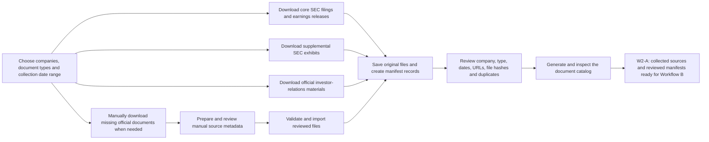
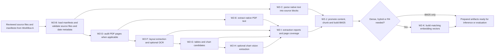
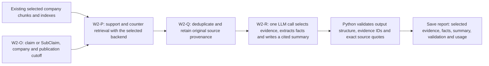
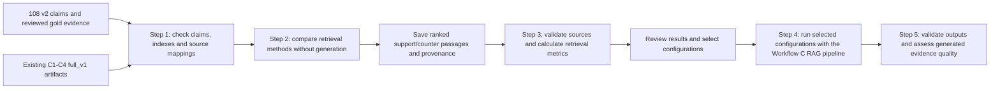
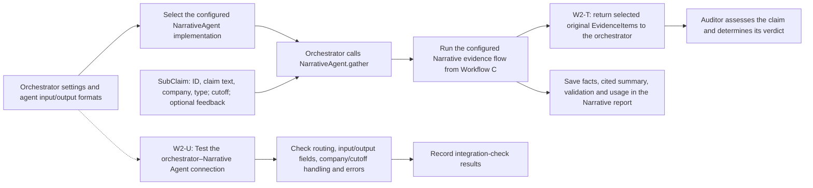

# Full Narrative Agent workflow: source collection to RAG, evaluation and orchestrator integration

Related documentation: [source collection guide](workflow_a_source_collection.md), [Narrative script inventory](../reference/narrative_script_inventory.md), and [orchestrator connection](workflow_e_orchestrator_integration.md#orchestrator-handoff). Guides, configuration files and retained reports live under `docs/narrative/`; generated data and historical experiment inputs must be restored separately where required.

This guide covers source collection, processing, RAG, evaluation and orchestrator integration for the Narrative Agent. Recorded results retain their original snapshot/dataset scope. File descriptions are available in the [script inventory](../reference/narrative_script_inventory.md).

## 1. Full workflow

This section summarizes each workflow. Open its linked guide for detailed explanations, commands, prerequisites and outputs. Current evaluation status is summarized below; output fields and examples are in [Workflow C](workflow_c_rag.md#rag-output).

Follow **A -> B -> C -> D** for source collection, preparation, RAG execution and evaluation. Workflow E connects Narrative to the orchestrator. Step numbers restart at 1 inside each detailed guide.

Choose the workflow that matches the task:

| Workflow | When to run it | Where to start |
|---|---|---|
| **A. Collect source documents and create manifests** | You need to acquire sources, fill coverage gaps or restore the team's collected corpus. | [Workflow A guide](workflow_a_source_collection.md) |
| **B. Prepare the corpus and indexes** | Sources, parsing, chunking or embedding settings change, or a laptop needs matching artifacts restored. | [Workflow B guide](workflow_b_processing_and_indexes.md) |
| **C. Run RAG for a claim** | You want evidence, extracted facts and a cited summary for an input claim. Reuse existing matching indexes. | [Workflow C guide](workflow_c_rag.md) |
| **D. Evaluate RAG** | You want to compare configurations and measure retrieval/summary quality. | [Workflow D guide](workflow_d_evaluation.md) |
| **E. Connect the orchestrator and Narrative Agent** | You want the orchestrator to call Narrative, receive evidence and pass it to the Auditor, or test that connection. | [Workflow E guide](workflow_e_orchestrator_integration.md) |

Workflows A and B prepare the corpus; reuse matching existing sources/indexes
instead of repeating collection and processing for every claim. Workflow C runs
RAG for an individual claim without the test dataset or comparisons.
Workflow D evaluates recorded RAG inputs and outputs. Workflow E
connects the orchestrator to the Narrative processing in Workflow C; its integration
checks are run separately after configuration or interface changes.

End-to-end calls through `python -m finsight run` default to the saved **C2 `full_v1`**
company indexes and **hybrid (BM25 + dense)** retrieval. The defaults are defined in
`finsight/config.py`; environment variables can override them. Matching C2 Qdrant
vectors are required. See [Workflow E](workflow_e_orchestrator_integration.md#default-chunks-and-retrieval-backend)
for configuration, session overrides and retrieval-log checks.

### 1.1 Workflow A — Collect source documents and create manifests



Collect or restore original source files, record their company, dates, URLs and file hashes in manifests, and review the document catalog. These reviewed files and manifests are the input to Workflow B.

[Workflow A details: explanations, scripts and instructions](workflow_a_source_collection.md).

### 1.2 Workflow B — Prepare searchable company evidence



Parse source documents, enrich PDFs where needed, create chunks and build matching search indexes. Reuse existing complete builds; vectors are needed for dense, hybrid and R4 retrieval, while BM25 can run without them.

[Workflow B details: explanations, scripts and instructions](workflow_b_processing_and_indexes.md).

### 1.3 Workflow C — RAG for one claim



Retrieve and deduplicate candidate passages, then use one LLM call to select facts, write a cited summary and assess SUPPORTED, UNSUPPORTED or CONTRADICTING with a reason. Python checks evidence IDs, exact quotes and stance references. The Auditor retains final-verdict authority. See [Workflow C's stance definitions](workflow_c_rag.md#claim-stance-and-reason).

[Workflow C details: explanations, scripts and instructions](workflow_c_rag.md).

### 1.4 Workflow D — Evaluation and validation



Compare retrieval first using all 108 v2 claims and C1-C4 x BM25/dense/hybrid/R4, without LLM generation. Validate and score the saved rankings, then evaluate generated facts, summaries and stances. Workflow D also compares the separate imported contextual/blurb captures, with their cohort differences and missing metrics made explicit. Both evaluation CLIs default to local Ollama (`qwen3-vl:4b-instruct`); the saved GPT-5.4/GPT-4o-mini results retain their original settings. No model runs were started for this update.

[Workflow D details: inputs, five steps, commands and metric definitions](workflow_d_evaluation.md).

### 1.5 Workflow E — Orchestrator and Narrative Agent connection



The orchestrator supplies a SubClaim, cutoff and optional feedback to NarrativeAgent.gather(). Narrative reuses Workflow C and returns selected original EvidenceItems; the Auditor assesses the claim and determines its verdict. Integration checks test this connection separately from quality evaluation.

[Workflow E details: explanations, scripts and instructions](workflow_e_orchestrator_integration.md).

## 2. Execution map

Each workflow guide contains its script table, responsibilities and expected outputs:

| Workflow | Script details |
|---|---|
| A. Source collection and manifests | [Collection scripts](workflow_a_source_collection.md#scripts-and-outputs) |
| B. Processing and indexing | [Processing and index builders](workflow_b_processing_and_indexes.md#scripts-and-outputs) |
| C. Per-claim RAG | [Retrieval and evidence-summary entry points](workflow_c_rag.md#scripts-and-outputs) |
| D. Evaluation | [Comparison and validation scripts](workflow_d_evaluation.md#scripts-and-outputs) |
| E. Orchestrator integration | [Agent entry classes and connection checks](workflow_e_orchestrator_integration.md#scripts-and-outputs) |

For descriptions of individual scripts, see the [grouped script inventory](../reference/narrative_script_inventory.md).

### 2.1 Company document coverage

See [Workflow A: company document coverage](workflow_a_source_collection.md#company-document-coverage) for the 16-company source table, collection window and notes on document categories.

## 3. Before running

Run commands from the repository root in PowerShell. Examples use single lines so PowerShell continuation characters are unnecessary.

```powershell
python -m pip install -e ".[dev,retrieval,document-ai]"
```

Restore the team's raw corpus/manifests or its matching processed snapshot under `data/`. A Git clone does not include that ignored folder. See the [source collection guide](workflow_a_source_collection.md) and [acquisition helper inventory](../reference/narrative_script_inventory.md#6-acquisition-and-manual-import-7-files) when acquiring new sources; downloader arguments depend on the source and destination, so acquisition is not an unconditional rerun step.

For local LLM use, install the chosen Ollama model and start Ollama. Check installed names with `ollama list`. The recorded Basic RAG smoke model is `qwen3-vl:4b-instruct`; a vision-capable model is required for chart extraction. For OpenAI, configure `llm_provider`, `llm_model` and `openai_api_key` in local `config.yaml`; copy the format from `config.example.yaml`. Keep credentials local. Chart extraction can explicitly select its provider with `--openai-model` or `--ollama-model`.

If the processed snapshot is current and you only want to run a claim, go directly to [Workflow C's single-claim command](workflow_c_rag.md#standard-command-prepare-a-cited-evidence-summary). Steps 1-3 in the Workflow B guide write processing/index artifacts; run them when building or refreshing the corpus.

## 4. Build searchable company evidence

Parse, enrich, chunk and index sources when building or updating the corpus. Reuse matching artifacts for ordinary requests. See [Workflow B: processing commands and outputs](workflow_b_processing_and_indexes.md) and the [Workflow B: chunk storage and builds](workflow_b_processing_and_indexes.md#chunk-and-index-storage).

### 4.1 Saved chunking and embedding results

Read from the current saved company outputs in the current saved snapshot. This describes the **canonical company corpus used by Basic RAG**, after PDF/chart promotion; it is separate from the C1-C4 comparisons documented in [Workflow D](workflow_d_evaluation.md). No extraction, chunk build or embedding inference was rerun for this summary.

| Item | Saved result |
|---|---|
| Companies / source documents | 16 companies / 1,201 documents |
| Processed source blocks | 10,424, summed from the saved processing reports |
| Canonical chunk settings | Target 800 words / 120-word overlap budget, with existing structure/content handling; not the strict fixed-window experimental C1 arm |
| Generated chunks in `chunks.jsonl` | **23,856** |
| Duplicate chunks excluded from BM25 | **874** |
| Final BM25 passages | **22,982** |
| Saved Qdrant vectors | **22,982**, one per final indexed passage |
| Embedding model | `sentence-transformers/all-MiniLM-L6-v2` |
| Vector dimension / similarity | **384** dimensions / cosine similarity |
| Embedding input limit | **256 tokens**, confirmed in the cached model configuration |
| BM25/vector metadata consistency | **16/16 companies match**: corpus fingerprints, ordered chunk IDs and passage/vector counts |

Generated chunks and indexed chunks differ because exact duplicate content is excluded during index construction. For example, META has 1,664 generated chunks, 84 excluded duplicates, and 1,580 final BM25 passages/vectors. Actual chunk lengths can be shorter than the configured target.

## 5. Run RAG for a claim

Provide a claim, company and publication cutoff. RAG retrieves source passages, uses an LLM to select relevant facts, and returns a cited summary plus a reasoned claim stance. Original passage labels and the final verdict remain independently assessed by the Auditor. No evaluation dataset is required. See [Workflow C](workflow_c_rag.md) for model and retrieval configuration.

### 5.1 Current command and output

Example using prepared C4 indexes and BM25. This illustrates configuration selection; it does not declare a winning method. Configure the shared LLM provider first, or add the Ollama flags below.

```powershell
python -u -m finsight.agents.narrative.rag.basic_rag --ticker MSFT --claim "Microsoft Azure Arc supports management across multiple clouds and on-premises environments." --cutoff 2024-07-30 --corpus-root data/narrative/processed/chunking_strategies/C4/full_v1 --backend bm25 --top-k 3 --candidate-k 50 --max-tokens 3000
```

| Setting / output | Meaning |
|---|---|
| `--corpus-root` | Selects the saved chunk strategy and matching company indexes; change C4 to C1, C2 or C3 to select another build |
| `--backend` | `bm25`, `dense`, `hybrid` or `r4`; dense/hybrid/R4 require matching vectors and model dependencies |
| `--top-k 3` | Up to three results per support/counter search before deduplication and LLM selection |
| `--candidate-k 50` | Candidate-pool setting used by the retrieval configuration; distinct from the returned top-K |
| Local LLM | Append `--ollama-model qwen3-vl:4b-instruct --ollama-context 20000` to use that installed Ollama model |
| `--max-tokens 3000` | Maximum output tokens for evidence preparation; does not change retrieval depth |
| Report contents | Selected evidence and provenance, exact-source facts, cited summary, citation validation and LLM usage |
| `--retrieval-only` | Explicitly skips LLM preparation; produces retrieval evidence without facts or a generated summary |

For R4, set `--rerank-overflow truncate` only when intentionally permitting cross-encoder input truncation; the default error policy rejects oversized pairs. Complete stored passages remain intact.

Omitting `--output` automatically saves a timestamped report under the renamed folder:

```text
data/narrative/experiments/standalone_rag/<TICKER>-<MODEL>-evidence-<TIMESTAMP>.json
```

The terminal prints the report path. [Workflow C: RAG output](workflow_c_rag.md#rag-output) explains its fields and Python checks. `status=OK` means technical acceptance, not independently verified answer accuracy.

## 6. Evaluate and validate RAG

[Workflow D](workflow_d_evaluation.md) documents evaluation methods, metric
definitions and commands. [The status file](retrieval_submission_status.md) holds detailed results for the 108-claim C1-C4 retrieval matrix, the selected
32-claim generation/judge study, and the separate imported contextual/blurb
comparison. Workflow D provides metric definitions and commands; the status
file provides configuration scores, applicability denominators, costs and source artifacts. Do not combine the imported cohort with the main
matrix as if their case sets and builds were identical.

### 6.1 Current retrieval evaluation status

See [detailed retrieval results](retrieval_submission_status.md#retrieval-results-across-all-24-configurations)
and [authoritative result locations](retrieval_submission_status.md#authoritative-result-locations).
Gold-reference recovery does not establish generated-answer or final-verdict accuracy.

### 6.2 RAG and integration validation status

Use [detailed stance results](retrieval_submission_status.md#stance-quality-and-completion)
and [RAGAS quality](retrieval_submission_status.md#final-judge-scores-with-coverage).
[Workflow E](workflow_e_orchestrator_integration.md) covers orchestrator
configuration, contracts and integration tests; the Auditor retains final-verdict authority.

### 6.3 Run RAG generation and RAGAS evaluation locally

Follow [Workflow D's local flow](workflow_d_evaluation.md#full-local-flow-generate-and-evaluate-with-ragas),
using the explicit v2 `cases_combined.csv` path and new output folders. Local
Ollama runs are separate from the saved GPT-5.4/GPT-4o-mini results. For generation
from an existing capture, use [the saved-retrieval instructions](workflow_d_evaluation.md#generate-from-saved-retrieval-with-gpt-54).
