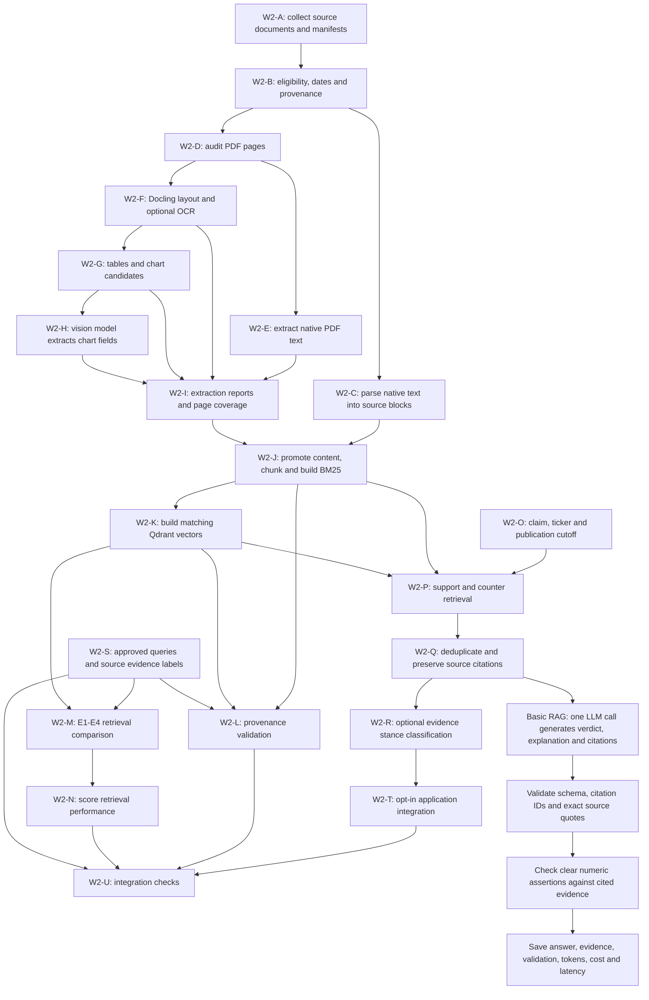

# Week 2 summary: source documents to Basic Narrative RAG

Documentation home: [docs/narrative/README.md](../README.md). Narrative guides, evaluation inputs, configuration files and reports now live together under `docs/narrative/`; commands below use the new paths.

This is the practical workflow and GitHub handoff for the Narrative workstream. Detailed status and earlier experiment results are in [recap_week_2.md](recap_week_2.md); commit guidance is in [narrative_pipeline_handoff.md](narrative_pipeline_handoff.md).

## 1. Full workflow

There are two operational stages: prepare searchable company evidence, then answer a claim using that evidence. Retrieval evaluation, provenance validation and integration checks accompany those stages. Chunking/retrieval research uses separate experiment artifacts.



W2-A through W2-U retain their meanings from the recap. The Basic RAG branch adds final answer generation and validation. Its CLI gathers evidence using exact stance mode, then makes one generation call. Iterative Agentic RAG is outside the current scope.

## 2. Execution map and files to commit

**Folder organization:** modules now live under `acquisition/`, `processing/`, `pdf/`, `retrieval/`, `rag/`, `evaluation/`, `maintenance/` and `demo/` inside `finsight/agents/narrative/`. Commands below use these new paths. The [migration guide](../reference/narrative_module_migration.md) maps all 40 former flat module paths to their new locations. Use it to update commands or local registry settings outside the repository.

Paths in the module column are relative to `finsight/agents/narrative/` unless stated otherwise. Commit the full Narrative package to preserve imports and demo compatibility; the table identifies the main responsibilities.

For a description of **every Python file in this folder**, including inputs/outputs, runnable commands, imported helpers and demo stubs, see the [grouped Narrative script inventory](../reference/narrative_script_inventory.md).

| Step | Workflow blocks | Entry point / supporting modules | Main output |
|---|---|---|---|
| 0. Restore or acquire sources | W2-A, W2-B | `processing/corpus.py`; acquisition/import modules listed in Section 9 | Raw files and canonical manifests under `data/narrative/` |
| 1. Parse, chunk and index text | W2-C, W2-J | `processing/process_corpus.py`, `processing/ingest.py`, `processing/chunk.py`, `processing/index.py`, `pdf/pdf_enrichment.py` | Company `documents.jsonl` source blocks, `chunks.jsonl`, BM25 and processing report |
| 2. Extract PDFs/charts and promote | W2-D to W2-J | `pdf/pdf_chart_processing.py`, `pdf/docling_charts.py`, `pdf/chart_vision.py`, `pdf/chart_models.py`, `pdf/chart_usage.py`, `pdf/pdf_enrichment.py` | Per-document reports, chart/table artifacts and company passages refreshed by promotion |
| 3. Build vectors | W2-K | `retrieval/build_vector_databases.py`, `retrieval/qdrant_index.py`, `retrieval/vector_index.py` | Company Qdrant storage and matching metadata |
| 4. Evaluate retrieval | W2-S, W2-M, W2-N | Canonical 92-claim experiment: `scripts/narrative/retrieval/compare_canonical_development.py`; historical v2 runner: `evaluation/run_retrieval_comparison.py` | 92-claim rankings and `comparison.json`; historical v2 rankings and `evaluation.json` |
| 5. Retrieval Provenance Validation | W2-L | `evaluation/validate_retrieval_provenance.py`, `retrieval/retriever.py` | Source/company/date/citation mapping checks; no answer generation |
| 6. Collect Evidence and Assign Stance | W2-O to W2-R | `rag/collect_evidence.py`, `retrieval/retriever.py` | 92-claim batch: 276 checks across BM25/dense/hybrid, exact stance |
| 7. Generate Basic RAG answer | Basic RAG branch | `rag/basic_rag.py`, `rag/collect_evidence.py`, `retrieval/retriever.py`; shared LLM client | Verdict, explanation, exact citations, consistency trace and usage |
| 8. Check application integration | W2-T, W2-U | `evaluation/verify_agent_integration.py`, shared `finsight/config.py` and contracts | Historical 16-claim check and current 92-claim x 3-backend isolated-index report |
| 9. Research alternatives | Separate experiment branch | `processing/adaptive_chunking.py`, `retrieval/source_priority.py`, `scripts/` runners in Section 7 | Isolated C1-C4 and R1-R4 x P0-P2 reports and indexes |

### 2.1 Company document coverage

Document availability checked against canonical manifests and local files in the current saved snapshot; collection window **2024-01-01 through 2026-10-04**. Category definitions follow the [corpus download guide](../corpus/narrative_corpus_download_guide.md#coverage-by-company). Counts describe available document records, not processing/index status or an exhaustive filing-history certification. High/Medium labels describe the experimental document-priority configuration; they do not automatically activate priority in P0 or Basic RAG.

| Company | 10-K / 20-F (High) | 10-Q (High) | Form 8-K / Form 6-K (main filings) (High) | 8-K/6-K exhibits | Earnings releases (High) | Investor presentations (Medium) | Earnings-call transcripts (Medium) |
|---|---:|---:|---:|---:|---:|---:|---:|
| AAPL | 2 | 9 | 26 | 11 | 11 | 0 | 11 / 11 |
| AMD | 3 | 8 | 38 | 11 | 11 | 11 | 11 / 11 |
| AMZN | 3 | 8 | 29 | 11 | 11 | 11 | 11 / 11 |
| CRM | 3 | 8 | 31 | 14 | 11 | 12 | 11 / 11 |
| GOOGL | 3 | 8 | 39 | 11 | 11 | 6 | 11 / 11 |
| INTC | 3 | 8 | 51 | 12 | 11 | 11 | 11 / 11 |
| INTU | 3 | 8 | 26 | 12 | 11 | 6 | 11 / 11 |
| MELI | 3 | 8 | 23 | 11 | 11 | 7 | 11 / 11 |
| META | 3 | 8 | 27 | 11 | 11 | 11 | 11 / 11 |
| MSFT | 3 | 8 | 22 | 11 | 11 | 11 | 11 / 11 |
| NFLX | 3 | 8 | 27 | 11 | 11 | 1 | 11 / 11 |
| NVDA | 3 | 8 | 29 | 11 | 11 | 20 | 11 / 11 |
| ORCL | 3 | 8 | 28 | 11 | 11 | 6 | 11 / 11 |
| PLTR | 3 | 8 | 16 | 11 | 11 | 11 | 11 / 11 |
| SBUX | 2 | 9 | 40 | 13 | 12 | 5 | 11 / 11 |
| TSLA | 3 | 8 | 32 | 23 | 23 | 11 | 11 / 11 |

How to read the table:

- **Main filings and exhibits differ:** main 8-K/6-K documents are counted separately from attachments. An earnings-release exhibit can also appear in the earnings-release column; do not sum the columns as unique documents. Exhibit priority follows the underlying content type.
- **Alternative form names:** the collected annual forms are 10-Ks; there are no collected 20-F or 6-K records. Companies do not need both alternatives. Main-filing counts include amendments where present.
- **Investor presentations include quarterly earnings slide decks**, Investor Day and other presentation decks. Counts exclude three reviewed release documents mislabelled as presentations. AAPL's zero means no separate deck was found in the checked archive; other small deck counts do not by themselves establish missing published quarters.
- **Earnings-call coverage is 176/176 expected periods:** each company has 11 of 11. These include official and authorized third-party transcripts, not only official company transcripts.
- **AAPL/SBUX annual counts differ because of fiscal calendars and filing dates.** Their counts are 2 annual and 9 quarterly reports within the collection window; the other companies have 3 annual and 8 quarterly reports.
- **Release counts can include different event types:** TSLA's 23 include 11 financial shareholder updates and 12 production/delivery announcements; SBUX's 12 include a preliminary release.
- **MELI is updated from the older guide:** 23 main filings are available locally; three 2026 8-K PDFs still referenced in manifests are absent. Thus the older 26-file availability count is not used here. This is a source-availability note, not a request to restore those removed documents.

For deck-period gaps and acquisition details, follow the [download guide](../corpus/narrative_corpus_download_guide.md#missing-or-incomplete-document-coverage). Availability alone does not establish that every page was extracted correctly.

## 3. Before running

Run commands from the repository root in PowerShell. Examples use single lines so PowerShell continuation characters are unnecessary.

```powershell
python -m pip install -e ".[dev,retrieval,document-ai]"
```

Restore the team's raw corpus/manifests or its matching processed snapshot under `data/`. A Git clone does not include that ignored folder. See [Week 1 recap](recap_week_1.md) and the [download guide](../corpus/narrative_corpus_download_guide.md) when acquiring new sources; downloader arguments depend on the source and destination, so acquisition is not an unconditional rerun step.

For local LLM use, install the chosen Ollama model and start Ollama. Check installed names with `ollama list`. The recorded Basic RAG smoke model is `qwen3-vl:4b-instruct`; a vision-capable model is required for chart extraction. For OpenAI, configure `llm_provider`, `llm_model` and `openai_api_key` in local `config.yaml`; copy the format from `config.example.yaml`. Keep credentials local. Chart extraction can explicitly select its provider with `--openai-model` or `--ollama-model`.

If the processed snapshot is current and you only want to answer claims, go directly to Step 7 below. Steps 1-3 write processing/index artifacts; run them when building or refreshing the corpus.

## 4. Build searchable company evidence: Steps 1-3

### Step 1. Create source blocks, chunks and BM25

Start with one company:

```powershell
python -u -m finsight.agents.narrative.corpus.processing.process_corpus --ticker META
```

Use `--all` instead of `--ticker META` for every eligible company. Existing output folders are skipped; use `--rebuild` only when intentionally refreshing them. The build uses promoted PDF enrichment when available. Outputs are under `data/narrative/processed/META/`:

```text
documents.jsonl             parsed source blocks with provenance
chunks.jsonl                retrieval passages and stable evidence IDs
processing_report.json      processing counts and warnings
indexes/index.json          BM25 data and passages
indexes/index_metadata.json build metadata
```

### Step 2. Enrich PDFs/charts, then promote into company passages

```powershell
python -u -m finsight.agents.narrative.corpus.pdf.pdf_chart_processing --ticker META --ollama-model qwen3-vl:4b-instruct --chart-workers 1 --chart-timeout 900 --promote
```

For OpenAI extraction, replace `--ollama-model qwen3-vl:4b-instruct` with `--openai-model gpt-5.4`; requests may incur API charges. Use `--all` instead of the ticker for an all-company batch. The pipeline reuses valid source-matched artifacts; failures or changed inputs may require work. `--promote` merges applicable extracted content into canonical company blocks/chunks and BM25.

If extraction is already complete and only promotion is needed:

```powershell
python -u -m finsight.agents.narrative.corpus.pdf.pdf_chart_processing --ticker META --promote-only
```

Inspect saved status:

```powershell
python -m finsight.agents.narrative.corpus.pdf.pdf_chart_processing --all --status
```

Per-document artifacts are under `data/narrative/processed/<TICKER>/experiments/pdf_chart_processing/<DOCUMENT_ID>/`. Available files depend on page routing; not every PDF produces charts or enhanced Markdown. A final report establishes recorded extraction status, not independently verified financial accuracy.

### Step 3. Build or refresh vectors after final promotion

```powershell
python -u -m finsight.agents.narrative.retrieval.build_vector_databases --ticker META
```

Use `--all` for every company. The builder reuses current vector indexes and rebuilds stale ones; `--rebuild` forces regeneration. Outputs include `data/narrative/processed/<TICKER>/indexes/qdrant/qdrant_metadata.json` and `storage/`. BM25 and vectors must describe the same passages for dense/hybrid retrieval. Avoid simultaneous writers to the same local Qdrant storage.

### 4.1 Saved chunking and embedding results for Steps 1-3

Read from the current saved company outputs in the current saved snapshot. This describes the **canonical company corpus used by Basic RAG**, after PDF/chart promotion; it is separate from the isolated C1-C4 experiment results in Section 8. No extraction, chunk build or embedding inference was rerun for this summary.

| Item | Saved result |
|---|---|
| Companies / source documents | 16 companies / 1,201 documents |
| Processed source blocks | 10,424, summed from the saved processing reports |
| Canonical chunk settings | Target 800 words / 120-word overlap budget, with existing structure/content handling; not the strict fixed-window experimental C1 arm |
| Generated chunks in `chunks.jsonl` | **23,856** |
| Duplicate chunks excluded from BM25 | **874** |
| Final BM25 passages | **22,982** |
| Saved Qdrant vectors | **22,982**, one per final indexed passage |
| Embedding model | `sentence-transformers/all-MiniLM-L6-v2` |
| Vector dimension / similarity | **384** dimensions / cosine similarity |
| Embedding input limit | **256 tokens**, confirmed in the cached model configuration |
| BM25/vector metadata consistency | **16/16 companies match**: corpus fingerprints, ordered chunk IDs and passage/vector counts |

Generated chunks and indexed chunks differ because exact duplicate content is excluded during index construction. For example, META has 1,664 generated chunks, 84 excluded duplicates, and 1,580 final BM25 passages/vectors. Actual chunk lengths can be shorter than the configured target.

| Company | Generated chunks | BM25 passages after deduplication | Qdrant vectors | Metadata matches |
|---|---:|---:|---:|---|
| AAPL | 687 | 667 | 667 | Yes |
| AMD | 1,657 | 1,643 | 1,643 | Yes |
| AMZN | 1,330 | 1,244 | 1,244 | Yes |
| CRM | 1,829 | 1,778 | 1,778 | Yes |
| GOOGL | 1,061 | 1,049 | 1,049 | Yes |
| INTC | 1,554 | 1,523 | 1,523 | Yes |
| INTU | 2,028 | 1,997 | 1,997 | Yes |
| MELI | 1,735 | 1,714 | 1,714 | Yes |
| META | 1,664 | 1,580 | 1,580 | Yes |
| MSFT | 1,445 | 1,387 | 1,387 | Yes |
| NFLX | 1,180 | 1,141 | 1,141 | Yes |
| NVDA | 1,416 | 1,335 | 1,335 | Yes |
| ORCL | 1,264 | 1,224 | 1,224 | Yes |
| PLTR | 2,233 | 2,121 | 2,121 | Yes |
| SBUX | 1,165 | 1,064 | 1,064 | Yes |
| TSLA | 1,608 | 1,515 | 1,515 | Yes |
| **Total** | **23,856** | **22,982** | **22,982** | **16/16** |

**What the checks establish:** saved BM25 and Qdrant metadata describe the same indexed passage set. This read-only review did not open/recount the physical Qdrant collections. Metadata consistency also does not prove that every passage was embedded without truncation: an 800-word target can exceed the model's 256-token limit. The token-valid experimental C4 representation has not been promoted into these canonical indexes. See Section 8 for the separate chunking validation/comparison results.

Source artifacts for each company:

```text
data/narrative/processed/<TICKER>/chunks.jsonl
data/narrative/processed/<TICKER>/processing_report.json
data/narrative/processed/<TICKER>/indexes/index.json
data/narrative/processed/<TICKER>/indexes/index_metadata.json
data/narrative/processed/<TICKER>/indexes/qdrant/qdrant_metadata.json
```

Inspect one company's saved results without rebuilding:

```powershell
$chunkReport = Get-Content -Raw data/narrative/processed/META/processing_report.json | ConvertFrom-Json
$chunkReport | Select-Object documents_selected, processed_blocks, chunks_created, duplicates_excluded, indexed_chunks
$bm25Metadata = Get-Content -Raw data/narrative/processed/META/indexes/index_metadata.json | ConvertFrom-Json
$bm25Metadata.chunking
$vectorMetadata = Get-Content -Raw data/narrative/processed/META/indexes/qdrant/qdrant_metadata.json | ConvertFrom-Json
$vectorMetadata | Select-Object embedding_model, dimension, vector_count, distance, corpus_fingerprint
```

## 5. Retrieve, evaluate and inspect evidence: Steps 4-6

### Step 4. Run and score retrieval methods

The latest 92-claim result uses the isolated canonical chunking runner documented in [Section 8.4](#84-run-canonical-chunking-on-the-same-92-development-claims). It compares R1-R4 with P0 and writes 368 cases under `data/narrative/experiments/narrative_rag/20261018_all16_v1/retrieval_canonical/canonical92_v1/`. Its saved results are in [Section 5.1](#51-saved-results-for-steps-4-6-92-development-claims). The approved-v2 command below reproduces the historical 16-claim run, not the current 92-claim result.

All approved v2 questions are selected when no ticker filter is provided:

```powershell
python -u -m finsight.agents.narrative.evaluation.run_retrieval_comparison --queries docs/narrative/evaluation/retrieval_queries_v2.jsonl --top-k 10 --candidate-k 50 --output-dir data/narrative/experiments/retrieval_comparison/handoff_v1
python -m finsight.agents.narrative.evaluation.summarize_retrieval_comparison --results data/narrative/experiments/retrieval_comparison/handoff_v1/results.json --queries docs/narrative/evaluation/retrieval_queries_v2.jsonl
```

Use a new output directory for a new run. The four reported methods are BM25, dense, hybrid, and hybrid with cross-encoder reranking. The scorer writes `evaluation.json` and `per_query.csv` beside `results.json`. These measure evidence retrieval against references; they do not evaluate generated answers. The runner uses canonical company indexes and can write retrieval caches; `--output-dir` alone does not isolate all inputs/caches.

### Step 5. Retrieval Provenance Validation

```powershell
python -u -m finsight.agents.narrative.evaluation.validate_retrieval_provenance --queries docs/narrative/evaluation/retrieval_queries_v2.jsonl --top-k 10 --candidate-k 50
```

This command validates retrieved evidence mappings, company/date filtering and citation metadata. It writes `data/narrative/experiments/basic_rag/task5_smoke.json`. It does not call a generation model. Repeated execution refreshes the saved report.

### Step 5.1 Validate the saved 92-claim experiment

Run the provenance audit against Step 4 artifacts; this checks saved rankings and does not issue retrieval or model calls:

```powershell
python -u -m finsight.agents.narrative.evaluation.validate_canonical_provenance --experiment-dir data/narrative/experiments/narrative_rag/20261018_all16_v1/retrieval_canonical/canonical92_v1 --queries data/narrative/experiments/narrative_rag/20261018_all16_v1/labels/evidence_labels_v3/dev/questions.jsonl
```

The report is written to `data/narrative/experiments/narrative_rag/20261018_all16_v1/retrieval_canonical/canonical92_v1/provenance_validation.json`. Expected scope: 92 claims, 16 companies and 368 saved query/method rankings. Read `error_count`; the audit checks ranked passage IDs/text hashes, company and cutoff, citation fields and source-map identity. It does not judge evidence relevance or financial correctness.

**Latest saved result:** complete; 92 claims, 16 companies, 368 rankings and 3,680 ranked passages checked; **0 errors** and 196 missing-URL occurrences. The missing URLs are counted separately from provenance errors. This validates recorded passage and source metadata; it does not verify PDF extraction accuracy or whether a passage supports a claim.

### Step 6. Collect Evidence and Assign Stance

Collect evidence and assign stance for a claim. Both examples below use the production META index for one query/claim; Section 5.2 checks all 92 claims against the isolated experiment indexes.

**Optional diagnostic: inspect raw retrieval results**

Use this to inspect passages returned by a query before stance assignment. You do not need to run it separately to complete Step 6, because evidence collection already calls the retriever.

```powershell
python -m finsight.agents.narrative.retrieval.retriever --ticker META --query "DAP June 2024" --cutoff 2025-07-31 --backend bm25 --top-k 3
```

**Step 6 command: collect evidence and assign stance**

This builds support/counter searches from your claim, retrieves and deduplicates passages, preserves provenance and assigns passage stance. Run this command when you want the complete evidence-collection step, without generating a final verdict.

```powershell
python -m finsight.agents.narrative.rag.collect_evidence --ticker META --sub-claim-id sc1 --claim-type OTHER --claim "DAP was 3.27 billion on average for June 2024" --cutoff 2025-07-31 --backend bm25 --stance-method exact
```

`exact` uses deterministic stance handling; `llm` selects the configured shared LLM for stance classification. This agent returns evidence. Step 7 adds the final generated assessment. The cutoff filters publication dates; it is an input for each request, not a permanent limit of 2025-07-31.

### 5.1 Saved results for Steps 4-6: 92 development claims

Updated from the saved artifacts. Retrieval evaluation is complete for **92 development claims across all 16 companies**, using canonical 800/120 chunking rules on the same frozen parsed sources, claim queries, source-span labels and P0 retrieval/scoring implementations as the C4 comparison. There are **368 claim/method cases**; the 36 heldout claims were not evaluated.

| Step | Latest 92-claim status | Saved output |
|---|---|---|
| 4. Retrieval Performance Evaluation | Complete: 92 claims x four methods = 368 cases; P0; cutoff 2025-07-31 | `data/narrative/experiments/narrative_rag/20261018_all16_v1/retrieval_canonical/canonical92_v1/` |
| 5. Retrieval Provenance Validation | **Complete for 92 claims:** 368 rankings / 3,680 ranked passages checked; 0 errors; 196 missing-URL occurrences recorded separately. Earlier production-index report: 96 checks, 0 errors, 127 missing-URL occurrences | `data/narrative/experiments/narrative_rag/20261018_all16_v1/retrieval_canonical/canonical92_v1/provenance_validation.json` |
| 6. Collect Evidence and Assign Stance | **Complete for 92 claims:** 276 checks across BM25/dense/hybrid, 0 recorded errors; question hash and all recorded index fingerprints match | `data/narrative/experiments/narrative_rag/20261018_all16_v1/retrieval_canonical/canonical92_v1/agent_integration/report.json` and unique claim/backend evidence files |

**Step 4 results: canonical chunking, 92 development claims, P0**

| Method | Recall@5 | Recall@10 | Support Recall@10 | Direct-counter Recall@10 | MRR@10 |
|---|---:|---:|---:|---:|---:|
| R1 BM25 | 79.89% | 85.33% | 88.73% | 85.71% | 0.7121 |
| R2 Dense | 27.17% | 36.41% | 38.03% | 42.86% | 0.1968 |
| R3 Hybrid with lexical anchors | 46.20% | 59.78% | 63.38% | 66.67% | 0.3926 |
| R4 Hybrid + cross-encoder | 48.37% | 64.67% | 71.83% | 61.90% | 0.4356 |

Support recall uses 71 support-labelled claims; direct-counter recall uses 21 counter-labelled claims. These measure evidence retrieval, not generated-verdict correctness. BM25 has the highest overall Recall@10 in this run. The C4 comparison and trade-offs are recorded in the [completed run report](../results/2026-10-19_canonical92_runner.md).

The isolated indexes contain 40,046 deduplicated passages. With explicit `truncate` policy, 8,621 passage inputs exceed the embedding limit and 1,679 reranker pairs exceed the pair limit. Full passages remain stored/scored, so labelled evidence can occur outside the model-visible prefix. Draft labels, this truncation limitation and cached timings prevent treating these results as final acceptance or a fair deployment-latency benchmark. The saved run reports zero paid API requests.

Inspect the saved results:

```powershell
$canonical92 = "data/narrative/experiments/narrative_rag/20261018_all16_v1/retrieval_canonical/canonical92_v1"
$r = Get-Content -Raw "$canonical92/comparison.json" | ConvertFrom-Json
$r | Select-Object status, development_claims, cases, heldout_evaluated
Get-Content "$canonical92/report.md"
Import-Csv "$canonical92/per_query.csv" | Select-Object -First 10
```

The earlier 16-claim retrieval and provenance results remain in their historical artifacts. The 92-claim Step 5 audit and Step 6 integration report are saved separately under `canonical92_v1/`.

### 5.2 Run agent integration on the 92 development claims

The integration runner now accepts the completed isolated experiment and verifies the questions hash against its configuration. Run from the project root:

```powershell
python -u -m finsight.agents.narrative.evaluation.verify_agent_integration --experiment-dir data/narrative/experiments/narrative_rag/20261018_all16_v1/retrieval_canonical/canonical92_v1 --queries data/narrative/experiments/narrative_rag/20261018_all16_v1/labels/evidence_labels_v3/dev/questions.jsonl
```

Expected: **276 checks = 92 claims x BM25/dense/hybrid**, using deterministic exact stance with no LLM calls. The agent uses its own two-query retrieval flow and production hybrid algorithm on the isolated indexes; these integration outputs are separate from the 368 Step 4 retrieval-performance cases. There is no cross-encoder agent backend. Existing embedding-vector truncation limitations remain.

Outputs: `data/narrative/experiments/narrative_rag/20261018_all16_v1/retrieval_canonical/canonical92_v1/agent_integration/report.json` plus unique claim/backend evidence files. The runner refuses a nonempty output directory; use `--output-dir` with a new path for another run. Stop overlapping vector builds before opening the same local Qdrant storage.

**Latest saved result: complete.** The report contains 276 checks covering 92 unique claims (92 per backend), with 0 recorded errors and 1,714 returned-passage occurrences: 25 `SUPPORTING` and 1,689 `NEUTRAL` under exact stance. It records 112 missing-URL occurrences separately and zero LLM/API requests. The question-file hash and recorded company index fingerprints match the saved experiment inputs. These establish integration consistency, not semantic stance accuracy or generated-verdict correctness. The 92-claim provenance validation is complete; see Section 5.1.

Inspect the saved integration result:

```powershell
$integration92 = Get-Content -Raw data/narrative/experiments/narrative_rag/20261018_all16_v1/retrieval_canonical/canonical92_v1/agent_integration/report.json | ConvertFrom-Json
$integration92 | Select-Object status, claim_count, expected_checks, check_count, error_count
```

This documentation update read existing artifacts only; it did not rerun retrieval, integration or models.

## 6. Generate and validate an answer: Steps 7-8

### Step 7. Run end-to-end Basic Narrative RAG

```powershell
python -u -m finsight.agents.narrative.rag.basic_rag --ticker META --claim "DAP was 3.27 billion on average for June 2024" --cutoff 2025-07-31 --backend bm25 --top-k 3 --max-tokens 1500 --ollama-context 20000 --ollama-model qwen3-vl:4b-instruct
```

This command retrieves support/counter passages, deduplicates them, makes one LLM call and validates the answer. `--top-k 3` applies to each search; up to six unique passages can reach generation. Omit `--ollama-model` and `--ollama-context` to use the configured cloud provider. `--max-tokens` limits generated tokens; it does not cap the prompt or impose a dollar budget. Local context size must fit the machine/model.

If `--output` is omitted, the report is saved automatically to:

```text
data/narrative/experiments/narrative_basic_rag/<TICKER>-<MODEL>-<TIMESTAMP>.json
```

**Run all 92 development claims in one batch using the experiment indexes:**

```powershell
python -u -m finsight.agents.narrative.evaluation.run_basic_rag_batch --experiment-dir data/narrative/experiments/narrative_rag/20261018_all16_v1/retrieval_canonical/canonical92_v1 --queries data/narrative/experiments/narrative_rag/20261018_all16_v1/labels/evidence_labels_v3/dev/questions.jsonl --output-dir data/narrative/experiments/narrative_basic_rag/canonical92_ollama_v1 --backend bm25 --top-k 3 --max-tokens 1500 --ollama-context 20000 --ollama-model qwen3-vl:4b-instruct --allow-draft --resume
```

The batch reuses `rag/basic_rag.py` and explicitly reads `canonical92_v1/companies/<TICKER>/index.json`. It checks that the questions hash matches the experiment and processes 92 claims sequentially with exact stance during collection plus one generation call per attempted claim. It does not activate experimental P1/P2 priority. The production agent's support/counter query generation differs from Step 4's original-claim queries.

Outputs are under `data/narrative/experiments/narrative_basic_rag/canonical92_ollama_v1/`: `cases/` contains one latest result per claim, `attempts/` preserves every saved attempt including retries, `configuration.json` records settings/input/code hashes, and `report.json` aggregates technical status, verdict counts, tokens, estimated cost and timing. Generation failures without returned usage have unknown usage/cost. Ollama calls have no OpenAI API charges.

`--resume` reuses saved cases, including failed cases, without making duplicate generation calls. Add `--retry-failed` when intentionally retrying failures; all saved attempts remain included in usage totals. Use a new output directory if the model, settings, indexes or pipeline code change. Force termination can lose an in-flight response's usage. Run only one process per output directory.

**Latest saved batch status: `complete_with_errors`.** All 92 claims were processed: 63 passed technical validation and 29 returned `INVALID_GENERATION`. Results and usage are in Section 6.2. Twelve focused implementation tests previously passed with mocked generation. Verdict accuracy remains unscored because the expected verdict labels require independent review.

Successful generation reports include `status`, `answer`, `retrieval`, `retrieved_evidence`, `citation_validation`, `consistency_check`, `llm` and `raw_model_output`. Check `answer.verdict`, `answer.explanation`, exact citations, numeric-check status and usage. Error reports may contain fewer fields. `status=OK` establishes technical validity; general semantic correctness still requires evaluation.

For clear single-value margin/DAP claims, the deterministic checker compares reliable cited evidence for the same metric and explicit period, with basis checks and a displayed-precision half-up rounding rule. A conflicting value yields `REFUTED`; numerical closeness alone does not support it. Ambiguous or unrecognized claims are left outside this narrow check. `PARTIALLY_SUPPORTED` is reserved in the prompt for mixed outcomes across independently verifiable parts of a multi-part claim. Exact source quotes and retrieved citation IDs remain mandatory.

Basic RAG accepts `REFUTED` as a response label; the shared application verdict enum uses `CONTRADICTED`. Review that boundary before wiring generated answers into application contracts.

### Step 8. Check agent integration and regression behavior

For the historical 16-claim integration batch using production indexes:

```powershell
python -u -m finsight.agents.narrative.evaluation.verify_agent_integration
python -m pytest tests/test_narrative_basic_rag.py -q
```

The no-argument integration command reads `docs/narrative/evaluation/retrieval_queries_v2.jsonl`, checks three backends in exact stance mode and writes 48 historical checks under `data/narrative/experiments/narrative_agent/task7/`. For the latest 92-claim experiment, use the separate command in Section 5.2; its report has 276 checks. Both batches check agent/index integration, not final generated-verdict accuracy. The regression tests cover Basic RAG numerical matching, conflict and rounding behavior without requiring paid calls.

Opt-in application routing described in recap Section 9 uses `FINSIGHT_CORPUS_PROFILE` and `FINSIGHT_IMPL_NARRATIVE`. It is separate from the standalone Basic RAG CLI; configuring the Narrative Agent does not automatically replace every demo agent or the generic Basic RAG baseline.

### 6.1 Saved answer-generation and validation results

**Step 7 has three saved end-to-end Basic RAG smoke runs**, using canonical company passages, BM25 retrieval and local Ollama `qwen3-vl:4b-instruct`. Settings: top K=3 per support/counter search, maximum output 1,500 tokens and context 20,000 tokens. These use the canonical 800/120 chunk setup with no experimental document-priority adjustment, not C4/P1/P2.

| Claim | Expected verdict | Final verdict | Technical validation | Matches expected verdict | Input / output tokens |
|---|---|---|---|---|---:|
| Alphabet operating margin 34% in Q1 2025 | SUPPORTED | SUPPORTED | Pass: `status=OK`, exact citations, numeric `APPLIED_MATCH` | Yes | 6,436 / 135 |
| Alphabet operating margin 36% in Q1 2025 | REFUTED | REFUTED | Pass: `status=OK`, exact citations, numeric `APPLIED_CONFLICT`; cited actual margin 34% | Yes | 7,537 / 255 |
| META DAP 3.27 billion on average for June 2024 | SUPPORTED | SUPPORTED | Pass: `status=OK`, exact citations, numeric `APPLIED_MATCH` | Yes | 6,141 / 157 |

The GOOGL runs used publication cutoff 2026-06-01; META used 2025-07-31. Each run included an LLM generation call and subsequent deterministic numerical consistency handling. The saved `raw_model_output` and `consistency_check.model_verdict` distinguish the original model response from the final validated answer. All three original model verdicts matched the final verdicts in these runs. API cost was recorded as $0 because generation was local; hardware/electricity cost was not measured.

Saved answer reports:

- [GOOGL: 34% margin](../../../data/narrative/experiments/narrative_basic_rag/GOOGL_margin_34pct_consistency.json)
- [GOOGL: 36% margin](../../../data/narrative/experiments/narrative_basic_rag/GOOGL_margin_36pct_consistency.json)
- [META: 3.27 billion DAP](../../../data/narrative/experiments/narrative_basic_rag/META_DAP_327B_consistency.json)

**Latest Step 8 results:** the 92-claim integration report has **276 cases, 0 recorded errors**, and 1,714 evidence occurrences (25 supporting and 1,689 neutral) in exact stance mode; see Section 5.1. The older 16-claim production-index run has 48 cases and 327 neutral passage occurrences. The **seven Basic RAG regression tests passed** in the earlier focused check. Integration checks do not generate or score an LLM answer; the three Step 7 cases above are separate answer-generation checks.

These three smoke cases demonstrate their expected outcomes and technical checks. The broader 92-claim generation batch is reported in Section 6.2; answer-quality evaluation against reviewed verdict labels remains pending. See the [Basic RAG consistency report](../results/2026-10-18_basic_narrative_rag_consistency.md). This section was updated by reading saved outputs; no model calls or checks were rerun for this documentation update.

Inspect one saved answer:

```powershell
$answerReport = Get-Content -Raw data/narrative/experiments/narrative_basic_rag/GOOGL_margin_36pct_consistency.json | ConvertFrom-Json
$answerReport | Select-Object status, ticker, claim, cutoff_date, backend
$answerReport.answer | ConvertTo-Json -Depth 5
$answerReport.citation_validation
$answerReport.consistency_check
$answerReport.llm
```

### 6.2 Basic RAG performance on 92 development claims

Saved run: `canonical92_ollama_v1`, using isolated `canonical92_v1` indexes, BM25/P0 and local Ollama `qwen3-vl:4b-instruct`. Settings: top K=3 per support/counter search, candidate K=50, maximum output 1,500 tokens and context 20,000 tokens. The batch processed all 92 development claims across 16 companies with 92 saved attempts and returned usage for every attempt.

| Measure | Saved result |
|---|---:|
| Batch status | `complete_with_errors` |
| Claims processed | 92 / 92 |
| Technically valid answers (`OK`) | **63 / 92 - 68.48%** |
| Invalid answers (`INVALID_GENERATION`) | **29 / 92 - 31.52%** |
| Total recorded attempt time | **43.24 minutes** |
| Average recorded time per claim | **28.20 seconds** |
| LLM generation time | 41.35 minutes |
| Input tokens | 371,296 |
| Output tokens | 22,873 |
| Total tokens | 394,169 |
| Recorded API cost | **$0 - local Ollama**; hardware/electricity costs were not measured |
| Verdict accuracy / Macro-F1 | Unscored: expected verdicts require independent review |

Time totals sum the recorded per-attempt durations; they are not a separately measured wall-clock benchmark. The 29 invalid answers failed citation checks, including quotes that were not exact retrieved-text substrings, duplicate citations, missing citations or evidence IDs that were not retrieved. A generated verdict can exist in an invalid response, so verdict counts in the aggregate JSON must not be interpreted as validated verdict counts.

The **63 technically valid answers** have the following verdict distribution:

| Verdict | Valid answers |
|---|---:|
| SUPPORTED | 39 |
| REFUTED | 19 |
| PARTIALLY_SUPPORTED | 3 |
| INSUFFICIENT_EVIDENCE | 2 |
| **Total** | **63** |

**68.48% is the technical validation rate.** Correctness of the verdicts, semantic citation support and faithfulness have not been scored. Current draft labels must be reviewed before reporting answer accuracy.

Saved report: [report.json](../../../data/narrative/experiments/narrative_basic_rag/canonical92_ollama_v1/report.json). Individual answers and validation errors are in its sibling `cases/` directory; all saved attempts are in `attempts/`.

```powershell
$basicRag92 = Get-Content -Raw data/narrative/experiments/narrative_basic_rag/canonical92_ollama_v1/report.json | ConvertFrom-Json
$basicRag92 | Select-Object status, completed_claims, technically_valid_claims, input_tokens, output_tokens, estimated_cost_usd
$basicRag92.results | Where-Object status -ne "OK" | Select-Object query_id, ticker, status, output
```

These figures were read from saved artifacts; this documentation update did not rerun generation.

## 7. Experiment workflow: chunking, retrieval and source priority

**Section 7 contains the execution steps; [Section 8](#8-chunking-and-retrieval-results) contains the saved results from those steps.** These experiments are part of the Week 2 comparison work and do not need to be rerun for every Basic RAG claim.

| Experiment step | Main runner | Corresponding saved results |
|---|---|---|
| Prepare sources, labels and technical checks | `prepare_narrative_experiment`, `prepare_narrative_labels`, `validate_narrative_chunking`, `build_adaptive_narrative_chunks` | [8.1: technical validity and chunking results](#81-c1-c4-chunking-strategies) |
| Compare C1-C4 with BM25/P0 | `compare_narrative_chunking` | [8.1: Recall and MRR for C1-C4](#81-c1-c4-chunking-strategies) |
| Compare R1-R4 x P0-P2 on C4 | `compare_narrative_retrieval_priority` | [8.2: retrieval results](#82-retrieval-methods-on-c4-with-p0-baseline) and [8.3: priority results](#83-source-priority-policies) |

Section 8 reports the existing run `20261018_all16_v1`. The commands below illustrate reproduction under a new run ID; a new run creates its own results.

### 7.1 Prepare the common foundation and validate chunking

These commands operate on a separate experiment foundation. Run this sequence when reproducing the research; normal Basic RAG inference does not require it. Choose a new run ID for a new corpus/build, and retain the component IDs below because the current retrieval/priority runner expects `evidence_labels_v3`, `bm25_dev_v1` and `c4_v1` within that run.

```powershell
$narrativeRunId = "handoff_all16_v1"
python -u -m scripts.narrative.experiments.prepare_narrative_experiment --all --run-id $narrativeRunId
python -u -m scripts.narrative.datasets.prepare_narrative_labels --run-id $narrativeRunId --dataset-id evidence_labels_v3
python -u -m scripts.narrative.chunking.validate_narrative_chunking --run-id $narrativeRunId --dataset-id evidence_labels_v3 --validation-id technical_v1
python -u -m scripts.narrative.chunking.build_adaptive_narrative_chunks --run-id $narrativeRunId --dataset-id evidence_labels_v3 --validation-id c4_v1 --config docs/narrative/config/narrative_c4_config_v1.json
```

### 7.2 Compare C1-C4 chunking

Use the prepared foundation and labels from Section 7.1. **Saved results: [Section 8.1](#81-c1-c4-chunking-strategies).**

```powershell
python -u -m scripts.narrative.chunking.compare_narrative_chunking --run-id $narrativeRunId --dataset-id evidence_labels_v3 --comparison-id bm25_dev_v1 --allow-draft
```

### 7.3 Compare retrieval and source priority

Use the C4 representation and indexes prepared above. **Saved results: [Section 8.2](#82-retrieval-methods-on-c4-with-p0-baseline) and [Section 8.3](#83-source-priority-policies).** Run Sections 7.1-7.3 in order, keeping `$narrativeRunId` set in the same PowerShell session.

```powershell
python -u -m scripts.narrative.retrieval.compare_narrative_retrieval_priority --run-id $narrativeRunId --experiment-id c4_dev_v1 --allow-draft --resume
```

Review the source-grounded labels prepared in `data/narrative/experiments/narrative_rag/<RUN_ID>/labels/evidence_labels_v3/dev/` and the corresponding heldout split before final evaluation. `--allow-draft` permits development diagnostics; it does not approve labels or establish a winner. The prepared dataset contains draft/synthetic claims and is not a frozen independent accuracy benchmark.

The sequence compares C1 800/120, C2 300/50, C3 400/60 and C4 adaptive chunks, then R1-R4 x P0-P2 retrieval/priority configurations. Read each step's reports before proceeding; the fixed word-window arms may exceed the current embedding model's 256-token limit. The C4 arm is used as a temporary token-valid research representation, not an accepted production strategy.

Results are saved under `data/narrative/experiments/narrative_rag/<RUN_ID>/`, with foundation, labels, validation, comparisons and retrieval-priority artifacts. Completed immutable steps support their documented `--verify` modes; do not rerun their creation commands over existing versions. The current experiment has no automatic validated promotion into canonical Basic RAG indexes. See [experimental design](../experiments/narrative_rag_experimental_design.md) for acceptance gates.

## 8. Chunking and retrieval results

**These are the saved outcomes of the [Section 7 experiment workflow](#7-experiment-workflow-chunking-retrieval-and-source-priority).** Sections 8.1-8.3 report that workflow's results; Section 8.4 provides the command for comparing canonical chunking on the same 92 development claims.

The completed research results are summarized here so the handoff includes outcomes as well as scripts. Full tables, technical counts, timing qualifications and source artifact paths are in the [GitHub-ready comparison report](../results/2026-10-18_chunking_retrieval_summary.md). These are saved development diagnostics, not accepted production winners.

### 8.1 C1-C4 chunking strategies

Execution: [Section 7.1 preparation/validation](#71-prepare-the-common-foundation-and-validate-chunking) and [Section 7.2 comparison](#72-compare-c1-c4-chunking).

**Where the 92 development claims came from:**

| Claim origin | Count | Source and creation method |
|---|---:|---|
| Original project development claims | 16 | Reused from [retrieval_queries_v2.jsonl](../evaluation/retrieval_queries_v2.jsonl), the previously approved project-curated claims. Their expected evidence IDs were resolved against frozen source passages. |
| Source-derived factual drafts | 55 | `scripts/narrative/datasets/prepare_narrative_labels.py` deterministically selected financial facts from the frozen parsed company corpus, using source text as the claim. |
| Synthetic numerical counterexamples | 21 | The same preparation script changed a number in a selected source fact to create a proposed conflicting claim. Original and replacement values are recorded; these are artificial diagnostic cases requiring review. |
| **Total** | **92** | **16 reused + 76 programmatically drafted; no independent natural-user benchmark is implied.** |

The underlying evidence comes from the saved 10-K/10-Q filings, earnings releases, presentation/deck documents and earnings-call transcripts. Each claim links to exact document IDs, source quotes and source locations; available original URLs are retained. The 76 new drafts were prepared without consulting retrieval rankings. Source-derived wording can favor lexical retrieval, and numerical perturbation alone does not establish a semantically valid contradiction.

For the source of **each individual claim**, open [development_claim_sources.csv](../results/2026-10-18_development_claim_sources.csv): 92 rows with claim text, creation origin, document IDs/types, available URLs, evidence locations, numerical transformations and review status. This small inventory can be committed to GitHub.

The original local records are:

- [dev/questions.jsonl](../../../data/narrative/experiments/narrative_rag/20261018_all16_v1/labels/evidence_labels_v3/dev/questions.jsonl): claim text, `origin`, transformations and evidence-label IDs.
- [dev/evidence_labels.jsonl](../../../data/narrative/experiments/narrative_rag/20261018_all16_v1/labels/evidence_labels_v3/dev/evidence_labels.jsonl): source quotes, document hashes, page/section/block/character spans and source URLs.

All 92 remain pending review in this experiment dataset, including the inherited claims whose wording had earlier approval. The 36 provisional heldout claims were excluded from this comparison and from the source inventory above.

Same frozen sources, BM25/P0, 92 development claims across 16 companies, 368 cases and publication cutoff 2025-07-31:

| Arm | Strategy | Recall@5 | Recall@10 | MRR@10 | Chunks over the 256-token embedding limit |
|---|---|---:|---:|---:|---:|
| C1 | Fixed 800 words / 120 overlap | 79.89% | 85.33% | 0.7112 | 16,270 |
| C2 | Fixed 300 words / 50 overlap | 82.07% | 84.78% | 0.7514 | 26,985 |
| C3 | Fixed 400 words / 60 overlap | 83.15% | 87.50% | 0.7334 | 22,481 |
| C4 | Adaptive; token targets 128/192/256 | 72.83% | 77.17% | 0.6958 | 0 |

All four arms recorded full extracted-source word coverage, zero provenance errors and zero unresolved reference mappings. The token counts cover the full frozen build; retrieval admits only the 679 cutoff-eligible documents. Fixed targets are word-window settings; short source blocks can produce shorter chunks.

C3 had the highest provisional Recall@10 and C2 the highest MRR. C4 met the token constraint but retrieved fewer labelled bundles. No final choice was made: C1-C3 remain incompatible with the current embedding limit without a declared representation/model change, and labels/context still require review. C3's exploratory Recall@10 improvement over C1 has an uncertainty interval spanning zero.

**C4 adaptive selection rules: what 128/192/256 means**

The values are candidate maximum token sizes, not fixed sizes assigned to particular document types. The largest target matches the current embedding model's 256-token limit. Actual chunks can be shorter to preserve natural boundaries.

1. For each source block, generate nine complete splitting plans: token targets **128, 192 and 256**, each with **structure**, **sentence** and **token** boundary policies. Plans can produce identical splits. Selection happens per source block, so different blocks can use different targets.
2. Apply mandatory hard rules before scoring: preserve the source body completely, preserve literal source provenance/context, and keep every final embedding input within **256 tokens**, including repeated context and special tokens. Plans do not combine content from different source blocks.
3. Score only plans passing all hard rules, using the criteria and initial weights below.
4. Select the highest weighted-score plan. Ties prefer fewer chunks, then a larger token target, then candidate ID for deterministic ordering. Record candidate checks, individual scores, selected configuration and selection reason. If no plan passes, report/quarantine that block rather than silently discarding its content.

| Soft criterion | Current scoring feature | Initial weight |
|---|---|---:|
| Structural integrity | Boundary rewards: paragraph/table row 1.0, sentence 0.8, word 0.25, character 0.0 | 25% |
| Context completeness | Retention of literal required context spans; otherwise applicable financial-field patterns | 25% |
| Semantic coherence | Adjacent-unit word-frequency cosine similarity; a single unit receives neutral score 0.5 | 25% |
| Length efficiency | Mean token utilization against the model limit, reduced by repeated-context character fraction | 25% |

Repeated context is copied from the same source block, with a budget of at most **64 tokens or half the candidate target, whichever is smaller**. It counts toward the final token limit. Context and coherence scores are engineering proxies, not semantic correctness judgments. Targets and equal weights are initial configurable choices, not measured optimal values; local soft-score selection does not establish that C4 is the best strategy.

Configuration: [narrative_c4_config_v1.json](../config/narrative_c4_config_v1.json). Implementation: `finsight/agents/narrative/corpus/processing/adaptive_chunking.py`. Runner: `scripts/narrative/chunking/build_adaptive_narrative_chunks.py` in [Section 7.1](#71-prepare-the-common-foundation-and-validate-chunking).

### 8.2 Retrieval methods on C4, with P0 baseline

Execution: [Section 7.3, `compare_narrative_retrieval_priority`](#73-compare-retrieval-and-source-priority).

**P0 means "no document-priority adjustment."** The four rows below use C4 chunks and rank evidence using each retrieval method's relevance scores/fusion/reranking and existing diversity rules. A 10-K is not boosted simply because it is a High-priority document, and a relevant presentation or transcript remains searchable. Company, eligibility and publication-date filters still apply. The runner records document-priority metadata for auditing under P0 but does not use it to promote or restrict results.

C4 was used temporarily because it fits the embedding model, not because it won the chunking comparison. All 92 development claims were evaluated under 12 retrieval/priority combinations, producing 1,104 cases.

| Method | Recall@5 | Recall@10 | Direct-counter Recall@10 | MRR@10 |
|---|---:|---:|---:|---:|
| R1 BM25 | 72.83% | 77.17% | 100.00% | 0.6958 |
| R2 Dense | 28.26% | 35.87% | 38.10% | 0.1921 |
| R3 Hybrid with lexical anchors | 52.72% | 62.50% | 76.19% | 0.3727 |
| R4 Hybrid + cross-encoder | 57.61% | 63.59% | 76.19% | 0.5317 |

BM25 led these provisional results. The draft source-derived questions share wording with documents, which can favor lexical retrieval; this does not establish BM25 as universally best. Direct-counter recall uses a subset of draft labels and is not a final-answer correctness measure. The 36 provisional heldout claims were not evaluated.

### 8.3 Source-priority policies

Execution: [Section 7.3](#73-compare-retrieval-and-source-priority), using the same 12 configurations as Section 8.2.

The experiment runs each method with P0, P1 and P2 separately. Section 8.2 displays only the P0 rows, so document-priority effects are evaluated here rather than mixed into that baseline table.

| Policy | Implemented behavior | Observed result |
|---|---|---|
| P0 | Relevance ranking without document priority | Baseline above |
| P1 | High-first, counter probe, Medium expansion when sufficiency is unknown | Same top-10 as P0 in 368/368 method/claim cases; no selective stopping benefit demonstrated |
| P2 | High-priority promotions within relevance/period bounds | Changed order in 132/368 cases; unchanged reported Recall@5/10 and small MRR differences |

**Saved results for all three policies:** same C4 representation, 92 development claims across 16 companies and cutoff 2025-07-31; 12 configurations x 92 claims = 1,104 cases.

| Retrieval method | Policy | Recall@5 | Recall@10 | Direct-counter Recall@10 | MRR@10 |
|---|---|---:|---:|---:|---:|
| R1 BM25 | P0 | 72.83% | 77.17% | 100.00% | 0.6958 |
| R1 BM25 | P1 | 72.83% | 77.17% | 100.00% | 0.6958 |
| R1 BM25 | P2 | 72.83% | 77.17% | 100.00% | 0.6956 |
| R2 Dense | P0 | 28.26% | 35.87% | 38.10% | 0.1921 |
| R2 Dense | P1 | 28.26% | 35.87% | 38.10% | 0.1921 |
| R2 Dense | P2 | 28.26% | 35.87% | 38.10% | 0.1934 |
| R3 Hybrid with lexical anchors | P0 | 52.72% | 62.50% | 76.19% | 0.3727 |
| R3 Hybrid with lexical anchors | P1 | 52.72% | 62.50% | 76.19% | 0.3727 |
| R3 Hybrid with lexical anchors | P2 | 52.72% | 62.50% | 76.19% | 0.3771 |
| R4 Hybrid + cross-encoder | P0 | 57.61% | 63.59% | 76.19% | 0.5317 |
| R4 Hybrid + cross-encoder | P1 | 57.61% | 63.59% | 76.19% | 0.5317 |
| R4 Hybrid + cross-encoder | P2 | 57.61% | 63.59% | 76.19% | 0.5314 |

P1 matched P0 exactly because the current implementation always expands to Medium and returns the final relevance order. P2 changed some ordering but did not improve reported Recall@5/10; its MRR effects were small and mixed. The labels remain unreviewed development references, so these results do not establish a final winner.

Source: the saved `retrieval_priority/c4_dev_v1/comparison.json` and Step 5 report under `data/narrative/experiments/narrative_rag/20261018_all16_v1/`; see the [exported comparison report](../results/2026-10-18_chunking_retrieval_summary.md). No policy was selected or promoted. These runs used local models with no paid API requests; local compute costs were not priced.

**Which documents are High, Medium or Low?** The current policy configures two levels, High and Medium; there is no Low category in this experiment.

| Priority | Document types | Meaning in P1 |
|---|---|---|
| High | Annual filings: `10-K`, `20-F`; quarterly filings: `10-Q`; main event-report filings: `8-K`, `6-K`; their `/A` amendments; official earnings releases (`earnings_release`) | Search these sources first. |
| Medium | Quarterly earnings slide decks (`earnings_presentation`), investor presentations, special presentations, Investor Day presentations, earnings-call transcripts and prepared remarks | Expand the search to these sources when sufficiency is unknown; the current implementation always expands. |
| Low | **Not configured** | No document type receives a Low label in this experiment. |
| Unclassified | Unknown document types default to **Medium** | Keep them searchable and flag their content type for review. |

An 8-K/6-K **exhibit** follows its classified content: an earnings-release exhibit is High; a presentation exhibit is Medium. An exhibit is not automatically High merely because it is attached to an 8-K/6-K. The counter probe searches across both High and Medium sources.

These are document-type priorities, separate from source tiers. For example, an official earnings release can be Tier 2 and High priority. See [narrative_priority_config_v1.json](../config/narrative_priority_config_v1.json) and `finsight/agents/narrative/retrieval/source_priority.py` for the configured assignments.

**Current Basic RAG behavior:** `rag/basic_rag.py` retrieves through `rag/collect_evidence.py` and `retrieval/retriever.py`; it does not expose or apply these experimental P1/P2 policies. Running the priority experiment does not activate document priority in Basic RAG.

### 8.4 Run canonical chunking on the same 92 development claims

The new runner uses **all 92 development claims across 16 companies**, the same frozen parsed sources, publication cutoff, source-span labels and P0 retrieval/scoring implementations as Section 8.2. It applies the canonical **800-word / 120-word overlap** chunking rules to those sources. This is a controlled representation comparison; it does not reuse the historical 16-claim benchmark's parser outputs or directional queries.

Run from the project root:

```powershell
python -u -m scripts.narrative.retrieval.compare_canonical_development --run-id 20261018_all16_v1 --experiment-id canonical92_v1 --allow-draft --overflow-policy truncate --resume
```

This runs R1-R4 with P0: **92 claims x 4 methods = 368 cases**. It uses pinned local embedding/reranker models; no generation LLM or paid API is called. `--allow-draft` acknowledges the existing unreviewed labels. `--overflow-policy truncate` explicitly permits model truncation for oversized embedding inputs and reranker pairs and records it; stored source passages remain complete. The default policy rejects overflow. Truncation is a reported limitation, not a token-valid final chunking solution.

Outputs are isolated under `data/narrative/experiments/narrative_rag/20261018_all16_v1/retrieval_canonical/canonical92_v1/`: `report.md`, `comparison.json`, `per_query.csv`, `per_query.jsonl`, configuration and company checkpoints. `comparison.json` includes the corresponding C4 results for the same claims/methods. Rerun the same command to resume verified checkpoints.

**Status: complete.** The saved full run contains 92 claims, 16 companies and 368 cases. See Section 5.1 for all four method scores and the [completed run report](../results/2026-10-19_canonical92_runner.md). The corresponding provenance audit and agent integration checks are complete; their results are in Section 5.1.

### 8.5 Inspect existing outputs without rerunning

```powershell
Get-Content -Raw data/narrative/experiments/narrative_rag/20261018_all16_v1/comparisons/bm25_dev_v1/comparison.json
Import-Csv data/narrative/experiments/narrative_rag/20261018_all16_v1/comparisons/bm25_dev_v1/per_query.csv | Select-Object -First 4
Get-Content -Raw data/narrative/experiments/narrative_rag/20261018_all16_v1/retrieval_priority/c4_dev_v1/comparison.json
Import-Csv data/narrative/experiments/narrative_rag/20261018_all16_v1/retrieval_priority/c4_dev_v1/per_query.csv | Select-Object -First 4
```

Keep the full JSON/CSV/index artifacts in the shared data snapshot. Commit the small comparison report and this summary so GitHub readers can see the results without downloading `data/`.

## 9. Latest recorded status

Status checked against the saved artifacts. Figures are scoped to the listed run; earlier reports remain historical where stated.

| Area | Recorded status | Interpretation |
|---|---|---|
| Canonical corpus | 1,201 eligible documents; 313/313 PDFs with final reports; 23,856 generated chunks / 22,982 indexed passages | Processing/report coverage, not independent PDF-value accuracy; detailed counts in Section 4.1 |
| Canonical vectors | 16/16 company metadata files match BM25; 22,982 vectors | Saved-index consistency |
| Retrieval evaluation | 92 development claims / 368 method cases completed with P0 | Canonical chunking rules on shared frozen sources; draft labels and explicit truncation |
| Provenance | 92 claims; 368 rankings / 3,680 ranked passages checked; 0 errors; 196 missing-URL occurrences | Saved-ranking audit against isolated indexes and source maps; not a relevance or PDF-accuracy judgment |
| Agent integration | 92 claims / 276 checks complete; 0 errors; 1,714 passage occurrences (25 supporting, 1,689 neutral); 112 missing-URL occurrences | Exact stance; question hash and recorded index fingerprints match; integration consistency, not semantic accuracy |
| Chunking/retrieval research | C1-C4 and all 16 retrieval/priority checkpoints executed as development diagnostics | Draft labels, final strategy acceptance and promotion pending |
| Basic RAG smoke cases | GOOGL 34% -> SUPPORTED; GOOGL 36% -> REFUTED; META 3.27 billion DAP -> SUPPORTED | All three technically valid and matched expected labels; broad accuracy evaluation pending |
| Basic RAG regression tests | 7 passed | Matching, conflict, rounding and citation behavior covered |
| Basic RAG 92-claim generation batch | All 92 processed; 63 technically valid (68.48%), 29 invalid; 43.24 minutes; 394,169 total tokens; $0 local API cost | `complete_with_errors`; citation failures need review; verdict accuracy and faithfulness remain unscored; see Section 6.2 |

The previously recorded full suite had 204 passes, 14 expected failures and one chart test failure due to invalid fake PNG fixture bytes. Resolve or document that check before reporting a fully green suite. For detailed evidence and limitations, follow the reports linked above.
