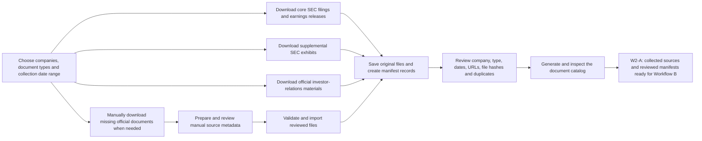

# Workflow A: Collect source documents and create manifests

[Back to the full Narrative workflow](summary_full_narrative_agent_flow.md) | [Shared setup](summary_full_narrative_agent_flow.md#3-before-running)

For saved results, see the [main summary](summary_full_narrative_agent_flow.md).

## Scripts and outputs

Paths in this table are relative to `finsight/agents/narrative/` unless stated otherwise. Steps start at 1 within this workflow. Use workflow letters A-E for the overall flow. See the [script inventory](../reference/narrative_script_inventory.md) for per-file descriptions.

| Step | Workflow blocks | Entry point / supporting modules | Main output |
|---|---|---|---|
| 1. Collect or restore sources and create/review manifests | W2-A | `corpus/acquisition/` collectors and manual importer; `corpus/maintenance/generate_catalog.py` | Original files, source manifests, review warnings and document catalog |

## Workflow and responsibilities



## Steps

### Step 1. Collect or restore sources and create/review manifests

This workflow collects or restores original HTML/PDF source files and records
their details in manifests for processing and retrieval.

A **manifest** is a JSON inventory of source documents. Each record identifies
the document and where its local file came from, so processing can check the
original file and preserve its source details. Typical fields are:

| Manifest information | Purpose |
|---|---|
| Document ID, company and document type | Identify the source and its scope. |
| Publication date, reporting period and date precision/basis | Keep publication eligibility separate from the period being discussed; disclose estimated dates. |
| Source URL/origin and source tier | Preserve where the document came from and its assigned source classification. |
| Local file path and SHA-256 hash | Locate the saved original and detect changed file contents. |
| Retrieval eligibility and review notes | Record exclusions, unresolved metadata and items requiring review. |

**Collection paths and current scripts** — paths are relative to `finsight/agents/narrative/`:

| Source path | Script | Output / follow-up |
|---|---|---|
| Core SEC annual/quarterly filings and earnings releases | `corpus/acquisition/download_corpus.py` | Original files and the core manifest. Requires an explicit output destination. |
| SEC exhibits such as decks, prepared remarks and presentations | `corpus/acquisition/download_supplemental_corpus.py` | Supplemental files/manifest; use exclusion manifests to avoid collecting known exact duplicates. |
| Official company IR archives | `corpus/acquisition/download_ir_archive.py` | Linked original files and IR manifest with warnings/date-review information. Site coverage varies by company. |
| Manually downloaded official documents | `corpus/acquisition/prepare_manual_ir_metadata.py`, then `corpus/acquisition/import_manual_ir.py` | Reviewed `import_metadata.json`, copied source files and an updated chosen manifest. The metadata helper uses project-specific inbox/date constants and has no argument parser. |
| Main 8-K/6-K event filings when needed | `corpus/acquisition/download_event_reports.py`, or the separate IR-copy collector `download_ir_event_reports.py` | Intake files and discovery metadata; review and canonical registration are separate. These are main filings, not earnings-release exhibits. |
| Human-readable inventory | `corpus/maintenance/generate_catalog.py` | Markdown catalog; it does not download or process document content. |

Existing canonical locations:

```text
data/narrative/raw/
  manifest_core_sec.json
  manifest_supplemental_sec.json
  manifest_official_ir.json
  manifest_event_reports.json
  manifest_third_party_transcripts.json  # optional, separately identified sources
  <TICKER>/
    core_sec/
    supplemental_sec/
    official_ir/
    ...                                # other registered source families
```

Keep permitted third-party transcripts and their actual publisher/source tier
distinct from official IR sources. The optional transcript manifest is read by
the corpus loader when present. The official download paths above do not certify
or import every third-party transcript automatically.

#### Company document coverage

Document availability checked against canonical manifests and local files in the recorded snapshot; collection window **2024-01-01 through 2026-10-04**. The category definitions are explained below the table. Counts describe available document records, not processing/index status or an exhaustive filing-history certification. High/Medium labels describe the experimental document-priority configuration; they do not automatically activate priority in P0 or Basic RAG.

| Company | 10-K / 20-F (High) | 10-Q (High) | Form 8-K / Form 6-K (main filings) (High) | 8-K/6-K exhibits | Earnings releases (High) | Investor presentations (Medium) | Earnings-call transcripts (Medium) |
|---|---:|---:|---:|---:|---:|---:|---:|
| AAPL | 2 | 9 | 26 | 11 | 11 | 0 | 11 / 11 |
| AMD | 3 | 8 | 38 | 11 | 11 | 11 | 11 / 11 |
| AMZN | 3 | 8 | 29 | 11 | 11 | 11 | 11 / 11 |
| CRM | 3 | 8 | 31 | 14 | 11 | 12 | 11 / 11 |
| GOOGL | 3 | 8 | 39 | 11 | 11 | 6 | 11 / 11 |
| INTC | 3 | 8 | 51 | 12 | 11 | 11 | 11 / 11 |
| INTU | 3 | 8 | 26 | 12 | 11 | 6 | 11 / 11 |
| MELI | 3 | 8 | 23 | 11 | 11 | 7 | 11 / 11 |
| META | 3 | 8 | 27 | 11 | 11 | 11 | 11 / 11 |
| MSFT | 3 | 8 | 22 | 11 | 11 | 11 | 11 / 11 |
| NFLX | 3 | 8 | 27 | 11 | 11 | 1 | 11 / 11 |
| NVDA | 3 | 8 | 29 | 11 | 11 | 20 | 11 / 11 |
| ORCL | 3 | 8 | 28 | 11 | 11 | 6 | 11 / 11 |
| PLTR | 3 | 8 | 16 | 11 | 11 | 11 | 11 / 11 |
| SBUX | 2 | 9 | 40 | 13 | 12 | 5 | 11 / 11 |
| TSLA | 3 | 8 | 32 | 23 | 23 | 11 | 11 / 11 |

How to read the table:

- **Main filings and exhibits differ:** main 8-K/6-K documents are counted separately from attachments. An earnings-release exhibit can also appear in the earnings-release column; do not sum the columns as unique documents. Exhibit priority follows the underlying content type.
- **Alternative form names:** the collected annual forms are 10-Ks; there are no collected 20-F or 6-K records. Companies do not need both alternatives. Main-filing counts include amendments where present.
- **Investor presentations include quarterly earnings slide decks**, Investor Day and other presentation decks. Counts exclude three reviewed release documents mislabelled as presentations. AAPL's zero means no separate deck was found in the checked archive; other small deck counts do not by themselves establish missing published quarters.
- **Earnings-call coverage is 176/176 expected periods:** each company has 11 of 11. These include official and authorized third-party transcripts, not only official company transcripts.
- **AAPL/SBUX annual counts differ because of fiscal calendars and filing dates.** Their counts are 2 annual and 9 quarterly reports within the collection window; the other companies have 3 annual and 8 quarterly reports.
- **Release counts can include different event types:** TSLA's 23 include 11 financial shareholder updates and 12 production/delivery announcements; SBUX's 12 include a preliminary release.
- **MELI is updated from the older guide:** 23 main filings are available locally; three 2026 8-K PDFs still referenced in manifests are absent. Thus the older 26-file availability count is not used here. This is a source-availability note, not a request to restore those removed documents.

#### Collection command examples

Use these commands only for an intentional corpus refresh. Run from the
repository root. These contact external sites and write files/manifests;
they were not executed while preparing this document. Restore the matching team
snapshot instead when you only need existing sources. Use one consistent
collection range; the example uses the recorded 2024–2026 window, not a claim's
retrieval cutoff. Replace the SEC contact placeholder with a real monitored
project contact before using the commands.

```powershell
$env:SEC_USER_AGENT = 'FinSight project YOUR_REAL_CONTACT_EMAIL'
$sourceFrom = '2024-01-01'
$sourceThrough = '2026-10-04'
$sourceTickers = @('AAPL', 'AMD', 'AMZN', 'CRM', 'GOOGL', 'INTC', 'INTU', 'MELI', 'META', 'MSFT', 'NFLX', 'NVDA', 'ORCL', 'PLTR', 'SBUX', 'TSLA')

python -m finsight.agents.narrative.corpus.acquisition.download_corpus --tickers $sourceTickers --from-date $sourceFrom --cutoff $sourceThrough --output data/narrative/raw/core_sec
python -m finsight.agents.narrative.corpus.acquisition.download_supplemental_corpus --tickers $sourceTickers --from-date $sourceFrom --cutoff $sourceThrough --output data/narrative/raw/supplemental_sec --exclude-manifest data/narrative/raw/manifest_core_sec.json

# The current generic IR collector has no MSFT entry in IR_SOURCES.
# Restore/review MSFT's existing official sources or use reviewed manual import.
$irTickers = @($sourceTickers | Where-Object { $_ -ne 'MSFT' })
python -m finsight.agents.narrative.corpus.acquisition.download_ir_archive --tickers $irTickers --from-date $sourceFrom --cutoff $sourceThrough --output data/narrative/raw/official_ir
```

The core/supplemental collectors can replace their destination manifests. Do not
use these as routine inference commands or assume that `--tickers MSFT` will
append safely to an existing all-company manifest. Use an intentionally selected
destination and review the resulting inventory before processing.

For manual intake, put downloaded official files under
`data/narrative/manual_inbox/<TICKER>/`, prepare their metadata using the helper
only after reviewing its company/calendar coverage, then verify dates, document
types and source URLs before importing. The helper skips NVDA/TSLA in its current
workflow; manual metadata must be prepared/reviewed separately where it does not
cover a company. Example import for an existing reviewed MSFT metadata file:

```powershell
python -m finsight.agents.narrative.corpus.acquisition.import_manual_ir data/narrative/manual_inbox/MSFT/import_metadata.json --manifest data/narrative/raw/manifest_official_ir.json --exclude-manifest data/narrative/raw/manifest_core_sec.json data/narrative/raw/manifest_supplemental_sec.json --skip-duplicates
```

The importer expects the target manifest to exist and uses that manifest's
collection range. It does not download the document. Main event-report collectors
and company-specific recovery tools also require their own reviewed registration
steps; do not assume an intake download is already part of the searchable corpus.

Generate the core/supplemental/official-IR catalog after review:

```powershell
python -m finsight.agents.narrative.corpus.maintenance.generate_catalog data/narrative/raw/manifest_core_sec.json data/narrative/processed/corpus_catalog.md --supplemental-manifest data/narrative/raw/manifest_supplemental_sec.json --ir-manifest data/narrative/raw/manifest_official_ir.json
```

This catalog command covers its three supplied manifests; inspect event and
third-party manifests separately. Check download warnings, missing files,
duplicates, dates and company/type coverage. Keep estimated dates explicitly
marked. Successful downloads do not establish complete source coverage. Workflow
B's corpus loader then checks selected file paths/hashes during processing.
