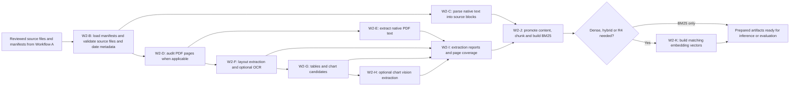

# Workflow B: Prepare searchable company evidence

[Back to the full Narrative workflow](summary_full_narrative_agent_flow.md) | [Shared setup](summary_full_narrative_agent_flow.md#3-before-running)

For saved results, see the [main summary](summary_full_narrative_agent_flow.md).

## Scripts and outputs

Paths in this table are relative to `finsight/agents/narrative/` unless stated otherwise. Steps start at 1 within this workflow. Use workflow letters A-E for the overall flow. See the [script inventory](../reference/narrative_script_inventory.md) for per-file descriptions.

| Step | Workflow blocks | Entry point / supporting modules | Main output |
|---|---|---|---|
| 1. Parse, chunk and index text | W2-C, W2-J | `corpus/processing/process_corpus.py`, `ingest.py`, `chunk.py`, `index.py` | Parsed source blocks, canonical chunks and BM25 |
| 2. Extract PDFs/charts and promote | W2-D to W2-J | `corpus/pdf/pdf_chart_processing.py` and PDF extraction helpers | Extraction artifacts and promoted company content |
| 3. Build matching vectors/strategy artifacts | W2-K | `retrieval/build_vector_databases.py`; `scripts/narrative/retrieval/build_full_chunking_indexes.py` for C1–C4 | Selected chunks, BM25 and matching Qdrant vectors; no retrieval-quality scores |

## Workflow and responsibilities

Optional contextual metadata and blurb preparation is documented in
[Step 4](#step-4-optionally-build-c2-contextual-metadata-and-blurbs), after the C1-C4 build instructions.
Its entry point is `scripts/narrative/chunking/build_c2_enriched.py`, with
`continue_c2_blurbs.py` for company workers.



Use existing complete, matching builds when available. W2-K is required for
dense, hybrid and R4, but not for BM25. Each strategy has its own chunks and
matching indexes. A changed query or a new test dataset alone does not require
rechunking or rebuilding vectors for these baseline builds. Query-selected
blurb enrichment has a separate dependency on the selected claims; see Step 4.

## Steps

**Workflow B — preparation.** Run these steps when building/changing artifacts.
If matching chunks/indexes are already available, start directly with the
per-claim commands in [Section 5](summary_full_narrative_agent_flow.md#5-run-rag-for-a-claim).

### Step 1. Create source blocks, chunks and BM25

Start with one company:

```powershell
python -u -m finsight.agents.narrative.corpus.processing.process_corpus --ticker META
```

Use `--all` instead of `--ticker META` for every eligible company. Existing output folders are skipped; use `--rebuild` only when intentionally refreshing them. The build uses promoted PDF enrichment when available. Outputs are under `data/narrative/processed/META/`:

```text
documents.jsonl             parsed source blocks with provenance
chunks.jsonl                retrieval passages and stable evidence IDs
processing_report.json      processing counts and warnings
indexes/index.json          BM25 data and passages
indexes/index_metadata.json build metadata
```

### Step 2. Enrich PDFs/charts, then promote into company passages

The processor reads retrieval-eligible source manifests, preserves original PDFs and records their SHA-256 hashes. Extracted chart values retain their source page and crop; extraction success does not mean they have been visually verified.

#### Prepare dependencies and audit pages

Run from the repository root. Install the extraction dependencies, keep Ollama running and install your chosen vision model when using local chart extraction:

```powershell
python -m pip install -e ".[document-ai,retrieval]"
ollama list
```

If needed, install the model with `ollama pull MODEL_NAME`. Audit eligible PDF pages without extraction/model calls:

```powershell
python -m finsight.agents.narrative.corpus.pdf.pdf_chart_processing --all --audit-only
```

#### Extract with local Ollama

```powershell
python -u -m finsight.agents.narrative.corpus.pdf.pdf_chart_processing --ticker META --ollama-model qwen3-vl:4b-instruct --chart-workers 1 --chart-timeout 900 --promote
```

Use an installed Ollama vision model; the report retains its actual model name. `--promote` merges applicable extracted content into canonical company blocks/chunks and BM25. Omit it when you only want extraction artifacts first.

| Option | Purpose / default |
|---|---|
| `--all` or `--ticker META` | Select every eligible company or one company. Repeat `--ticker` for several companies. |
| `--document-id DOC_ID`, `--pages 7-10` | Restrict the document set and extraction pages. |
| `--experiment NAME` | Select a separate extraction experiment and usage history; default `pdf_chart_processing`. |
| `--chart-workers` | Concurrent chart jobs; default `1`. |
| `--chart-timeout` | Provider request timeout; default `300` seconds. The example allows `900`. |
| `--chart-max-output-tokens` | Per-response output limit: default `4000` for Ollama, `6000` for OpenAI. |
| `--ollama-context` | Local context window; default `8192`. Increase with the output budget if a dense chart's JSON is cut off. |
| `--force` | Bypass caches. Leave unset when resuming existing work. |

#### Optional OpenAI extraction and key configuration

The chart adapter reads `OPENAI_API_KEY` first, then `openai_api_key` in the project's gitignored `config.yaml`. `FINSIGHT_SECRETS_FILE` can select a different configuration file. An explicitly supplied Python provider `api_key` argument takes precedence over both.

Create `config.yaml` from `config.example.yaml` if needed and keep the real key there privately:

```yaml
openai_api_key: "YOUR_OPENAI_API_KEY"
llm_provider: mock
```

`--openai-model` explicitly selects paid chart extraction even when the application's shared provider remains `mock`. To process pending work, promote the results and refresh canonical vectors:

```powershell
python -u -m finsight.agents.narrative.corpus.pdf.pdf_chart_processing --all --openai-model gpt-5.4 --chart-workers 1 --chart-timeout 300 --promote --rebuild-vectors
```

The adapter sends chart crops and nearby extracted text to OpenAI; Docling/OCR stays local. Matching successful chart caches can be reused across provider changes, preserving their original provider/model metadata. Without `--force`, switching providers does not replace every successful extraction.

This chart adapter uses the shared key loader, but its requests bypass the shared spending guard and usage ledger. It does not enforce a dollar spending cap; `--chart-max-output-tokens` limits each response, not total spending.

#### Page routing, outputs and coverage

Readable pages use native text. Ranges needing layout analysis use Docling; zero-text and sparse image-bearing ranges use OCR. Built-in Granite chart extraction stays disabled. Chart candidates are cropped from the original PDF and read by the selected vision provider. Units, signs, periods, legends, accounting basis and uncertainties are retained where available; missing fields stay unknown.

```text
data/narrative/processed/<TICKER>/experiments/pdf_chart_processing/
  audit_report.json              selected-page audit
  experiment_report.json         company progress and coverage
  <DOCUMENT_ID>/
    page_audit.json
    audit.json                   document extraction details
    blocks.jsonl                 page-cited extracted blocks
    ranges/pNNN-NNN/              range exports, chart crops and caches
```

Within a range, `document.md` is readable extracted content; `enhanced/document.enhanced.md` includes successfully extracted chart tables. Structured fields are under `enhanced/charts/*.json`, with matching PNG crops. The company report may lag the newest per-chart files while a document is still running.

Routing and chart detection use heuristics: zero candidates does not prove that a PDF has no charts. `status: partial` records failed extraction operations. Review `documents_with_errors`, `coverage_limitations` and `unsupported_pages`; usable OCR text can remain available even when chart extraction fails.

#### Track OpenAI chart usage

New OpenAI chart requests are recorded separately from RAG generation and judging:

```text
data/narrative/experiments/pdf_chart_processing/usage/<RUN_ID>/
  calls.jsonl       new provider requests and returned usage
  summary.json      combined tokens, cost estimate, status and missing usage
```

The processor prints the summary path at startup and completion, updates it after each recorded request, and prints combined usage when its finalizer runs, including handled failures or Ctrl+C. Cache reuse does not add historical tokens to the current total. Requests without returned usage or configured pricing have unknown cost, not zero cost; a force-killed process can lose an in-flight request's usage.

Read saved cumulative usage without starting extraction or making API calls:

```powershell
python -m finsight.agents.narrative.corpus.pdf.pdf_chart_processing --all --usage
python -m finsight.agents.narrative.corpus.pdf.pdf_chart_processing --ticker GOOGL --usage
```

Use `--experiment NAME` for a different experiment's history. Totals cover locally recorded requests since tracking began; earlier extractions and other tools/teammates are not backfilled. `cost_estimate_complete=false` means `estimated_cost_usd` covers only the priced portion. Rates and supported pricing conditions are defined in [chart_usage.py](../../../finsight/agents/narrative/corpus/pdf/chart_usage.py). Reported input includes chart image tokens; output includes reported reasoning tokens. These are local estimates, not account credit or authoritative billing. The `finsight usage` ledger is separate.

#### Promote, stop and resume

If extraction is already complete and only promotion is needed:

```powershell
python -u -m finsight.agents.narrative.corpus.pdf.pdf_chart_processing --ticker META --promote-only
```

Add `--rebuild-vectors` to refresh canonical Qdrant vectors after successful promotion, or use Step 3. Promotion accepts current eligible documents with matching source hashes, writes hashed artifacts under `<TICKER>/enrichments/` and records them in `<TICKER>/pdf_enrichment.json`. Enriched page blocks replace ordinary blocks for those pages; chart/table regions with extracted numeric values are not repeated as narrative text. Charts without numeric values retain descriptive content and available Docling text.

Canonical rebuilds retain extraction artifacts and use staged publication with rollback copies. Source metadata and promoted extraction/coverage hashes contribute to the effective corpus fingerprint, so changed content invalidates stale vectors/caches. This promotion updates the canonical company build; rebuild the separate C1-C4 strategy artifacts below when their parsed source inputs change.

Inspect saved status:

```powershell
python -m finsight.agents.narrative.corpus.pdf.pdf_chart_processing --all --status
```

Use Ctrl+C in the running terminal, then rerun the same command without `--force` to resume. Document/range checkpoints and successful source/crop-matched chart caches are reused. Force termination may prevent the interruption report from being written, although completed caches remain on disk. Do not run two processors against the same company's experiment directory simultaneously.

Coverage limitations remain in the processing report and index. `CorpusRetriever.coverage_limitations(cutoff_date)` exposes company/date-eligible limitations. A completed extraction report establishes recorded processing status, not independently verified financial accuracy.

### Step 3. Build or refresh vectors after final promotion

```powershell
python -u -m finsight.agents.narrative.retrieval.build_vector_databases --ticker META
```

Use `--all` for every company. The builder reuses current vector indexes and rebuilds stale ones; `--rebuild` forces regeneration. Outputs include `data/narrative/processed/<TICKER>/indexes/qdrant/qdrant_metadata.json` and `storage/`. BM25 and vectors must describe the same passages for dense/hybrid retrieval. Avoid simultaneous writers to the same local Qdrant storage.

## Source metadata and traceability

### From source files to indexed passages

The corpus loader selects the company's registered documents and checks local source paths and file SHA-256 hashes before processing. It reads the core SEC, supplemental SEC, official IR and event-report manifests; the third-party transcript manifest is optional. Keep third-party provenance distinct from official sources.

HTML parsing removes scripts, hidden content and common navigation, preserves document order and labels table rows with their headers. Native PDF text retains page references; PDFs needing richer extraction follow Step 2. These transformations do not prove that every table, chart or OCR value was extracted correctly.

Each parsed block is chunked within its source boundary. Canonical chunk IDs combine the document ID, section slug, ordinal and a text-hash prefix. The canonical chunker handles charts as whole units and tables by rows/headers, rather than treating all content as plain word windows. C1-C4 have their own saved representations; use the selected build's IDs and source map when comparing strategies.

### Metadata retained with chunks

These fields are defined in [`NarrativeChunk`](../../../finsight/agents/narrative/corpus/processing/chunk.py) and carried into the saved passage/index records:

| Fields | Purpose |
|---|---|
| `chunk_id`, `document_id` | Identify the retrieval passage and its source document. |
| `company_ticker`, `company_name`, `document_type` | Keep company and document scope explicit. |
| `publication_date` | Effective source publication date used for cutoff filtering; separate from the reporting period. |
| `publication_date_is_estimated`, `publication_date_precision`, `publication_date_basis` | Disclose estimated dates and the basis for the effective date. |
| `period` | Reporting period, when supplied; may be null. |
| `source_tier`, `source_url` | Source classification and original URL; missing URLs must not be invented. |
| `local_path`, `original_local_path` | Saved source path and an earlier original path where one exists, such as a converted presentation. |
| `section`, `page`, `citation_span` | Human-readable source location; PDF pages and HTML section locations are not necessarily exact character spans. |
| `text`, `text_sha256` | Stored passage text and its SHA-256. |
| `source_format`, `extraction_method`, `content_type` | How the content was obtained and whether it represents narrative, a table or a chart. |
| `chart_id`, `source_ref`, `validation_status` | Additional chart/source locators and recorded extraction/validation status, where present. |

Manifest-level `sha256`, `retrieval_eligible`, `estimated_publication_date` and `estimated_publication_date_basis` are intake fields, not all separate chunk fields. The loader chooses a recorded publication date or a supplied estimate when eligible under its rules, excludes records without an effective date, and carries the effective date plus its qualifications into processing. Review estimates during collection; an estimated date does not certify the actual release day.

### Source maps, hashes and duplicate handling

| Saved information | How it is used |
|---|---|
| Index `schema_version`, `corpus_fingerprint`, chunking settings and passage counts | Identify a compatible index build and its contents. |
| `text_sha256` versus manifest file `sha256` | The first identifies passage text; the second verifies the saved source file. They are different hashes. |
| Strategy `source_map.jsonl`: `chunk_id`, `document_id`, `block_line_1based` | Link each strategy passage to a parsed source block. |
| `body_char_span`, `context_char_spans` | Identify body and copied context within the parsed block using zero-based, end-exclusive offsets. They do not locate bytes in the original PDF/HTML. |
| `parsed_sha256` and build reports | Detect changed source text or mismatched chunks, mappings and indexes. |

Canonical index construction removes exact duplicate text by default. The full C1-C4 builders retain source duplicates (`deduplicate_text=False`) so that another source or an earlier publication date is not lost. Neither is semantic deduplication. Request-time deduplication of repeated retrieved IDs is a separate step.

BM25 and vector metadata must describe the same passage set. Matching IDs/hashes establish technical consistency, not source completeness or retrieval relevance. See [Workflow C's evidence mapping](workflow_c_rag.md#how-source-metadata-becomes-evidence) for the fields returned to callers.

## Different chunking strategies

**Canonical** means the existing company build stored under `data/narrative/processed/<TICKER>/`. **C1-C4** name four chunking strategies with separate builds. They can reuse the same parsed documents while dividing the text into different passages.

| Build | How it creates chunks |
|---|---|
| Canonical | Uses the existing chunker with an 800-word target and 120-word overlap setting, plus special handling for tables and charts. |
| C1 | Uses strict 800-word windows with 120-word overlap within each source block, including table/chart text. |
| C2 | Uses strict 300-word windows with 50-word overlap within each source block. |
| C3 | Uses strict 400-word windows with 60-word overlap within each source block. |
| C4 | Uses adaptive, structure-aware splitting with candidate token targets of 128, 192 and 256, subject to the embedding tokenizer's hard limit. |

Canonical and C1 share the 800/120 settings, but their table/chart handling can produce different passages. Do not treat them as identical builds. Fixed-window chunks can be shorter at the end of a source block; word counts do not guarantee compliance with an embedding token limit.

C1-C4 builds are stored under `data/narrative/processed/chunking_strategies/<STRATEGY>/<build-version>/<TICKER>/`. Each has its own chunks and matching indexes. Selecting a strategy chooses those saved artifacts; selecting BM25, dense, hybrid or R4 chooses how to search them. Full strategy builds can be used for ordinary RAG as well as evaluation.

Workflow B prepares these artifacts. [Workflow C](workflow_c_rag.md#step-1-select-chunks-and-indexes-for-a-rag-run) selects them for a request, and [Workflow D](workflow_d_evaluation.md) compares their quality. The table below compares the canonical build with the full C1-C4 builds.

## Recorded build counts: canonical and C1-C4

| Item | Canonical | C1 | C2 | C3 | C4 |
|---|---:|---:|---:|---:|---:|
| Chunking strategy | 800-word target / 120-word overlap; special table/chart handling | Fixed 800 words / 120 overlap | Fixed 300 words / 50 overlap | Fixed 400 words / 60 overlap | Adaptive; token targets 128 / 192 / 256 |
| Companies | 16 | 16 | 16 | 16 | 16 |
| Source documents | 1,201 | 1,201 | 1,201 | 1,201 | 1,201 |
| Processed source blocks | 10,424 | 10,424 | 10,424 | 10,424 | 10,424 |
| Generated chunks | 23,856 | 24,089 | 52,732 | 40,680 | 90,361 |
| Duplicate chunks excluded from BM25 | 874 | 0 | 0 | 0 | 0 |
| Final BM25 passages | 22,982 | 24,089 | 52,732 | 40,680 | 90,361 |
| Saved Qdrant vectors | 22,982 | 24,089 | 52,732 | 40,680 | 90,361 |
| Companies with matching BM25/vector metadata | 16 / 16 | 16 / 16 | 16 / 16 | 16 / 16 | 16 / 16 |
| Embedding model | all-MiniLM-L6-v2 | all-MiniLM-L6-v2 | all-MiniLM-L6-v2 | all-MiniLM-L6-v2 | all-MiniLM-L6-v2 |
| Vector dimensions | 384 | 384 | 384 | 384 | 384 |
| Vector similarity | Cosine | Cosine | Cosine | Cosine | Cosine |
| Embedding input limit (tokens) | 256 | 256 | 256 | 256 | 256 |
| Longest chunk before embedding (tokens) | Not recorded | 2,877 | 2,626 | 2,626 | 256 |
| Indexed chunks exceeding the embedding limit | Not recorded | 18,609 | 44,722 | 33,847 | 0 |
| Saved embedding overflow policy | Not recorded | Truncate embedding input | Truncate embedding input | Truncate embedding input | Enforce token limit during chunking |

All five builds use `sentence-transformers/all-MiniLM-L6-v2`; the model, vector dimensions and cosine similarity match across all 16 companies in each build. The effective 256-token limit is recorded in the C1-C4 configurations and confirmed in the cached model configuration. Canonical metadata does not record overflow counts or an explicit overflow policy; "Not recorded" does not mean zero overflow.

C1-C3 keep complete passages in BM25 and source files, but embedding inputs exceeding 256 tokens are truncated. Their vectors therefore represent only the model-visible beginning of oversized passages. C4 produces shorter token-valid chunks, so its saved reports show no embedding overflow and more vectors. This explains an embedding difference between the strategies; it does not establish which retrieves the best evidence. The embedding input limit is separate from the cross-encoder reranker's limit and the generation LLM's context/output limits.

Canonical removes exact duplicate passages during indexing. The C1-C4 builders retain exact-text duplicates with their separate source provenance, so zero excluded duplicates does not mean no repeated text exists. Different chunk sizes, overlaps, table/chart handling and duplicate policies all affect these counts; more chunks do not establish better retrieval quality.

All strategies cover the same 1,201 documents. Retrieval only searches documents published on or before the request's cutoff date.

Counts were checked by reading saved reports, counting `chunks.jsonl` entries and indexed passages, and comparing ordered chunk IDs, corpus fingerprints and vector counts against Qdrant metadata. Strategy totals also match their aggregate build reports. Physical Qdrant collections were not opened or recounted; no builds, retrieval runs or model calls were executed.

Source files:

- Canonical: `data/narrative/processed/<TICKER>/processing_report.json`, `chunks.jsonl`, `indexes/index.json` and `indexes/qdrant/qdrant_metadata.json`.
- C1-C4: `data/narrative/processed/chunking_strategies/<STRATEGY>/full_v1/build_report.json`, plus each `<TICKER>/build_report.json`, `chunks.jsonl`, `indexes/index.json` and `indexes/qdrant/qdrant_metadata.json`.
- Embedding settings and token statistics: each strategy's `configuration.json`, company `build_report.json` and `indexes/qdrant/qdrant_metadata.json`. The cached model's `sentence_bert_config.json` specifies its effective input limit.

Matching metadata does not establish that embedding inputs avoided truncation. Canonical and C1-C3 chunks can exceed the embedding model's 256-token limit; the saved C1-C3 builds explicitly use `truncate`. C4 enforces its tokenizer-based limit. See [Section 4.1 of the main summary](summary_full_narrative_agent_flow.md#41-saved-chunking-and-embedding-results) for canonical per-company counts and limitations.

Full C1-C4 strategy builds are described below. Run either the canonical vector builder above or the appropriate strategy builder for the artifacts you need; both are not required for every claim.

## Chunk and index storage

Full-corpus strategy outputs live under `data/narrative/processed/chunking_strategies/`.
The existing canonical company folders remain in place; canonical 800/120 is
not renamed to experimental C1. Historical experiments are preserved separately.

```text
data/narrative/processed/
├── <TICKER>/
│   ├── documents.jsonl                 shared parsed source blocks
│   ├── chunks.jsonl                    canonical 800/120 chunks
│   └── indexes/                        canonical BM25 and vectors
└── chunking_strategies/
    └── <C1|C2|C3|C4>/<build-version>/
        ├── configuration.json          strategy, model and processing identities
        └── <TICKER>/
            ├── chunks.jsonl            exact indexed passages and provenance
            ├── source_map.jsonl        source block/body/context locations
            ├── chunking_report.json
            ├── build_report.json       completed chunk/vector build report
            ├── layout_manifest.json    hashes for chunks/map/index
            ├── token_overflow.jsonl    fixed arms C1–C3
            ├── candidate_scores.jsonl.gz  C4 adaptive candidate diagnostics
            └── indexes/
                ├── index.json          BM25 data and complete passage text
                └── qdrant/
                    ├── qdrant_metadata.json
                    └── storage/
```

All four strategies have a full-corpus builder through
`scripts/narrative/retrieval/build_full_chunking_indexes.py`. C1 uses strict
800-word/120-overlap windows, C2 uses 300/50, C3 uses 400/60, and C4 delegates to
the existing adaptive builder. The table shows strategy-specific optional files;
not every strategy creates every diagnostic file. `full_v1` is a build-version
name, not a publication cutoff or a retrieval policy.

`experiments/` keeps frozen experiment artifacts, labels, configurations, metrics
and reports. Building full indexes does not refresh Recall/MRR results or rewrite
historical experiments. Full build coverage includes current eligible processed
documents; each retrieval request still enforces its own publication cutoff.

### Build full C1-C4 indexes

Use existing complete builds when their source/configuration identities match.
Run from the repository root after restoring canonical processed source blocks,
indexes and the cached local embedding model. These commands are instructions,
not a record of a new build executed while updating this guide.

All companies, all four strategies:

```powershell
python -u -m scripts.narrative.retrieval.build_full_chunking_indexes --all --strategies C1 C2 C3 C4 --build-version full_v1 --threads 4 --embedding-overflow truncate --resume
```

One company, all four strategies:

```powershell
python -u -m scripts.narrative.retrieval.build_full_chunking_indexes --ticker MSFT --strategies C1 C2 C3 C4 --build-version full_v1 --threads 2 --embedding-overflow truncate --resume
```

Replace `MSFT` with another valid ticker when needed. Select just one arm with
`--strategies C4` or another listed strategy. The output root is
`data/narrative/processed/chunking_strategies/`; the builder creates the strategy
and version folders underneath it.

`--embedding-overflow truncate` explicitly permits C1–C3 inputs longer than the
embedding model's token limit to be shortened for embedding. Complete chunks and
BM25 passage text remain stored. This limitation must accompany any dense/hybrid
comparison. The default `error` policy rejects overflow; it does not resize fixed
chunks. C4 applies its own tokenizer-based hard limit. Changing an existing
build's overflow/configuration/code/source identity requires a new build version.

`--resume` verifies compatible checkpoints and reuses completed work. It can
reject stale or interrupted artifacts; it does not mean every existing folder
is safe to reuse. Review the error and use a new version when required rather
than deleting saved data to bypass checks.

The C4-only entry point remains available and is also used by the unified builder:

```powershell
python -u -m scripts.narrative.retrieval.build_full_c4_indexes --ticker MSFT --output-dir data/narrative/processed/chunking_strategies/C4/full_v1 --threads 2 --resume
```

The builders use current eligible processed documents without the old benchmark
date filter. They reuse existing parsed text and do not reparse PDFs. They build
matching BM25 and vector indexes using local embedding inference, with no
generation LLM/API call. They do not run evaluation cases or generate new
Recall/MRR scores. The optional retrieval dependencies and cached model must
already be available on the laptop.

Initialize the shared destination with one invocation before launching separate
company processes. Then use different companies per process, with --threads 2
as a starting point. Do not run the same company twice or overlap --all with
individual company builds. A later compatible `--all --resume` run verifies
company checkpoints and writes aggregate build reports. The unified builder
writes a root `<build-version>_build_report.json` for `--all`, or
`<build-version>_<TICKER>_build_report.json` for a single company; each strategy
also retains its own company and aggregate reports.

After a build is complete, follow [Workflow C: select chunks and indexes for a RAG run](workflow_c_rag.md#step-1-select-chunks-and-indexes-for-a-rag-run). For comparing strategies and measuring quality, follow [Workflow D](workflow_d_evaluation.md).

### Step 4. Optionally build C2 contextual metadata and blurbs

Use the existing `C2/full_v1` build as the source. These variants preserve its
300-word/50-overlap passage boundaries, ordered chunk IDs, source `text`, source
tiers and `source_map.jsonl`. Only `search_text` and, for blurbs, `context_blurb`
change. Generated context is search assistance, not a new source quote.

| Variant | Preparation | Output under `data/narrative/processed/chunking_strategies/C2/` |
|---|---|---|
| C2 baseline | Existing fixed C2 chunks | `full_v1/` |
| C2 + contextual metadata | Deterministic company/document/period/section/page prefix in `search_text`; no generation calls | `contextual_metadata_v1/` |
| C2 + contextual metadata + blurb | Add a short LLM-written context sentence to selected passages | `contextual_blurb_all_v1/` for all cases; historical `contextual_blurb_v1/` for the 32-case selection |

All variants support BM25, dense, hybrid RRF and hybrid with cross-encoder
reranking (R4), provided their matching vectors exist. Because enrichment changes
`search_text`, rebuild the indexes and vectors in the new output build; do not
reuse baseline vectors. The builder retains C2's embedding model and records
embedding truncation in `token_overflow.jsonl`. Adding context does not increase
the embedding model's input limit.

The older `scripts/narrative/chunking/build_contextual_index.py` and
`run_blurb_top50.py` belong to the separate contextual passage approach. The
contextual builder can repack/split content into its own representation. Those
outputs are not interchangeable with preserved C2 chunks. The C2 builder reuses
the prefix/blurb helpers without applying that contextual splitting.

#### Build contextual metadata

Run from the repository root after the source C2 build is complete:

```powershell
$cases = 'data/narrative/evaluation/test_claims_v2/cases_combined.csv'
$base = 'data/narrative/processed/chunking_strategies/C2'

python -u -m scripts.narrative.chunking.build_c2_enriched `
    --mode metadata `
    --source-root "$base/full_v1" `
    --output-root "$base/contextual_metadata_v1" `
    --cases $cases `
    --embed `
    --resume
```

Omitting `--case-ranges` selects every row in the CSV (108 in the dataset used
for this build). In metadata mode, cases determine which companies to prepare;
the prefix does not depend on claim wording. Local embedding inference is
required, but this step makes no generation API calls. For an older metadata
build covering fewer companies, `extend_c2_metadata.py` provides a compatibility
checked extension path; do not change an existing manifest manually.

#### Plan and generate query-selected blurbs

This mode first selects passages using the claims. For each selected claim it
unions the top candidates from BM25 and dense retrieval, across support and
counter queries, and deduplicates passage IDs. `--selection-backends bm25 dense`
means two candidate searches followed by a union; it does not perform RRF here.
The later evaluation retrieval backend is chosen independently.

```powershell
$env:FINSIGHT_LLM_PROVIDER = 'openai'
$env:FINSIGHT_LLM_MODEL = 'gpt-5.4'
# Use openai_api_key in private config.yaml.
# Omit this removal if using an existing OPENAI_API_KEY environment variable.
Remove-Item Env:OPENAI_API_KEY -ErrorAction SilentlyContinue

$blurbArgs = @(
    '--mode', 'blurb',
    '--source-root', "$base/contextual_metadata_v1",
    '--output-root', "$base/contextual_blurb_all_v1",
    '--cases', $cases,
    '--selection-backends', 'bm25', 'dense',
    '--candidate-k', '50',
    '--blurb-model', 'gpt-5.4',
    '--blurb-max-tokens', '3000',
    '--embed',
    '--resume'
)

# Plan only: no blurb generation calls; dense selection still runs locally.
python -u -m scripts.narrative.chunking.build_c2_enriched @blurbArgs --prepare-only

# Generate/cache blurbs and publish matching company indexes; incurs API usage.
python -u -m scripts.narrative.chunking.build_c2_enriched @blurbArgs
```

The plan reports cases, companies and new unique blurb requests. These are not
completed answers to claims. All selected claim types participate; gold labels,
answers, snippets and distractors are not used in selection or blurb generation.
Nevertheless, selection depends on the test queries, so describe this as
**query-selected enrichment**, not claim-independent corpus preprocessing.
All source chunks for the selected companies remain indexed; only shortlisted
passages receive blurbs. "All cases" does not mean every corpus chunk gets one.

For the 32-case subset, add `--case-ranges 1-20 38-49` and use a separate output
root. Do not switch an existing 32-case blurb manifest to 108 cases in place.
`--resume` requires compatible cases, code, model, settings and source hashes.

#### Checkpoints, continuation and alternative builders

| Artifact under the enriched output root | Purpose |
|---|---|
| `enrichment_configuration.json` | Source, dataset, code and model identities for compatibility checks |
| `build_plan.json`, `selected_passages.json` | Planned scope and query-selected passage IDs |
| `blurb_cache.jsonl` | Request checkpoints, completed blurbs and recorded usage/cost |
| `<TICKER>/build_report.json` | Company completion, preserved chunk count and vector-build status |
| `<TICKER>/chunks.jsonl`, `source_map.jsonl`, `indexes/` | Enriched search data, preserved source mapping and matching indexes |

Successful matching prompt/model responses are reused from cache. Unresolved
requests can already have been billed; inspect their checkpoints before opting
into `--retry-incomplete`. `FINSIGHT_SPEND_LIMIT_USD` limits spending per process,
so separate workers have separate limits. Count recorded costs from the root
cache; `.workers/<TICKER>/blurb_cache.jsonl` contains recovery mirrors and must
not be added again.

After preparing the parent build, company workers can continue disjoint companies:

```powershell
python -u -m scripts.narrative.chunking.continue_c2_blurbs `
    --output-root "$base/contextual_blurb_all_v1" `
    --cases $cases `
    --companies PLTR `
    --threads 2 `
    --progress-every 20 `
    --resume
```

Keep the parent provider/model configuration. Stop the original builder before
using workers; do not overlap companies between workers. `--threads` controls
local embedding CPU work, while `--progress-every 20` reports passage progress,
not 20 completed claims.

For **claim-independent full-corpus blurbs**, use
`scripts/narrative/chunking/build_c2_corpus_blurbs.py` with a separate output root
such as `contextual_blurb_corpus_v1`. It has no cases/shortlisting requirement and
enriches every source chunk in scope; use `--prepare-only` to inspect its plan
before generation. This is a different, potentially larger experiment than the
query-selected build above. For local Ollama, `build_c2_ollama_blurbs.py` supports
either query-selected mode or `--all-chunks`, requires `--ollama-model`, and uses
a separate output root; it does not fall back to OpenAI.

These steps prepare artifacts only and do not change the default end-to-end
Narrative configuration. Select the enriched build explicitly in Workflow C or
the evaluation runner. Retrieval, generation and RAGAS quality measurements belong
in [Workflow D](workflow_d_evaluation.md), after the required company indexes are
complete. The commands above document the process; updating this guide does not
execute them.
