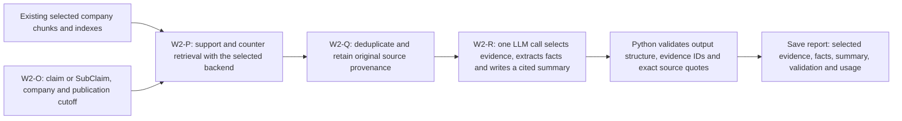

# Workflow C: Run RAG for a claim

[Back to the full Narrative workflow](summary_full_narrative_agent_flow.md) | [Shared setup](summary_full_narrative_agent_flow.md#3-before-running)

For evaluation status and results, see [Workflow D](workflow_d_evaluation.md#current-126-claim-retrieval-only-results).

## Scripts and outputs

Paths in this table are relative to `finsight/agents/narrative/` unless stated otherwise. Steps start at 1 within this workflow. Use workflow letters A-E for the overall flow. See the [script inventory](../reference/narrative_script_inventory.md) for per-file descriptions.

| Step | Workflow blocks | Entry point / supporting modules | Main output |
|---|---|---|---|
| 1. Select chunks, indexes and retrieval backend | W2-O, W2-P | Selected corpus root and retrieval settings | Matching company artifacts and backend selected for the request |
| 2. Run RAG for the claim | W2-O to W2-R | `rag/basic_rag.py` and shared retrieval and summary helpers | Selected original evidence, facts, cited summary, citation validation and usage; no stance/verdict |

Step 2 uses `basic_rag`, which runs retrieval and evidence preparation together.

## Workflow and responsibilities



The standalone `rag.basic_rag` command runs retrieval and LLM evidence preparation
and saves the report. The registry's NarrativeAgent uses the same
`rag/evidence_summary.py` helper on collected passages and returns selected
original EvidenceItems. The summary is available in its saved report; it is not
silently added to the shared EvidenceItem contract. The Workflow E guide shows the
orchestrator connection; Workflow C shows the Narrative processing it reuses.

Neither path assigns public passage stance labels or a whole-claim verdict.
The auditor remains responsible for claim assessment. Explicit retrieval-only
mode skips the LLM and therefore does not produce the factual summary. Use
`FINSIGHT_NARRATIVE_ANALYSIS=evidence` for orchestrator evidence preparation;
see [Workflow E: orchestrator handoff](workflow_e_orchestrator_integration.md#orchestrator-handoff).

## Steps

### Step 1. Select chunks and indexes for a RAG run

After the requested strategy/company has a complete `build_report.json`, select
its root. This example uses C4 with strict R4 pair-token validation:

```powershell
Remove-Item Env:FINSIGHT_NARRATIVE_INDEX_TEMPLATE -ErrorAction SilentlyContinue
Remove-Item Env:FINSIGHT_NARRATIVE_QDRANT_TEMPLATE -ErrorAction SilentlyContinue
$env:FINSIGHT_NARRATIVE_CORPUS_ROOT = "data/narrative/processed/chunking_strategies/C4/full_v1"
$env:FINSIGHT_NARRATIVE_BACKEND = "r4"
$env:FINSIGHT_NARRATIVE_CANDIDATE_K = "50"
$env:FINSIGHT_NARRATIVE_TOP_K = "3"
$env:FINSIGHT_NARRATIVE_RERANK_OVERFLOW = "error"
```

Continue with the existing standalone basic_rag or orchestrator command and
working LLM settings. Root selection chooses chunks/indexes; R4 chooses fresh
retrieval/reranking. Each request still applies its own source publication cutoff.

To select C1, C2 or C3, change the strategy part of the corpus root. Their longer
chunks may also exceed the cross-encoder's pair limit. Keep `error` to reject that
condition, or explicitly choose `FINSIGHT_NARRATIVE_RERANK_OVERFLOW=truncate` and
record the truncation limitation. Embedding overflow and reranker overflow are
separate settings. Merely choosing R4 does not switch the chunking strategy.

Build or restore the required artifacts using [Workflow B](workflow_b_processing_and_indexes.md#build-full-c1-c4-indexes) first. These settings select prepared artifacts; they do not build them.

#### Retrieval backends and requirements

| Backend | Ranking behavior | Required artifacts |
|---|---|---|
| `bm25` | Lexical matching over company/date-eligible passages. | Saved BM25 index; no vectors or generation LLM needed for the search itself. |
| `dense` | Embedding similarity using the stored vector model. | Matching Qdrant storage, vector metadata and embedding model. |
| `hybrid` | BM25 and dense fusion with reciprocal-rank constant 60 and up to two retained lexical anchors. | The BM25 index and matching vectors/models. |
| `r4` / `hybrid_cross_encoder` | Reranks the wider hybrid candidate pool with a cross-encoder, then returns top-K. | Hybrid requirements plus the reranker and an explicit overflow policy when needed. |
| `auto` | Chooses hybrid when Qdrant metadata exists, otherwise BM25. It does not select R4. | Depends on the selected backend; inspect `backend_used` rather than assuming the choice. |

`candidate_k` controls hybrid/R4 retrieval breadth; the implementation uses at least the requested top-K. Lexical anchors belong to hybrid fusion and do not guarantee presence in the final R4 or LLM-selected results. These runtime backends use the current query and selected indexes; they do not load saved evaluation scores or activate P1/P2 document priority.

BM25 tokenizes lowercase alphanumeric terms, filters company and publication cutoff, then scores with `k1=1.5` and `b=0.75`. Ties use chunk IDs. It prefers distinct document/citation locations before filling remaining places from repeated locations. Similarity rankings do not establish relevance or claim correctness.

Install the retrieval extra for vector/reranker backends using `python -m pip install -e ".[retrieval]"`. The embedding model comes from vector metadata. Initial model loading may download weights; an offline run requires the appropriate cached model files. Reuse prepared vectors from [Workflow B](workflow_b_processing_and_indexes.md), not a fresh embedding build for every query.

#### Configuration precedence

| Setting | Applies to |
|---|---|
| `FINSIGHT_NARRATIVE_CORPUS_ROOT` | Parent of company index folders; defaults to `data/narrative/processed`. Explicit `--corpus-root`/constructor arguments take precedence. |
| `FINSIGHT_NARRATIVE_BACKEND`, `FINSIGHT_NARRATIVE_CANDIDATE_K` | Backend and candidate depth when the caller does not provide explicit values. An explicit CLI backend overrides the shell setting. |
| `FINSIGHT_NARRATIVE_INDEX`, `FINSIGHT_NARRATIVE_QDRANT` | Lower-level `CorpusRetriever`/raw retriever CLI overrides; explicit `--index`/`--qdrant-dir` or constructor paths take precedence. |
| `FINSIGHT_NARRATIVE_INDEX_TEMPLATE`, `FINSIGHT_NARRATIVE_QDRANT_TEMPLATE` | Claim collector paths with `{ticker}` placeholders; used by the Narrative wrapper and standalone RAG. A configured index template overrides the collector's corpus-root-derived index path. |
| `FINSIGHT_NARRATIVE_RERANKER_MODEL`, `FINSIGHT_NARRATIVE_RERANK_OVERFLOW` | R4 model and pair-token overflow behavior when not explicitly supplied. |

The claim collector resolves per-company paths and passes them explicitly to its lower-level retriever. Do not expect a single-company lower-level path variable to redirect that collector. Prefer a selected corpus root for current C1-C4 builds and clear stale template overrides as shown above.

#### Empty retrieval and configuration errors

- Blank queries, nonpositive top-K, missing default company indexes or no company/date-eligible passages can return no evidence. BM25 can also return none when query terms do not match.
- A missing explicitly configured index is an error. Explicit dense/hybrid/R4 requests reject absent or mismatched vectors rather than silently switching to BM25. Auto rejects invalid vector metadata if that metadata exists.
- Vector checks compare corpus fingerprints and ordered chunk IDs; an injected embedding backend must match the recorded model. Each Qdrant client is closed after search, including on errors. Recreate a long-lived `CorpusRetriever` after rebuilding its index, because it caches loaded text/model state.
- Empty retrieval does not refute a claim. Dense nearest neighbors can be irrelevant, and a nonempty ranking does not support a claim. Missing URLs are retained as missing; the raw retrieval report exposes `citation_gaps`.
- Promoted chart/table passages use the same retrieval path. Their text and citation locations are preserved; extraction or OCR limitations still need review.

Raw retrieval reports use `OK`/`NO_EVIDENCE`; its CLI exits with code 2 on configuration/retrieval failures. The RAG preparation outcomes and fallback behavior are explained under [Error handling](#error-handling-and-original-evidence-preservation).

### Step 2. Run RAG for a claim

Use prepared indexes and provide a claim, company and cutoff to the standard `basic_rag` command below. No test dataset, gold labels or comparison is required for a single claim.

#### Standard command: prepare a cited evidence summary

```powershell
python -u -m finsight.agents.narrative.rag.basic_rag --ticker META --claim "DAP was 3.27 billion on average for June 2024" --cutoff 2025-07-31 --backend bm25 --top-k 3
```

This command retrieves candidates and makes one LLM call to select relevant sources, extract exact-source facts and write a cited summary. It does not classify stance or decide a verdict. Python validates selected IDs and exact quotes; original source text is preserved. `--top-k 3` applies to each directional search. `--max-tokens` limits the one evidence-preparation response. OpenAI/shared-provider configuration is used unless an explicit Ollama model is supplied. `--retrieval-only` skips this LLM step intentionally. See [RAG output](#rag-output) below.

If `--output` is omitted, the report is saved automatically to:

```text
data/narrative/experiments/standalone_rag/<TICKER>-<MODEL>-evidence-<TIMESTAMP>.json
```

For the report fields, examples, citation checks and usage, see [RAG output](#rag-output) below. Chunk/index and retrieval selection are covered in Step 1.

## RAG output

The report contains source evidence, extracted facts and a cited factual summary. Narrative does not assign passage stance or decide the claim verdict; that assessment belongs to the Auditor.

### Output fields and producers

| Field | Purpose | Producer |
|---|---|---|
| `status` | Overall evidence-preparation outcome: OK, NO_EVIDENCE, INVALID_GENERATION or GENERATION_ERROR | Python |
| `pipeline` | narrative_evidence_rag, or narrative_evidence_retrieval when explicitly requested | Python |
| `ticker`, `claim`, `cutoff_date`, `backend` | Input scope and requested search configuration | User/default, normalized/recorded by Python |
| `assessment_status` | NOT_ASSESSED means no claim stance/verdict assessment was done; it does not mean the LLM was skipped | Python |
| `evidence_preparation_status` | COMPLETED, FAILED, SKIPPED_NO_EVIDENCE or SKIPPED_RETRIEVAL_ONLY | Python, based on execution/validation |
| `retrieval` | Original candidate count, IDs, queries and retrieval timing | Python search pipeline |
| `candidate_evidence` | All original retrieved passages and provenance before model selection | Canonical indexed sources, copied by Python |
| `selected_evidence_ids` | Candidate IDs derived in the order of the selected facts | Python derives IDs from the LLM-selected facts and validates them |
| `facts` | Exact source quotes tied to selected IDs | LLM selects source spans; Python copies their original text and validates it |
| `summary` | Factual evidence-summary sentences, each with cited IDs | LLM writes sentences and cites fact indices; Python resolves their evidence IDs and validates references |
| `selection` | Count/IDs of original passages actually returned by basic_rag | Python |
| `selection_applied` | Whether the validated model selection was applied | Python; false on fallback/error |
| `evidence` | Returned original passages/provenance, without public stance labels | Python selects existing EvidenceItems; source text is never rewritten |
| `llm` | Provider/model, token usage, timing and estimated cost | Provider response plus Python accounting |
| `citation_validation` | Format, selection, quote and summary-reference checks | Python |
| `consistency_check` | NOT_APPLICABLE: no verdict is generated or numerically corrected here | Python |
| `evidence_preparation_protocol` | `source_spans_v2`: the model selects supplied source-span IDs | Python |
| `fact_source_spans` | Fact indices, source-span IDs and original character offsets for resolved facts | Python |
| `raw_model_output` | Original model response before span resolution and validation | LLM text recorded by Python |
| `generation_error` | Error details, only on preparation failure | Python exception handling |
| `contract_note` | Explains the mandatory internal unassessed NEUTRAL placeholder | Python |

An OK result establishes only that preparation passed the implemented technical
checks. It does not establish correct relevance judgments, faithful summaries,
full evidence coverage or a true claim. NO_EVIDENCE means no candidates were
retrieved; a valid empty model selection instead means it selected no relevant
passages from available candidates. Read retrieval/selection counts together.

### How source metadata becomes evidence

| Indexed source field | Returned evidence / report field |
|---|---|
| `chunk_id` | `evidence_id`: stable passage identifier. |
| `text` | `content`: original stored passage text. |
| `company_name` | `company`; the request ticker scopes the search and is recorded in the report. |
| `document_type`, `source_tier` | `doc_type`, `source_tier`. |
| `publication_date`, date-estimation flags/basis, `period` | Retained with their qualifications; publication date and reporting period remain separate. |
| `source_url`, `citation_span` | `url`, `citation_span`; source URLs are never guessed. |
| Incoming claim identifier | `sub_claim_id`, set by claim collection for each returned passage. |

`document_id`, section/page details, extraction metadata and chart IDs remain in the source/index records and maps; they are not all separate fields of the shared `EvidenceItem` contract. Resolve them through the passage ID when deeper provenance is needed. Do not insert invented metadata into the contract. See [Workflow B's metadata reference](workflow_b_processing_and_indexes.md#source-metadata-and-traceability).

Internal `EvidenceItem.stance=NEUTRAL` means unassessed compatibility data, not a Narrative classification. Current standalone RAG/public wrapper evidence omits it. The [Workflow E contracts](workflow_e_orchestrator_integration.md#input-and-output-contracts) explain the handoff to the Auditor.

### Example: relevant evidence, extracted facts and cited summary

Illustrative format, not an additional saved experimental result:

```json
{
  "status": "OK",
  "pipeline": "narrative_evidence_rag",
  "assessment_status": "NOT_ASSESSED",
  "evidence_preparation_status": "COMPLETED",
  "evidence_preparation_protocol": "source_spans_v2",
  "selected_evidence_ids": ["passage-1"],
  "facts": [
    {
      "evidence_id": "passage-1",
      "quote": "Data center segment revenue increased year over year."
    }
  ],
  "summary": [
    {
      "text": "The source reports year-over-year growth in data center segment revenue.",
      "evidence_ids": ["passage-1"]
    }
  ]
}
```

There is no `answer.verdict`, predicted stance or claim-correctness decision.
Python copies facts from the source spans selected by the LLM. The saved report
resolves those selections into quotes and evidence IDs; it differs from the raw
model response, which uses `source_span_id` and `fact_indices`. A summary may
paraphrase facts but must reference selected IDs with exact-source facts. Prompt instructions require original
metrics, values, units, periods, scope and accounting basis to be preserved and
prohibit invented calculations. These semantic requirements still need evaluation;
reference validation alone does not prove faithful interpretation.

### `citation_validation`: Python rules

The current `source_spans_v2` prompt asks the LLM for **facts and summary**. Each fact selects an `evidence_id` and a supplied `source_span_id`; each summary sentence cites zero-based `fact_indices`. Python copies the original span text, derives `selected_evidence_ids` and converts fact references into public `evidence_ids`.

Python then checks:

1. Source-span IDs exist in the cited candidate passage; fact references are valid integer positions.
2. The resolved JSON contains exactly `selected_evidence_ids`, `facts` and `summary`, all arrays. Extra stance/verdict fields are rejected.
3. Selected IDs are unique and belong to the retrieved candidates. The resolver enforces at most four selected passages, six facts and three summary sentences.
4. Each resolved fact contains exactly `evidence_id` and `quote`; its quote is a nonempty exact substring of the selected source passage.
5. Identical ID-and-quote pairs are rejected. Different exact quotes from one passage are allowed. Every selected ID needs at least one valid fact.
6. Each resolved summary item contains exactly `text` and `evidence_ids`, with nonempty text and IDs backed by accepted exact-source facts.
7. A nonempty selection requires a cited summary. An empty selection requires empty facts and summary.
8. A response stopped because it reached its output-token limit is rejected.

`citation_validation` records PASSED/FAILED and errors; when generation is skipped or cannot complete before validation, it remains NOT_RUN. The prompt also requests at most 90 summary words, but the current Python validator does not enforce that word count.

No source text is replaced with generated content. The collector separately checks source identity, text, company scope and publication cutoff. These checks do not establish relevance, semantic entailment, summary accuracy, OCR/PDF extraction accuracy or whether source URLs remain accessible. Implementation: [`rag/evidence_summary.py`](../../../finsight/agents/narrative/rag/evidence_summary.py).

### `llm`: usage, cost and limits

| Field | Meaning |
|---|---|
| `provider`, `model` | Configured shared provider/model, or explicit Ollama model |
| `api_requests` | Preparation completion attempts, normally one for a nonempty collection; an adapter/setup failure can occur before reaching the provider |
| `input_tokens`, `output_tokens` | Actual returned usage for the preparation response, not token limits |
| `cost_usd` | Local estimate from returned usage; not an account balance or authoritative bill |
| `generation_ms` | Time around evidence preparation |
| `max_output_tokens` | Requested response-token budget |
| `context_window_tokens` | Requested Ollama context size; null for the shared online path, not unlimited context |

On failed completion without usage, tokens/cost are null rather than asserted
zero. If no evidence exists or retrieval-only mode is chosen, no call is made.
Local Ollama's zero API cost does not price hardware/electricity. Other agents
and previous/team runs are not included in this report. Source selection and
summary use one call, not one separate call for every passage.

### Error handling and original evidence preservation

* INVALID_GENERATION means a response failed validation. 
* GENERATION_ERROR means preparation could not complete. 
* Both record evidence_preparation_status=FAILED, selection_applied=false, and 
no accepted generated facts/summary. 
* Original candidate passages remain the returned evidence, so a malformed answer 
does not erase valid retrieval. 
* Raw invalid model text remains diagnostic only. The CLI saves the report 
and exits nonzero; the orchestrator collector logs a warning and returns 
original candidates. 
* Do not interpret fallback evidence as model selected.
* Retrieval/source-verification failures still propagate separately.

### `consistency_check` and assessment status

* consistency_check remains NOT_APPLICABLE because this stage makes no claim
verdict or deterministic verdict correction.
* assessment_status=NOT_ASSESSED specifically refers to claim stance/verdict
assessment.
* Use the separate evidence_preparation_status to see whether LLM preparation ran successfully.
* The auditor is responsible for interpreting the evidence and assessing the claim.

### Output locations and inspection

New standalone reports use:

`data/narrative/experiments/standalone_rag/<TICKER>-<MODEL>-evidence-<TIME>.json`

The registry collector saves unique JSON under
`data/narrative/experiments/orchestrator_narrative/`. Old verdict, stance and
retrieval-only files are preserved with their original schemas.

```powershell
$evidenceReportPath = "data/narrative/experiments/standalone_rag/YOUR_REPORT.json"
$evidenceReport = Get-Content -Raw -LiteralPath $evidenceReportPath | ConvertFrom-Json
$evidenceReport | Select-Object status, assessment_status, evidence_preparation_status
$evidenceReport.facts | Format-List
$evidenceReport.summary | ConvertTo-Json -Depth 6
$evidenceReport.citation_validation | ConvertTo-Json -Depth 5
$evidenceReport.llm | Format-List
```
