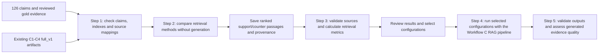

# Workflow D: Evaluate retrieval and selected RAG configurations

[Back to the full workflow](summary_full_narrative_agent_flow.md) | [Run RAG for a claim](workflow_c_rag.md)

This workflow compares retrieval performance first, **without LLM generation**, then runs and evaluates RAG for selected configurations. It uses the current **126-claim CSV** and the **C1-C4 `full_v1` chunks and indexes**. `full_v1` is the index-build version, not the test-dataset name. It does not use the earlier development datasets or their saved scores.

## Inputs and current scope

| Input | Location / scope |
|---|---|
| Test claims | `data/narrative/evaluation/test_claims_v1/cases.csv` |
| Saved evaluation results | `data/narrative/evaluation/test_claims_v1_result/<RUN>/` |
| Cases | 126 unique claims across 16 companies: 42 supported, 42 contradicting, 42 unsupported |
| Saved chunks and indexes | `data/narrative/processed/chunking_strategies/<STRATEGY>/full_v1/<TICKER>/` |
| Source text | `data/narrative/processed/<TICKER>/documents.jsonl` |
| Publication cutoff | Use each case's `cut_off`; all current dates use `yyyy-mm-dd` |
| Expected evidence | Existing `source_doc`, `gold_snippet` and `gold_answer` annotations; independent review remains necessary |

Replace `<STRATEGY>` with C1, C2, C3 or C4, and `<TICKER>` with the company symbol. For example, `data/narrative/processed/chunking_strategies/C4/full_v1/AAPL/` contains Apple's C4 chunks, source map, build reports and matching search indexes.

## Scripts and outputs

Step numbers start at 1 within this workflow. Prepare sources/indexes using Workflows A and B. Steps 1-3 compare retrieval; Steps 4-5 run and evaluate selected RAG configurations using the Workflow C pipeline.

| Step | Script / input | Output |
|---|---|---|
| 1. Prepare test claims and indexes | Current CSV, source maps and Workflow B build reports | Reviewed gold evidence and matching company/strategy artifacts |
| 2. Run retrieval comparisons | `scripts/narrative/evaluation/run_rag_comparison.py --retrieval-only` | Ranked support/counter passages, queries, evidence and source metadata |
| 3. Validate and score saved retrieval | `scripts/narrative/evaluation/evaluate_rag_comparison.py` | Source checks, Source Hit@5/10, Recall@5/10, MRR@5/10 and company/case reports |
| 4. Run RAG for selected configurations | `scripts/narrative/evaluation/run_rag_comparison.py` without `--retrieval-only` | Exact LLM inputs/responses, selected evidence, quoted facts, cited summaries, validation and usage |
| 5. Evaluate selected RAG outputs | `scripts/narrative/evaluation/evaluate_rag_comparison.py`, plus separate semantic review | Technical/citation outcomes and usage; summary quality requires additional review; RAGAS is not implemented |

## Workflow and responsibilities



## Steps

### Step 1. Prepare test claims and matching artifacts

Use the current CSV unchanged during a comparison. Review `source_doc` and `gold_snippet` against the original source text; corrections require a new dataset version.

Check each selected company's `build_report.json`, BM25/vector metadata and source map against the current parsed documents. Source maps connect the annotated document/text span to each strategy's chunks; chunk IDs differ across strategies. Flag missing or ambiguous mappings for review. See [Workflow B](workflow_b_processing_and_indexes.md) for build instructions and [the all-claims runbook](section_08_all_claims_refresh_plan.md) for detailed source checks.

Give retrieval only `claims`, `company`, `cut_off` and normal runtime settings. Keep gold answers, snippets, labels and distractors out of search queries. Do not inject distractors in this baseline comparison.

The 84 supported/contradicting cases have positive gold snippets. The 42 unsupported cases have none; a background document named in those cases is not positive gold evidence.

### Step 2. Run retrieval comparisons

Use the same claims, publication cutoffs, candidate limits and top K across configurations. **P0** means no document-priority ranking adjustment. Backend names are R1=`bm25`, R2=`dense`, R3=`hybrid`, R4=`r4` (hybrid plus cross-encoder).

| Chunking strategy | Retrieval methods | Test executions |
|---|---|---:|
| C1 | BM25, dense, hybrid, R4 | 126 x 4 = 504 |
| C2 | BM25, dense, hybrid, R4 | 126 x 4 = 504 |
| C3 | BM25, dense, hybrid, R4 | 126 x 4 = 504 |
| C4 | BM25, dense, hybrid, R4 | 126 x 4 = 504 |
| **Total** | **16 configurations** | **2,016** |

Each execution processes one claim/configuration without generation. The same saved results compare chunking while holding retrieval fixed, or retrieval while holding chunking fixed. Report support-search and counter-search scores separately.

**Input:** the CSV, parsed documents for all 16 companies and their complete C1-C4 `full_v1` folders, including matching Qdrant storage. Dense/hybrid/R4 require the retrieval dependencies and local embedding/reranker models.

Run from the repository root in PowerShell. Install dependencies if needed:

```powershell
python -m pip install -e ".[retrieval]"
```

Run all claims/configurations:

```powershell
$retrievalRun = 'data/narrative/evaluation/test_claims_v1_result/retrieval_all126_v1'

python -u -m scripts.narrative.evaluation.run_rag_comparison --all-cases --strategies C1 C2 C3 C4 --backends bm25 dense hybrid r4 --build-version full_v1 --threads 2 --rerank-overflow truncate --retrieval-only --output-dir $retrievalRun --resume
```

**Output:** `matrix_configuration.json`, `matrix_report.json` and `configurations/<STRATEGY>/<backend>/`, containing the case snapshot, configuration, source checks, ordered retrieval and candidate evidence. Generation is skipped; facts/summaries are empty and citation-generation checks are NOT_RUN. Local compute/model downloads can still take time.

**Resume:** saved results are reused. Increasing the case limit is allowed when the existing selection is an unchanged prefix and dataset/build/settings/code match. Changed configurations require a new folder. Previous scope reports are retained under `history/`. Run one process per output folder.

**Input checks only:** append `--preflight-only` to validate inputs without retrieval. Remove it to execute the comparison.

**Token limits:** `--rerank-overflow truncate` permits R4 to shorten oversized query/passage pairs for scoring; stored passages remain complete. C1-C3 also have saved embedding-input truncation. Include these limitations when interpreting dense/hybrid/R4 results.

P1/P2 priority comparisons remain a separate future experiment and are not activated by these commands.

### Step 3. Check retrieved evidence and evaluate results

| Check / metric | Meaning |
|---|---|
| Source validation | Check source IDs/text, company, cutoff, source mappings and input/build identities. Preserve source URLs and date qualifications. |
| Source Hit@5/10 | Did the top 5/10 results contain any passage from the annotated source document? |
| Known-reference Recall@5/10 | Did those results collectively cover the annotated gold text span? |
| MRR@5/10 | Average `1 / rank` of the first single passage covering the complete gold span within the rank limit; missing evidence scores zero. |
| Scope | Positive-reference metrics use 84 supported/contradicting cases; 42 unsupported cases are N/A. Report directions and case types separately. |
| Overall report | Completion/errors, per-case/company metrics and equal-company averages. Generation quality is not assessed. |

Python compares saved source locations/text coverage against the gold annotations; it does not judge whether those annotations prove the claim. Alternative valid evidence needs review. Precision/nDCG require broader relevance labels; RAGAS and summary-quality evaluation are outside this retrieval run.

After all requested configurations finish, score their saved outputs:

```powershell
python -u -m scripts.narrative.evaluation.evaluate_rag_comparison --run-dir $retrievalRun
Get-Content -LiteralPath "$retrievalRun/comparison.md"
```

If opening a new terminal, set `$retrievalRun` to the actual folder first. Scoring makes no new retrieval or LLM calls. The full scorer stops on missing planned cases or source/hash mismatches; it does not turn missing files into relevance zeros. Partial reports below score only the complete configurations identified in their scope.

| Output | Contents |
|---|---|
| `comparison.md` | Readable retrieval metrics per configuration/direction |
| `comparison.csv` | Case-type metrics, denominators and equal-company averages |
| `per_company.csv` | Per-company results |
| `per_case.csv` | Individual case/configuration/direction scores |
| `comparison.json` | Aggregates, status, recorded usage and limitations |
| Configuration `evaluation.md` / `evaluation.json` | Detailed source checks and case outcomes |

### Step 4. Run RAG for selected configurations

Choose one or two configurations after reviewing retrieval scores, context completeness and tokenizer limitations. This reduces generation calls: 126 claims need up to **126 initial calls for one configuration**, or **252 for two**, instead of 2,016 for all 16. These selected runs do not evaluate summary quality for the other configurations.

**Input:** the same CSV, cutoffs and matching indexes; configure the LLM using [Workflow C](workflow_c_rag.md). Keep the model, prompt and context/output budgets consistent across selected configurations, and check that their input fits the model's context window.

**Script:** use the comparison runner **without `--retrieval-only`**. It performs retrieval and one LLM evidence-preparation call when candidates are available. The LLM selects source facts and writes a cited summary; the Auditor determines claim verdicts separately. This stage uses the configured model and may incur generation costs.

The following uses C4/BM25 as an example, not a declared winner. Replace the strategy/backend after reviewing the retrieval results. For local generation, include the model/context options described in Workflow C.

```powershell
$selectedStrategy = 'C4'
$selectedBackend = 'bm25'
$ragRun = 'data/narrative/evaluation/test_claims_v1_result/rag_selected_v1'

python -u -m scripts.narrative.evaluation.run_rag_comparison --all-cases --strategies $selectedStrategy --backends $selectedBackend --build-version full_v1 --threads 2 --max-tokens 3000 --rerank-overflow truncate --output-dir $ragRun --resume
```

For an initial one-claim check, replace `--all-cases` with `--limit 1`; afterward use `--all-cases --resume` to add the remaining claims while preserving saved results. Keep the model/settings/code unchanged when extending the run.

**Output:** saved rankings, exact LLM inputs/responses, selected evidence, quoted facts, cited summaries, citation validation and token/cost usage. Store these separately from the retrieval-only run. The current runner retrieves again for the selected configuration; it does not import the earlier rankings.

### Step 5. Evaluate selected RAG outputs

Score the saved selected-RAG run:

```powershell
python -u -m scripts.narrative.evaluation.evaluate_rag_comparison --run-dir $ragRun
Get-Content -LiteralPath "$ragRun/comparison.md"
```

| Evaluation | What is available |
|---|---|
| Source and citation checks | Validate source identity, company/cutoff, exact fact quotes and citation references. |
| Technical completion | Report OK, INVALID_GENERATION and GENERATION_ERROR outcomes; retain retrieval scores when generation fails. |
| Usage | Report saved generation tokens, recorded cost estimates and timings. Scoring makes no new model calls. |
| Summary quality | Review relevance, completeness, grounding and acknowledgment of missing evidence against the supplied contexts and reviewed references. **The current scorer does not judge these semantics; RAGAS is not implemented.** |
| Final claim verdict | Determined by the Auditor; not a Narrative Agent output or a metric of this standalone run. |

Technical acceptance is not answer accuracy. Report generated-summary quality separately from retrieval metrics and use independently reviewed held-out cases for final quality conclusions.

## Recorded input and build status

| Component | Recorded finding |
|---|---|
| Test dataset | 126 unique claims across 16 companies; 42 supported, 42 contradicting and 42 unsupported; valid ISO cutoffs |
| Gold snippets | Present for 84 positive-reference cases; empty for 42 unsupported cases; independent semantic review remains necessary |
| Full builds | C1-C4 each cover 16 companies and 1,201 documents |
| Saved passage/vector totals | C1: 24,089; C2: 52,732; C3: 40,680; C4: 90,361 |
| Build/source identities | All 64 recorded strategy/company reports match their parsed-source hashes, layout fingerprints and saved vector metadata |

## Current 126-claim retrieval-only results

Source: `data/narrative/evaluation/test_claims_v1_result/retrieval_all126_v1/comparison.md` and its matching `comparison.json`. The saved matrix is **COMPLETE** and the full report is **SCORED_SAVED_OUTPUTS**.

| Item | Completed result |
|---|---|
| Saved retrieval executions | **2,016 / 2,016 (100%)**; all recorded retrieval statuses OK |
| Completed and scored configurations | **16 / 16**: C1-C4, each with BM25, dense, hybrid and R4; 126 claims per configuration; P0 |
| Remaining configurations | None |
| Source validation | **2,016 / 2,016 passed** across all 16 configurations |
| LLM input/output tokens and API cost | **0 / 0 tokens; $0**; generation was disabled |
| Generated-summary/citation quality and RAGAS | Not assessed by this retrieval-only comparison |

### Scored completed configurations: all 126 claims

Each row scores the **84 supported/contradicting claims** with annotated evidence. The 42 unsupported claims are N/A for positive-reference metrics. Support/counter refer to search directions, not evidence stance labels. Source Hit checks the annotated document; Recall checks coverage of the gold source span, and MRR checks the first single passage covering that complete span.

| Strategy / method | Cases / positive references | Direction | Source Hit@5 / @10 | Recall@5 / @10 | MRR@5 | MRR@10 |
|---|---|---|---|---|---|---|
| C1 / bm25 | 126 / 84 | support | 97.62% / 98.81% | 84.52% / 88.10% | 0.7579 | 0.7626 |
| C1 / bm25 | 126 / 84 | counter | 97.62% / 98.81% | 86.90% / 91.67% | 0.7405 | 0.7468 |
| C1 / dense | 126 / 84 | support | 76.19% / 89.29% | 38.10% / 47.62% | 0.2329 | 0.2464 |
| C1 / dense | 126 / 84 | counter | 78.57% / 90.48% | 34.52% / 48.81% | 0.2012 | 0.2203 |
| C1 / hybrid | 126 / 84 | support | 78.57% / 100.00% | 63.10% / 90.48% | 0.4855 | 0.5147 |
| C1 / hybrid | 126 / 84 | counter | 79.76% / 98.81% | 63.10% / 92.86% | 0.4399 | 0.4728 |
| C1 / r4 | 126 / 84 | support | 91.67% / 98.81% | 46.43% / 50.00% | 0.3653 | 0.3697 |
| C1 / r4 | 126 / 84 | counter | 90.48% / 98.81% | 50.00% / 53.57% | 0.4022 | 0.4079 |
| C2 / bm25 | 126 / 84 | support | 100.00% / 100.00% | 76.19% / 78.57% | 0.6865 | 0.6905 |
| C2 / bm25 | 126 / 84 | counter | 98.81% / 100.00% | 78.57% / 80.95% | 0.6889 | 0.6926 |
| C2 / dense | 126 / 84 | support | 84.52% / 94.05% | 40.48% / 57.14% | 0.2786 | 0.3012 |
| C2 / dense | 126 / 84 | counter | 79.76% / 92.86% | 38.10% / 50.00% | 0.2587 | 0.2740 |
| C2 / hybrid | 126 / 84 | support | 89.29% / 97.62% | 67.86% / 78.57% | 0.4774 | 0.4919 |
| C2 / hybrid | 126 / 84 | counter | 89.29% / 98.81% | 72.62% / 80.95% | 0.4403 | 0.4516 |
| C2 / r4 | 126 / 84 | support | 98.81% / 100.00% | 66.67% / 71.43% | 0.5460 | 0.5530 |
| C2 / r4 | 126 / 84 | counter | 98.81% / 100.00% | 63.10% / 65.48% | 0.5500 | 0.5535 |
| C3 / bm25 | 126 / 84 | support | 97.62% / 100.00% | 78.57% / 83.33% | 0.6766 | 0.6837 |
| C3 / bm25 | 126 / 84 | counter | 100.00% / 100.00% | 83.33% / 84.52% | 0.7103 | 0.7118 |
| C3 / dense | 126 / 84 | support | 76.19% / 89.29% | 40.48% / 55.95% | 0.2835 | 0.3045 |
| C3 / dense | 126 / 84 | counter | 79.76% / 86.90% | 39.29% / 53.57% | 0.2671 | 0.2859 |
| C3 / hybrid | 126 / 84 | support | 85.71% / 98.81% | 70.24% / 80.95% | 0.5389 | 0.5534 |
| C3 / hybrid | 126 / 84 | counter | 84.52% / 96.43% | 67.86% / 82.14% | 0.4645 | 0.4826 |
| C3 / r4 | 126 / 84 | support | 96.43% / 100.00% | 71.43% / 73.81% | 0.6062 | 0.6092 |
| C3 / r4 | 126 / 84 | counter | 96.43% / 100.00% | 72.62% / 75.00% | 0.6169 | 0.6195 |
| C4 / bm25 | 126 / 84 | support | 98.81% / 100.00% | 80.95% / 83.33% | 0.7117 | 0.7151 |
| C4 / bm25 | 126 / 84 | counter | 100.00% / 100.00% | 80.95% / 83.33% | 0.7335 | 0.7375 |
| C4 / dense | 126 / 84 | support | 79.76% / 90.48% | 54.76% / 65.48% | 0.4032 | 0.4169 |
| C4 / dense | 126 / 84 | counter | 77.38% / 91.67% | 51.19% / 61.90% | 0.3665 | 0.3804 |
| C4 / hybrid | 126 / 84 | support | 90.48% / 100.00% | 73.81% / 83.33% | 0.5917 | 0.6044 |
| C4 / hybrid | 126 / 84 | counter | 89.29% / 98.81% | 72.62% / 84.52% | 0.5683 | 0.5839 |
| C4 / r4 | 126 / 84 | support | 98.81% / 100.00% | 80.95% / 85.71% | 0.6806 | 0.6867 |
| C4 / r4 | 126 / 84 | counter | 97.62% / 100.00% | 73.81% / 80.95% | 0.6310 | 0.6406 |

In this comparison, **C1/hybrid has the highest known-reference Recall@10**: 90.48% for support search and 92.86% for counter search. **C1/BM25 has the highest MRR@10**: 0.7626 and 0.7468 respectively. These are case-weighted retrieval results, not a measurement of generated-summary quality.

All configurations are now scored. Alternate valid evidence remains unjudged, and the claim annotations still require independent review. C1-C3 embedding truncation and the explicit R4 pair-truncation policy remain limitations. Compare per-company and equal-company results alongside the overall scores because AAPL has more test cases. Precision/nDCG and semantic summary quality are not established by these annotations/checks.

Complete saved reports: [comparison.md](../../../data/narrative/evaluation/test_claims_v1_result/retrieval_all126_v1/comparison.md), [comparison.json](../../../data/narrative/evaluation/test_claims_v1_result/retrieval_all126_v1/comparison.json), [comparison.csv](../../../data/narrative/evaluation/test_claims_v1_result/retrieval_all126_v1/comparison.csv), [per_company.csv](../../../data/narrative/evaluation/test_claims_v1_result/retrieval_all126_v1/per_company.csv), [per_case.csv](../../../data/narrative/evaluation/test_claims_v1_result/retrieval_all126_v1/per_case.csv). Each configuration also has `evaluation.md` and `evaluation.json` in its own folder. Earlier `partial_comparison.*` files are progress snapshots, not the final scores.

This documentation refresh reads existing reports only; it does not repeat retrieval, scoring or LLM generation. Continue with Steps 4-5 when ready to evaluate generated evidence summaries for selected configurations.
