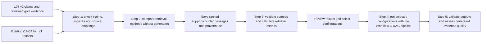

# Workflow D: Evaluate retrieval and selected RAG configurations

[Back to the full workflow](summary_full_narrative_agent_flow.md) | [Run RAG for a claim](workflow_c_rag.md)

For detailed v2 scores, coverage, costs and result locations, see [retrieval_submission_status.md](retrieval_submission_status.md). This guide covers evaluation methods, metric definitions and commands. It follows the five-step structure of the latest pushed `venes-new-sys` version checked on 1 November 2026 (`50f4a13`), with v2 dataset references.

This workflow compares retrieval performance first, **without LLM generation**, then runs and evaluates RAG for selected configurations. It uses the **108-claim v2 CSV** and the **C1-C4 `full_v1` chunks and indexes**. `full_v1` is the index-build version, not the test-dataset name. The saved benchmark measures standalone Narrative retrieval and generation; it does not measure influencer-post matching, claim extraction, Auditor decisions or final orchestrator verdict accuracy.

**Local by default:** `run_rag_comparison` and `evaluate_ragas` use Ollama with `qwen3-vl:4b-instruct`, host `http://localhost:11434` and context 20,000 when no model mode is specified. They do not fall back to OpenAI if Ollama is unavailable. API generation requires `--shared-llm`; an explicit `--judge-model` selects the shared provider for judging. Existing OpenAI result folders remain separate from local runs.

The judging example below explicitly uses **OpenAI / GPT-4o-mini**, matching the
saved API-based evaluations. This documentation choice does not change the CLI
defaults or the generation model.

## Inputs and current scope

| Input | Location / scope |
|---|---|
| Test claims | `data/narrative/evaluation/test_claims_v2/cases_combined.csv` |
| Saved evaluation results | `data/narrative/evaluation/test_claims_v2_result/<RUN>/` |
| Cases | 108 unique claims across 16 companies: 38 supported, 37 unsupported, 32 contradicting and one partially supported |
| Saved chunks and indexes | `data/narrative/processed/chunking_strategies/<STRATEGY>/full_v1/<TICKER>/` |
| Source text | `data/narrative/processed/<TICKER>/documents.jsonl` |
| Publication cutoff | Use each case's `cut_off`; all current dates use `yyyy-mm-dd` |
| Expected evidence | Existing `source_doc`, `gold_snippet` and `gold_answer` annotations; independent review remains necessary |

Replace `<STRATEGY>` with C1, C2, C3 or C4, and `<TICKER>` with the company symbol. For example, `data/narrative/processed/chunking_strategies/C4/full_v1/AAPL/` contains Apple's C4 chunks, source map, build reports and matching search indexes.

## Scripts and outputs

Step numbers start at 1 within this workflow. Prepare sources/indexes using Workflows A and B. Steps 1-3 compare retrieval; Steps 4-5 run and evaluate selected RAG configurations using the Workflow C pipeline.

| Step | Script / input | Output |
|---|---|---|
| 1. Prepare test claims and indexes | Current CSV, source maps and Workflow B build reports | Reviewed gold evidence and matching company/strategy artifacts |
| 2. Run retrieval comparisons | `scripts/narrative/evaluation/run_rag_comparison.py --retrieval-only` | Ranked support/counter passages, queries, evidence and source metadata |
| 3. Validate and score saved retrieval | `scripts/narrative/evaluation/evaluate_rag_comparison.py` | Source checks, Source Hit@5/10, Recall@5/10, MRR@5/10 and company/case reports |
| 4. Run RAG for selected configurations | `scripts/narrative/evaluation/run_rag_comparison.py` without `--retrieval-only` | Exact LLM inputs/responses, selected evidence, quoted facts, cited summaries, stance with reason, validation and usage |
| 5. Evaluate selected RAG outputs | `scripts/narrative/evaluation/evaluate_rag_comparison.py`, then `evaluate_ragas.py` | Local stance classification and coverage, technical checks, usage, RAGAS evidence/summary quality, stance justification and citation relations; see the [metric index](#metrics-available-from-each-evaluation-script) |

## Workflow and responsibilities



## Steps

### Step 1. Prepare test claims and matching artifacts

Use the current CSV unchanged during a comparison. Review `source_doc` and `gold_snippet` against the original source text; corrections require a new dataset version.

Check each selected company's `build_report.json`, BM25/vector metadata and source map against the current parsed documents. Source maps connect the annotated document/text span to each strategy's chunks; chunk IDs differ across strategies. Flag missing or ambiguous mappings for review. See [Workflow B](workflow_b_processing_and_indexes.md) for build instructions and [Step 3](#step-3-check-retrieved-evidence-and-evaluate-results) for source checks.

Give retrieval only `claims`, `company`, `cut_off` and normal runtime settings. Keep gold answers, snippets, labels and distractors out of search queries. Do not inject distractors in this baseline comparison.

The 71 supported/contradicting/partial-support cases have positive gold snippets. The 37 unsupported cases have none; a background document named in those cases is not positive gold evidence.

### Step 2. Run retrieval comparisons

Use the same claims, publication cutoffs, candidate limits and top K across configurations. **P0** means no document-priority ranking adjustment. Backend names are R1=`bm25`, R2=`dense`, R3=`hybrid`, R4=`r4` (hybrid plus cross-encoder).

| Chunking strategy | Retrieval methods | Test executions |
|---|---|---:|
| C1 | BM25, dense, hybrid, R4 | 108 x 4 = 432 |
| C2 | BM25, dense, hybrid, R4 | 108 x 4 = 432 |
| C3 | BM25, dense, hybrid, R4 | 108 x 4 = 432 |
| C4 | BM25, dense, hybrid, R4 | 108 x 4 = 432 |
| **Total** | **16 configurations** | **1,728** |

Each execution processes one claim/configuration without generation. The same saved results compare chunking while holding retrieval fixed, or retrieval while holding chunking fixed. Report support-search and counter-search scores separately.

**Input:** the CSV, parsed documents for all 16 companies and their complete C1-C4 `full_v1` folders, including matching Qdrant storage. Dense/hybrid/R4 require the retrieval dependencies and local embedding/reranker models.

Run from the repository root in PowerShell. Install dependencies if needed:

```powershell
python -m pip install -e ".[retrieval]"
```

Run all claims/configurations:

```powershell
$cases = 'data/narrative/evaluation/test_claims_v2/cases_combined.csv'
$retrievalRun = 'data/narrative/evaluation/test_claims_v2_result/retrieval_v2_new_run'

python -u -m scripts.narrative.evaluation.run_rag_comparison --cases $cases --all-cases --strategies C1 C2 C3 C4 --backends bm25 dense hybrid r4 --build-version full_v1 --threads 2 --rerank-overflow truncate --retrieval-only --output-dir $retrievalRun --resume
```

**Output:** `matrix_configuration.json`, `matrix_report.json` and `configurations/<STRATEGY>/<backend>/`, containing the case snapshot, configuration, source checks, ordered retrieval and candidate evidence. Generation is skipped; facts/summaries are empty and citation-generation checks are NOT_RUN. Local compute/model downloads can still take time.

**Resume:** saved results are reused. Increasing the case limit is allowed when the existing selection is an unchanged prefix and dataset/build/settings/code match. Changed configurations require a new folder. Previous scope reports are retained under `history/`. Run one process per output folder.

**Input checks only:** append `--preflight-only` to validate inputs without retrieval. Remove it to execute the comparison.

**Token limits:** `--rerank-overflow truncate` permits R4 to shorten oversized query/passage pairs for scoring; stored passages remain complete. C1-C3 also have saved embedding-input truncation. Include these limitations when interpreting dense/hybrid/R4 results.

P1/P2 priority comparisons remain a separate future experiment and are not activated by these commands.

### Step 3. Check retrieved evidence and evaluate results

| Check / metric | Meaning |
|---|---|
| Source validation | Check source IDs/text, company, cutoff, source mappings and input/build identities. Preserve source URLs and date qualifications. |
| Source Hit@5/10 | Did the top 5/10 results contain any passage from the annotated source document? |
| Known-reference Recall@5/10 | Did those results collectively cover the annotated gold text span? |
| MRR@5/10 | Average `1 / rank` of the first single passage covering the complete gold span within the rank limit; missing evidence scores zero. |
| Scope | Positive-reference metrics use 71 annotated cases; 37 unsupported cases are N/A. Report directions and case types separately. |
| Overall report | Completion/errors, per-case/company metrics and equal-company averages. Generation quality is not assessed. |

Python compares saved source locations/text coverage against the gold annotations; it does not judge whether those annotations prove the claim. Alternative valid evidence needs review. Precision/nDCG require broader relevance labels; RAGAS and summary-quality evaluation are outside this retrieval run.

After all requested configurations finish, score their saved outputs:

```powershell
python -u -m scripts.narrative.evaluation.evaluate_rag_comparison --run-dir $retrievalRun
Get-Content -LiteralPath "$retrievalRun/comparison.md"
```

If opening a new terminal, set `$retrievalRun` to the actual folder first. Scoring makes no new retrieval or LLM calls. The full scorer stops on missing planned cases or source/hash mismatches; it does not turn missing files into relevance zeros. Partial reports score only the complete configurations identified in their scope.

| Output | Contents |
|---|---|
| `comparison.md` | Readable retrieval metrics per configuration/direction |
| `comparison.csv` | Case-type metrics, denominators and equal-company averages |
| `per_company.csv` | Per-company results |
| `per_case.csv` | Individual case/configuration/direction scores |
| `comparison.json` | Aggregates, status, recorded usage and limitations |
| Configuration `evaluation.md` / `evaluation.json` | Detailed source checks and case outcomes |

### Step 4. Run RAG for selected configurations

Choose one or two configurations after reviewing retrieval scores, context completeness and tokenizer limitations. This reduces generation calls: 108 claims need up to **108 initial calls for one configuration**, or **216 for two**, instead of 1,728 for all 16. These selected runs do not evaluate summary quality for the other configurations.

**Input:** the same CSV, cutoffs and matching indexes, with Ollama running and the local model installed. Keep the model, prompt and context/output budgets consistent across selected configurations, and check that their input fits the model's context window.

**Script:** use the comparison runner **without `--retrieval-only`**. It performs retrieval and one local LLM evidence-preparation call when candidates are available. The LLM selects source facts and writes a cited summary; the Auditor determines claim verdicts separately. The default Ollama mode uses no OpenAI key or credits.

The following uses C4/R4 as an example, not a declared winner. Replace the strategy/backend after reviewing the retrieval results. Use `--ollama-model` to select another installed local model.

```powershell
$cases = 'data/narrative/evaluation/test_claims_v2/cases_combined.csv'
$selectedStrategy = 'C4'
$selectedBackend = 'r4'
$ragRun = 'data/narrative/evaluation/test_claims_v2_result/rag_C4_r4_ollama_new_run'

python -u -m scripts.narrative.evaluation.run_rag_comparison --cases $cases --all-cases --strategies $selectedStrategy --backends $selectedBackend --build-version full_v1 --threads 2 --max-tokens 3000 --rerank-overflow truncate --output-dir $ragRun --resume
```

For an initial one-claim check, replace `--all-cases` with `--limit 1`; afterward use `--all-cases --resume` to add the remaining claims while preserving saved results. Keep the model/settings/code unchanged when extending the run.

**Output:** saved rankings, exact LLM inputs/responses, selected evidence, quoted facts, cited summaries, citation validation and token/cost usage. Store these separately from the retrieval-only run. By default the runner retrieves again. To generate from an existing capture instead, use `--retrieval-run-dir` as below.

#### Generate from saved retrieval with GPT-5.4

`--retrieval-run-dir` takes the **parent retrieval matrix folder** containing `matrix_configuration.json`. It preserves the saved support/counter rankings and the exact ordered candidate passages returned by the original collector, including any filtering that occurred after ranking. It does not run retrieval, embedding, reranking, or Qdrant. GPT-5.4 still makes paid generation calls when `--shared-llm` is selected.

The source CSV identity, selected case rows, chunk/build, backend, top-k, candidate-k, rerank settings, source hashes, passage text, provenance and candidate order must match. All requested configurations/cases are preflighted before the first model call. The source matrix need not be globally complete when only a completed subset is selected (for example, C1/C2 in the interrupted `retrieval_all_v1` matrix).

For the 108-claim v2 dataset, use these authoritative sources. Paths in the right column are relative to `data/narrative/evaluation/test_claims_v2_result/`:

| Chunk / backends | `--retrieval-run-dir` |
|---|---|
| C1 or C2 / any backend | `retrieval_all_v1` |
| C3 / any backend | `retrieval_C3_v1` |
| C4 / bm25 or dense | `retrieval_C4_bm25_dense_v1` |
| C4 / hybrid or r4 | `retrieval_C4_hybrid_r4_v1` |

Start with six cases from C1/BM25:

```powershell
$env:FINSIGHT_LLM_PROVIDER = 'openai'
$env:FINSIGHT_LLM_MODEL = 'gpt-5.4'

# Use openai_api_key from private config.yaml instead of an environment key.
Remove-Item Env:OPENAI_API_KEY -ErrorAction SilentlyContinue

$cases = 'data/narrative/evaluation/test_claims_v2/cases_combined.csv'
$retrievalRun = 'data/narrative/evaluation/test_claims_v2_result/retrieval_all_v1'
$ragRun = 'data/narrative/evaluation/test_claims_v2_result/rag_C1_bm25_gpt-5.4_saved_new_run'

python -u -m scripts.narrative.evaluation.run_rag_comparison `
  --cases $cases `
  --limit 6 `
  --strategies C1 `
  --backends bm25 `
  --build-version full_v1 `
  --top-k 10 `
  --candidate-k 50 `
  --threads 2 `
  --max-tokens 3000 `
  --rerank-overflow truncate `
  --shared-llm `
  --retrieval-run-dir $retrievalRun `
  --output-dir $ragRun `
  --resume
```

Add `--preflight-only` to validate without generation calls. After reviewing the pilot, replace `--limit 6` with `--all-cases`; keep the source, settings and output folder unchanged. A new model or retrieval source requires a separate output version. The `_saved_v1` suffix separates this mode from earlier runs that performed fresh retrieval.

To select non-contiguous cases, replace `--limit 6` with `--case-ranges 1-20 38-49`. These are inclusive, 1-based **data-row positions in the original CSV**, excluding the header: 32 cases total. Do not combine this option with `--limit` or `--all-cases`. The original CSV remains unchanged, so saved-retrieval dataset hashes still match. Cases execute in original CSV order; invalid, out-of-bounds or overlapping ranges are rejected. For a separate subset experiment, use an output name such as `rag_C1_bm25_gpt-5.4_saved_rows1-20_38-49_v1`. Repeat the same selection with `--resume` to continue it. Changing selection in an existing folder is permitted only when the new case list extends its existing snapshot as an unchanged prefix; inserting previously skipped rows requires a new output folder.

For parallel execution, use one window per chunk and process backends sequentially. Set the source for each backend using the table above; C4's backends come from two different source folders. Each chunk/backend/model combination must have its own generation output folder. Saved-retrieval mode only reads the source folders and does not open their Qdrant storage.

Each generated case contains `retrieval_source.json` with source file hashes, a byte-for-byte copy of the original `retrieval.json`, and the normal `result.json`, `llm_input.json` and `llm_response.json` outputs. `result.json` records `retrieval_reuse` and `new_retrieval_requests: 0`; `retrieval.elapsed_ms` retains the original retrieval latency, not a newly measured search. Changed pinned source artifacts are rejected on resume. Gold fields remain evaluation inputs and are not supplied to the generation prompt.

Score and judge the new `$ragRun` using Step 5. The original retrieval folders and their reports remain unchanged.

### Step 5. Evaluate selected RAG outputs

Score the saved selected-RAG run:

```powershell
python -u -m scripts.narrative.evaluation.evaluate_rag_comparison --run-dir $ragRun
Get-Content -LiteralPath "$ragRun/comparison.md"
```

| Evaluation | What is available |
|---|---|
| Source and citation checks | Validate source identity, company/cutoff, exact fact quotes and citation references. |
| Technical completion | Report OK, INVALID_GENERATION and GENERATION_ERROR outcomes; retain retrieval scores when generation fails. |
| Usage | Report saved generation tokens, recorded cost estimates and timings. Scoring makes no new model calls. |
| Summary quality | Run the separate RAGAS evaluator below against saved inputs/outputs and reviewed references. The offline comparison scorer above makes no judge calls. |
| Narrative stance | Locally compare SUPPORTED/UNSUPPORTED/CONTRADICTING with the existing CSV `type`; separately judge the reason and supporting/contradicting citations. |
| Final claim verdict | Determined by the Auditor; separate from Narrative's preliminary stance and not scored by this standalone evaluation. |

Technical acceptance is not answer accuracy. Report generated-summary quality separately from retrieval metrics and use independently reviewed held-out cases for final quality conclusions.

### Metrics available from each evaluation script

The run command captures outputs; the evaluation commands below calculate the
metrics. Use the existing CSV `type` for expected stance. No additional dataset
columns are required.

| Script and saved input | Metrics available | Reports | Judge calls |
|---|---|---|---|
| `evaluate_rag_comparison --run-dir $run`, where `$run` contains a **retrieval-only matrix** | Source Hit@5/@10, known-reference Recall@5/@10, MRR@5/@10 and bundle completion RR@10; source/cutoff checks and run status. No assessed stance or generated-answer quality. | `comparison.md`, `comparison.json`, `comparison.csv`, `per_case.csv`, `per_company.csv`; bundle completion RR is in JSON/CSV. | None |
| `evaluate_rag_comparison --run-dir $ragRun`, where `$ragRun` contains a **full stance-enabled RAG matrix** | The same retrieval metrics, plus stance accuracy, macro F1, precision/recall/F1 for each stance, confusion matrix, false support rate, assessment completion rate and all-case accuracy. Also reports citation-validation status, generation failures, saved tokens/cost and timing. | `comparison.md`/`.json`, `stance_metrics.csv`, `stance_per_case.csv`, `stance_per_label.csv`, `stance_confusion_matrix.csv`, plus the retrieval CSVs. | None |
| `evaluate_rag_pilot --run-dir <CONFIGURATION_FOLDER>` | Single-configuration counterpart of the local scorer: retrieval, technical and stance metrics. | `evaluation.md`, `evaluation.json` with per-case records, reasons and `stance_metrics`. | None |
| `evaluate_ragas --run-dir $ragRun ... --output-dir $judgeRun` | Faithfulness; selected Context Recall (`evidence_completeness`); selected Context Precision (`evidence_selection_quality`); retrieved Context Precision/Recall; summary completeness; summary citation correctness; relevance; stance justification; stance citation correctness; extended unsupported behavior. Also repeats local stance classification and records judge usage. | `ragas_report.md`/`.json`, `ragas_metrics.csv`, `ragas_per_case.csv`; detailed judge reasons/checkpoints under `samples/` and `calls/`. | Yes, except `--prepare-only`, which exports inputs without calculating judge scores. |

**Your retrieval-only command:** `run_rag_comparison --retrieval-only` does not
generate a stance. Score its saved output with:

```powershell
python -m scripts.narrative.evaluation.evaluate_rag_comparison --run-dir $run
Get-Content -LiteralPath "$run/comparison.md"
Import-Csv -LiteralPath "$run/comparison.csv" | Format-Table
```

To obtain stance metrics, first create a separate full RAG run without
`--retrieval-only`, then score `$ragRun`. RAGAS also requires that full run;
passing the retrieval-only folder is rejected. The full flow below shows local
generation followed by OpenAI judging of saved outputs.

**How to inspect a stance-enabled run:**

```powershell
Get-Content -LiteralPath "$ragRun/comparison.md"
Import-Csv -LiteralPath "$ragRun/stance_metrics.csv" | Format-Table
Import-Csv -LiteralPath "$ragRun/stance_per_label.csv" | Format-Table
Import-Csv -LiteralPath "$ragRun/stance_confusion_matrix.csv" | Format-Table
Import-Csv -LiteralPath "$ragRun/stance_per_case.csv" |
    Select-Object id, expected_stance, predicted_stance, stance_assessment_status, stance_correct, stance_reason |
    Format-List

Get-Content -LiteralPath "$judgeRun/ragas_report.md"
Import-Csv -LiteralPath "$judgeRun/ragas_metrics.csv" | Format-Table
Import-Csv -LiteralPath "$judgeRun/ragas_per_case.csv" | Format-Table
```

The table lists implemented metrics, not newly measured performance. N/A and
errors remain distinct from scores. Classification excludes invalid/null
predictions from accuracy/F1 while coverage and all-case accuracy retain failures
in their denominators. Judge scores have their own scored-case counts. See the
[local metric definitions](#step-3-validate-and-score-saved-pipeline-outputs)
and [RAGAS field mappings](#what-the-scores-compare) below for interpretation.
Noise Sensitivity and Factual Correctness in F1 mode are not currently reported;
`summary_completeness` uses Factual Correctness in recall mode.

<a id="full-local-flow-generate-and-evaluate-with-ragas"></a>

### Full flow: generate locally and evaluate with OpenAI RAGAS

**Flow:** existing C4 indexes -> R4 retrieval -> Ollama facts, summary and reasoned stance -> Python source/citation/retrieval and stance classification checks -> OpenAI GPT-4o-mini RAGAS judging -> reports. The Auditor remains responsible for final claim verdicts.

The generation example uses C4/R4 for all 108 v2 claims with local
`qwen3-vl:4b-instruct` and a 20,000-token context. Step 4 uses OpenAI
`gpt-4o-mini` to judge the saved outputs, without repeating retrieval or
generation. You can also start at Step 4 with an existing GPT-5.4 RAG run;
the judge model is independent of the generation model. Judging makes multiple
API requests per applicable case and records their tokens and cost.

#### Step 1. Prepare local dependencies and folders

Run from the repository root in PowerShell. Keep Ollama running and check the model is installed:

```powershell
python -m pip install -e ".[retrieval,ragas]"
ollama list

$cases = 'data/narrative/evaluation/test_claims_v2/cases_combined.csv'
$ragRun = 'data/narrative/evaluation/test_claims_v2_result/rag_C4_r4_ollama_stance_new_run'
$judgeRun = 'data/narrative/evaluation/test_claims_v2_result/ragas_C4_r4_gpt-4o-mini_stance_new_run'
```

If the generation model is missing, install it using `ollama pull qwen3-vl:4b-instruct`. The CSV, current parsed documents and matching full C4 indexes/vectors must already be present. Local generation needs no OpenAI key; OpenAI judging in Step 4 requires your API key. Use separate judge folders for Ollama and OpenAI; changing provider/model cannot resume the other judge's checkpoints.

The stance prompt and evaluation protocol changed. Use new generation and judge
folders, including when older folders used the same model. Existing saved results
are not rewritten or relabelled. No new dataset columns are needed: `type` maps
supported -> SUPPORTED, unsupported -> UNSUPPORTED, contradicting -> CONTRADICTING.
Keep the reviewed labels, `gold_answer`, `gold_snippet` and `expected_behavior`
out of generation inputs. No adversarial flags, attack categories or pair IDs
are required, and no dedicated paired-attack metrics are reported.

CSV `cut_off` must be populated for every selected case as `YYYY-MM-DD`, using
the reviewed claim/video publication cutoff. It is not the collection-folder
date or today's date. Preflight reports invalid dates with case IDs and CSV
record numbers before reading corpus builds. Changing CSV contents requires a
new run folder when an older manifest already exists.

Positive cases can cite multiple exact `block N | chars START:END` anchors in
`source_doc`. Each anchor needs its own document header; `gold_snippet` contains
their quotes in the same order. All identities, bounds, text and dates are checked.
Known-reference Recall@K requires coverage of every span; Source Hit@K counts any
annotated document, single-passage MRR requires one passage to cover the complete
reference, and bundle completion RR measures when the accumulated hits cover it.
The optional existing CSV type `partially supported` retains its gold evidence
for retrieval/quality evaluation but maps to expected UNSUPPORTED for the
three-stance assessment. Its original CSV label and evidence are preserved.

#### Step 2. Run retrieval and local generation

```powershell
python -u -m scripts.narrative.evaluation.run_rag_comparison --cases $cases --all-cases --strategies C4 --backends r4 --build-version full_v1 --threads 2 --max-tokens 3000 --rerank-overflow truncate --output-dir $ragRun --resume
```

**Output:** exact `llm_input.json` and `llm_response.json`, `result.json`, `retrieval.json`, selected evidence, facts, cited summary, stance with reason and fact references, validation and usage under each case folder. The startup message identifies the local model. If Ollama is unavailable, the runner stops; it does not switch to a paid API.

For a one-claim preview, replace `--all-cases` with `--limit 1`. Later extend to `--all-cases --resume` using the same folder/settings. Append `--preflight-only` to the generation command to check inputs without model calls; remove it to execute.

#### Step 3. Validate and score saved pipeline outputs

Wait for generation to finish, then run:

```powershell
python -u -m scripts.narrative.evaluation.evaluate_rag_comparison --run-dir $ragRun
Get-Content -LiteralPath "$ragRun/comparison.md"
```

This offline scorer reports source checks, directional retrieval metrics, technical/citation outcomes, stance classification and recorded usage. It makes no retrieval or model calls. Invalid generations remain visible rather than being counted as semantic answers. The single-configuration counterpart is `python -m scripts.narrative.evaluation.evaluate_rag_pilot --run-dir <CONFIGURATION_FOLDER>`.

Stance classification counts each case once, not once per support/counter search.
The matrix writes `stance_metrics.csv`, `stance_per_case.csv`, `stance_per_label.csv`
and `stance_confusion_matrix.csv`, plus the stance section in `comparison.md` and
`comparison.json`. Each configuration's `evaluation.json` also contains
`stance_metrics` and the per-case prediction/reason/status.

| Local metric | Definition |
|---|---|
| `accuracy` | Correct labels / valid assessments. |
| `macro_f1` | Unweighted average F1 over all three labels. Undefined class precision/recall/F1 is zero when at least one valid assessment exists; all are N/A with none. |
| Per-label precision, recall and F1 | Computed from valid expected/predicted labels; includes class support counts. UNSUPPORTED recall measures correct refusal on gold unsupported cases. |
| Confusion matrix | Expected labels in rows, predictions in columns, valid assessments only. |
| `false_support_rate` | Incorrect SUPPORTED predictions / valid gold UNSUPPORTED or CONTRADICTING cases. Lower is better; N/A without such cases. |
| `assessment_completion_rate` | Valid assessments / all saved full-RAG cases. |
| `all_case_accuracy` | Correct predictions / all saved full-RAG cases, retaining failures/missing assessments in the denominator. |

Retrieval-only cases are excluded from stance denominators. Historical reports
without a stance remain NOT_ASSESSED; invalid generation/model failures are
ERROR, never an UNSUPPORTED prediction. A valid empty-retrieval abstention counts
as an assessment and can still be incorrect against the gold label. Read valid
accuracy together with coverage and all-case accuracy. A one-case preview is an
execution check; use all three classes before interpreting macro F1.

#### Step 4. Run OpenAI RAGAS judging

The evaluator prepares inputs from the completed full RAG folder in `$ragRun`,
including its `configurations/<CHUNK>/<BACKEND>/cases.csv` snapshot,
`result.json` and captured `llm_input.json`. It then calls **GPT-4o-mini through
OpenAI** to calculate judge scores. It does not retrieve evidence or regenerate
Narrative answers. Gold annotations are evaluator inputs only and are not sent
back to Narrative generation.

Use `$ragRun` and the separate OpenAI `$judgeRun` from Step 1. To judge your
existing **C2/hybrid, 32-case GPT-5.4** run instead, set these paths before the
judging command (the new output version keeps earlier judge scores intact):

```powershell
$ragRun = 'data/narrative/evaluation/test_claims_v2_result/rag_C2_hybrid_gpt-5.4_saved_rows1-20_38-49_v1'
$judgeRun = 'data/narrative/evaluation/test_claims_v2_result/ragas_C2_hybrid_gpt-4o-mini_rows1-20_38-49_v2'
```

```powershell
$env:FINSIGHT_LLM_PROVIDER = 'openai'

# Use openai_api_key from private config.yaml.
# If using an existing OPENAI_API_KEY environment variable instead, omit this line.
Remove-Item Env:OPENAI_API_KEY -ErrorAction SilentlyContinue

python -u -m scripts.narrative.evaluation.evaluate_ragas `
  --run-dir $ragRun `
  --all-cases `
  --judge-model gpt-4o-mini `
  --max-tokens 3000 `
  --output-dir $judgeRun `
  --resume
```

Startup should show `Explicit shared LLM: openai / gpt-4o-mini.` The explicit
`--judge-model` selects API judging; do not combine it with `--ollama-model`.
`--all-cases` means all cases saved in `$ragRun`: **32** for the selected C2
example, not the 108 rows of the original CSV. Changing the original CSV does
not change the saved run's case snapshot.

For a one-case preview, replace `--all-cases` with `--limit 1`. The model/provider,
protocol and source inputs must remain unchanged when resuming that judge
folder. A fresh folder reruns judging and incurs new API usage; it does not
change the judge rubric or resolve known score/rationale inconsistencies by
itself. Review judge explanations on supported, contradicting and unsupported
cases before reporting scores. The evaluator does not silently shorten evidence
to fit the judge's context window.

#### Step 5. Read retrieval and quality reports

```powershell
Get-Content -LiteralPath "$ragRun/comparison.md"
Get-Content -LiteralPath "$judgeRun/ragas_report.md"
Import-Csv -LiteralPath "$judgeRun/ragas_metrics.csv" | Format-Table
Import-Csv -LiteralPath "$judgeRun/ragas_per_case.csv" | Format-Table
Import-Csv -LiteralPath "$ragRun/stance_metrics.csv" | Format-Table
Import-Csv -LiteralPath "$ragRun/stance_per_case.csv" | Format-Table
Import-Csv -LiteralPath "$ragRun/stance_confusion_matrix.csv" | Format-Table
```

`ragas_report.json` contains per-metric status/reasons and coverage; `calls/`
retains judge request/response checkpoints. The OpenAI judge reports input/output
tokens, timings and recorded API cost; this spending is separate from Narrative
generation and index/blurb preparation. For optional Ollama judge runs, API
cost is recorded as zero and hardware/electricity costs are not measured. Do
not combine Ollama and OpenAI scores as if they came from the same judge model.

**Resume and failures:** ordinary `--resume` reuses saved work and permits adding cases under unchanged settings. For generation failures, inspect the cause and add `--retry-generation-errors --resume`; failed attempts are archived and successful/invalid-format outputs are preserved. For failed/interrupted judge requests, inspect the error then use `--retry-errors --resume`. Source/reference, model/provider or substantive code changes require a new compatible output version. Run only one process per output folder. After forced termination, verify no process is running before removing its lock file.

**Windows report-file locks:** the shared JSON writer stages a unique temporary
file in the destination directory, closes it, then atomically replaces the report.
Windows access/sharing/lock errors (5/32/33) are retried up to eight times with
bounded backoff. A persistent failure retains the last good report and the staged
payload; it does not delete saved case results. Close any viewer or other process
holding the report and rerun the same command with `--resume` and unchanged
settings. Already saved `result.json`/`retrieval.json` pairs are reused, and the
progress report is rebuilt from them. Do not delete the output folder or rename
a leftover temporary report over the real report manually. Other permission
errors still fail immediately; retries do not bypass filesystem permissions.

**Parallel dense/hybrid/R4 runs and local Qdrant:** separate result folders still
share `<STRATEGY>/full_v1/<TICKER>/indexes/qdrant/storage`. Local Qdrant permits
one open client per storage folder. The loader now waits up to 60 seconds for
that specific native lock conflict and closes its client after searching or on
validation failure. It does not bypass/delete Qdrant locks, rebuild vectors,
change rankings or silently fall back to BM25. Parallel processes may wait when
they reach the same company; different company/strategy stores remain independent.
After updating this fix, restart both affected C4 split commands with `--resume`
so both processes load the waiting behavior. Saved case pairs are reused in the
same folders. If the timeout persists, check for another C4 process still using
the store and let it finish or stop it. Do not delete the vector-storage lock.

**Explicit API opt-in:** generation uses `--shared-llm` to select the shared provider/model from private configuration or environment. Judging uses `--judge-model gpt-4o-mini`, or `--shared-llm` for the configured shared model. These options may incur API charges; do not combine them with `--ollama-model`. Historical OpenAI results stay unchanged and require the original model/settings when resumed. The shared API spend guard remains process-specific; local execution does not consume that API budget.

**Source-span input check:** the evaluator validates the exact generation partition, including span IDs, order and text, while allowing the generator's omission of whitespace-only segments. Previously accepted samples and prompts are preserved by the audited input-validation/CLI-default migrations; changing to a different provider or model still requires a new output folder.

#### What the scores compare

| Report metric | JSON/reference fields | Meaning |
|---|---|---|
| `faithfulness` | Joined `summary[].text` vs actual `source_passages` captured in `llm_input.json` | RAGAS Faithfulness: are the summary's factual statements grounded in the supplied sources? |
| `evidence_completeness` | Selected original passages vs CSV `gold_answer` | RAGAS Context Recall: how much of the expected source fact is covered by selected evidence? |
| `evidence_selection_quality` | Original passages in `selected_evidence_ids` order vs claim and `gold_answer` | RAGAS Context Precision: rank-aware relevance of the selected evidence; not a simple percentage of useful passages. |
| `retrieved_context_precision` | All actual supplied contexts in captured prompt order vs claim and `gold_answer` | RAGAS Context Precision before LLM selection. This is the captured supplied list, not either original directional ranking. |
| `retrieved_context_recall` | All actual supplied contexts vs `gold_answer` | RAGAS Context Recall before LLM selection; compare with `evidence_completeness` to identify selection losses. |
| `summary_completeness` | Joined summary text vs CSV `gold_answer` | RAGAS Factual Correctness in recall mode: how much expected factual content appears in the summary? |
| `citation_correctness` | Each summary sentence vs only the passages in its `evidence_ids` | Custom RAGAS binary attribution rubric; case score is the mean across cited sentences. Requires entity/period/number/qualification and explicit attribution to match. |
| `relevance` | `facts` and `summary` vs claim/company/cutoff | Custom RAGAS rubric: 0 = off-topic/materially changes scope, 0.5 = partly relevant, 1 = directly relevant. No stance/verdict is required. |
| `stance_justification` | Stance, reason, exact facts, missing parts and actual supplied contexts | Custom rubric: 0 = unjustified/inconsistent, 0.5 = partially justified with a missing qualification, 1 = fully justified. Includes compound claims, attribution, matching scope/period and unresolved conflicts. No gold label is supplied to this judge task. |
| `stance_citation_correctness` | Each supporting/contradicting fact reference vs claim, exact quote and its original cited passage | Binary relation check per reference; case score is their mean. Supporting facts must establish a material part; contradicting facts must directly oppose it under applicable scope/period. No references means N/A. Existing summary citation correctness remains separate. |
| `unsupported_behavior` | Evidence brief, supplied contexts, available stance/reason/missing parts and CSV `expected_behavior` | Extended binary rubric for gold unsupported cases: avoids invented evidence and, when a stance exists, requires a justified UNSUPPORTED refusal to confirm. Empty facts/summary are valid; an error is not a refusal. Historical v2 reports retain brief-only behavior checks. |
| Technical citation checks | Saved `citation_validation` | Existing Python ID/exact-quote/structure checks, reported separately from semantic attribution. |

For **contradicting** claims, `gold_answer` contains the correct source fact, not the false assertion. For **unsupported** claims, positive-reference completeness/precision scores are N/A. Empty summaries get no faithfulness score; failed generation is not scored as zero or as perfect. For supported/contradicting cases, an accepted empty evidence selection/summary has zero expected-fact coverage. All output quality scores are separate from the Auditor's claim verdict.

The judge report also includes locally calculated `stance_metrics` per
configuration and expected/predicted stance, reason and status in
`ragas_per_case.csv`. Per-reference relation judgments and reasons are saved as
`samples/<CONFIG>/<CASE_ID>/stance_citation_<ROLE>_<FACT_INDEX>.json` and
`stance_justification.json`. JSON/CSV metric status distinguishes scored values,
N/A and failures. Historical outputs without stance get N/A for stance judging;
no stance is fabricated. Judge errors stop/checkpoint the run as before.
In-progress stance aggregates cover processed rows only; use a COMPLETE report
for the full selected scope. Detailed historical scores remain in
[the status file](retrieval_submission_status.md); no new model/judge calls were
made for this documentation update.

The evaluator uses **RAGAS 0.4.3** with the existing shared client (or the existing Ollama helper), not a second production pipeline. References: [Faithfulness](https://docs.ragas.io/en/stable/concepts/metrics/available_metrics/faithfulness/), [Context Recall](https://docs.ragas.io/en/stable/concepts/metrics/available_metrics/context_recall/), [Context Precision](https://docs.ragas.io/en/stable/concepts/metrics/available_metrics/context_precision/), [Factual Correctness](https://docs.ragas.io/en/stable/concepts/metrics/available_metrics/factual_correctness/) and [custom criteria](https://docs.ragas.io/en/stable/concepts/metrics/available_metrics/general_purpose/).

Reports separate supported, contradicting and unsupported cases, show scored/N/A counts, and include equal-company means because company case counts differ. Existing sparse gold references and automated judges require independent review; a valid alternative source is not automatically irrelevant. Check judge reasons on sample cases, including explicit date/document constraints, before reporting benchmark conclusions.

### Consolidate company-level C2 blurb retrieval captures

Company captures such as `retrieval_C2_blurb108_AMZN_v1` can be copied into the
single matrix `retrieval_C2_blurb108_v1`. Both live under
`data/narrative/evaluation/test_claims_v2_result/`. The combined layout is
`configurations/C2/<BACKEND>/cases/<CLAIM_ID>/`, with matrix-wide comparison,
per-company and per-case reports at the root.

```powershell
# Read-only compatibility and coverage check
python -u -m scripts.narrative.evaluation.consolidate_retrieval_runs --prepare-only

# First consolidation, or add newly completed company captures
python -u -m scripts.narrative.evaluation.consolidate_retrieval_runs --resume
```

The consolidator discovers `retrieval_C2_blurb108_*_v1`, skips running/incomplete
matrices, validates common dataset/build/backend settings and original source
hashes, and copies completed case files without changing their bytes. It refuses
duplicate claim IDs, changed existing evidence and scope reductions. Newly added
claims follow original CSV order, including when they precede already merged rows.
Reports are recalculated from individual saved cases, rather than averaging
company percentages. No retrieval, embedding, generation or judge calls are made.
`consolidation.json` records input runs, coverage and copied/reused case counts.
Earlier report/configuration snapshots are kept under `history/`.

For each later company, first run the usual retrieval-only matrix into its own
`retrieval_C2_blurb108_<TICKER>_v1` folder with the same source CSV and settings;
then rerun the consolidation command above. Do not run the normal matrix runner
directly against the consolidated output when extending a non-prefix selection.
Retain the company folders: existing generation captures pin those source paths
and hashes. Updating the combined scope changes its manifest/configuration hashes;
use a fresh generation-output version for the updated combined snapshot and do
not consolidate while a generation process is reading that folder. Coverage can
be less than 108 until all company matrices finish; missing claims are not zeros.
