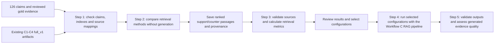

# Workflow D: Evaluate retrieval and selected RAG configurations

[Back to the full workflow](summary_full_narrative_agent_flow.md) | [Run RAG for a claim](workflow_c_rag.md)

This workflow compares retrieval performance first, **without LLM generation**, then runs and evaluates RAG for selected configurations. It uses the current **126-claim CSV** and the **C1-C4 `full_v1` chunks and indexes**. `full_v1` is the index-build version, not the test-dataset name. It does not use the earlier development datasets or their saved scores.

**Local by default:** `run_rag_comparison` and `evaluate_ragas` use Ollama with `qwen3-vl:4b-instruct`, host `http://localhost:11434` and context 20,000 when no model mode is specified. They do not fall back to OpenAI if Ollama is unavailable. API generation requires `--shared-llm`; an explicit `--judge-model` selects the shared provider for judging. Existing OpenAI result folders remain separate from local runs.

## Inputs and current scope

| Input | Location / scope |
|---|---|
| Test claims | `data/narrative/evaluation/test_claims_v1/cases.csv` |
| Saved evaluation results | `data/narrative/evaluation/test_claims_v1_result/<RUN>/` |
| Cases | 126 unique claims across 16 companies: 42 supported, 42 contradicting, 42 unsupported |
| Saved chunks and indexes | `data/narrative/processed/chunking_strategies/<STRATEGY>/full_v1/<TICKER>/` |
| Source text | `data/narrative/processed/<TICKER>/documents.jsonl` |
| Publication cutoff | Use each case's `cut_off`; all current dates use `yyyy-mm-dd` |
| Expected evidence | Existing `source_doc`, `gold_snippet` and `gold_answer` annotations; independent review remains necessary |

Replace `<STRATEGY>` with C1, C2, C3 or C4, and `<TICKER>` with the company symbol. For example, `data/narrative/processed/chunking_strategies/C4/full_v1/AAPL/` contains Apple's C4 chunks, source map, build reports and matching search indexes.

## Scripts and outputs

Step numbers start at 1 within this workflow. Prepare sources/indexes using Workflows A and B. Steps 1-3 compare retrieval; Steps 4-5 run and evaluate selected RAG configurations using the Workflow C pipeline.

| Step | Script / input | Output |
|---|---|---|
| 1. Prepare test claims and indexes | Current CSV, source maps and Workflow B build reports | Reviewed gold evidence and matching company/strategy artifacts |
| 2. Run retrieval comparisons | `scripts/narrative/evaluation/run_rag_comparison.py --retrieval-only` | Ranked support/counter passages, queries, evidence and source metadata |
| 3. Validate and score saved retrieval | `scripts/narrative/evaluation/evaluate_rag_comparison.py` | Source checks, Source Hit@5/10, Recall@5/10, MRR@5/10 and company/case reports |
| 4. Run RAG for selected configurations | `scripts/narrative/evaluation/run_rag_comparison.py` without `--retrieval-only` | Exact LLM inputs/responses, selected evidence, quoted facts, cited summaries, stance with reason, validation and usage |
| 5. Evaluate selected RAG outputs | `scripts/narrative/evaluation/evaluate_rag_comparison.py`, then `evaluate_ragas.py` | Local stance classification and coverage, technical checks, usage, RAGAS evidence/summary quality, stance justification and citation relations; see the [metric index](#metrics-available-from-each-evaluation-script) |

## Workflow and responsibilities



## Steps

### Step 1. Prepare test claims and matching artifacts

Use the current CSV unchanged during a comparison. Review `source_doc` and `gold_snippet` against the original source text; corrections require a new dataset version.

Check each selected company's `build_report.json`, BM25/vector metadata and source map against the current parsed documents. Source maps connect the annotated document/text span to each strategy's chunks; chunk IDs differ across strategies. Flag missing or ambiguous mappings for review. See [Workflow B](workflow_b_processing_and_indexes.md) for build instructions and [Step 3](#step-3-check-retrieved-evidence-and-evaluate-results) for source checks.

Give retrieval only `claims`, `company`, `cut_off` and normal runtime settings. Keep gold answers, snippets, labels and distractors out of search queries. Do not inject distractors in this baseline comparison.

The 84 supported/contradicting cases have positive gold snippets. The 42 unsupported cases have none; a background document named in those cases is not positive gold evidence.

### Step 2. Run retrieval comparisons

Use the same claims, publication cutoffs, candidate limits and top K across configurations. **P0** means no document-priority ranking adjustment. Backend names are R1=`bm25`, R2=`dense`, R3=`hybrid`, R4=`r4` (hybrid plus cross-encoder).

| Chunking strategy | Retrieval methods | Test executions |
|---|---|---:|
| C1 | BM25, dense, hybrid, R4 | 126 x 4 = 504 |
| C2 | BM25, dense, hybrid, R4 | 126 x 4 = 504 |
| C3 | BM25, dense, hybrid, R4 | 126 x 4 = 504 |
| C4 | BM25, dense, hybrid, R4 | 126 x 4 = 504 |
| **Total** | **16 configurations** | **2,016** |

Each execution processes one claim/configuration without generation. The same saved results compare chunking while holding retrieval fixed, or retrieval while holding chunking fixed. Report support-search and counter-search scores separately.

**Input:** the CSV, parsed documents for all 16 companies and their complete C1-C4 `full_v1` folders, including matching Qdrant storage. Dense/hybrid/R4 require the retrieval dependencies and local embedding/reranker models.

Run from the repository root in PowerShell. Install dependencies if needed:

```powershell
python -m pip install -e ".[retrieval]"
```

Run all claims/configurations:

```powershell
$retrievalRun = 'data/narrative/evaluation/test_claims_v1_result/retrieval_all126_v1'

python -u -m scripts.narrative.evaluation.run_rag_comparison --all-cases --strategies C1 C2 C3 C4 --backends bm25 dense hybrid r4 --build-version full_v1 --threads 2 --rerank-overflow truncate --retrieval-only --output-dir $retrievalRun --resume
```

**Output:** `matrix_configuration.json`, `matrix_report.json` and `configurations/<STRATEGY>/<backend>/`, containing the case snapshot, configuration, source checks, ordered retrieval and candidate evidence. Generation is skipped; facts/summaries are empty and citation-generation checks are NOT_RUN. Local compute/model downloads can still take time.

**Resume:** saved results are reused. Increasing the case limit is allowed when the existing selection is an unchanged prefix and dataset/build/settings/code match. Changed configurations require a new folder. Previous scope reports are retained under `history/`. Run one process per output folder.

**Input checks only:** append `--preflight-only` to validate inputs without retrieval. Remove it to execute the comparison.

**Token limits:** `--rerank-overflow truncate` permits R4 to shorten oversized query/passage pairs for scoring; stored passages remain complete. C1-C3 also have saved embedding-input truncation. Include these limitations when interpreting dense/hybrid/R4 results.

P1/P2 priority comparisons remain a separate future experiment and are not activated by these commands.

### Step 3. Check retrieved evidence and evaluate results

| Check / metric | Meaning |
|---|---|
| Source validation | Check source IDs/text, company, cutoff, source mappings and input/build identities. Preserve source URLs and date qualifications. |
| Source Hit@5/10 | Did the top 5/10 results contain any passage from the annotated source document? |
| Known-reference Recall@5/10 | Did those results collectively cover the annotated gold text span? |
| MRR@5/10 | Average `1 / rank` of the first single passage covering the complete gold span within the rank limit; missing evidence scores zero. |
| Scope | Positive-reference metrics use 84 supported/contradicting cases; 42 unsupported cases are N/A. Report directions and case types separately. |
| Overall report | Completion/errors, per-case/company metrics and equal-company averages. Generation quality is not assessed. |

Python compares saved source locations/text coverage against the gold annotations; it does not judge whether those annotations prove the claim. Alternative valid evidence needs review. Precision/nDCG require broader relevance labels; RAGAS and summary-quality evaluation are outside this retrieval run.

After all requested configurations finish, score their saved outputs:

```powershell
python -u -m scripts.narrative.evaluation.evaluate_rag_comparison --run-dir $retrievalRun
Get-Content -LiteralPath "$retrievalRun/comparison.md"
```

If opening a new terminal, set `$retrievalRun` to the actual folder first. Scoring makes no new retrieval or LLM calls. The full scorer stops on missing planned cases or source/hash mismatches; it does not turn missing files into relevance zeros. Partial reports below score only the complete configurations identified in their scope.

| Output | Contents |
|---|---|
| `comparison.md` | Readable retrieval metrics per configuration/direction |
| `comparison.csv` | Case-type metrics, denominators and equal-company averages |
| `per_company.csv` | Per-company results |
| `per_case.csv` | Individual case/configuration/direction scores |
| `comparison.json` | Aggregates, status, recorded usage and limitations |
| Configuration `evaluation.md` / `evaluation.json` | Detailed source checks and case outcomes |

#### Current 126-claim retrieval-only results

Source: `data/narrative/evaluation/test_claims_v1_result/retrieval_all126_v1/comparison.md` and its matching `comparison.json`. The saved matrix is **COMPLETE** and the full report is **SCORED_SAVED_OUTPUTS**.

| Item | Completed result |
|---|---|
| Saved retrieval executions | **2,016 / 2,016 (100%)**; all recorded retrieval statuses OK |
| Completed and scored configurations | **16 / 16**: C1-C4, each with BM25, dense, hybrid and R4; 126 claims per configuration; P0 |
| Remaining configurations | None |
| Source validation | **2,016 / 2,016 passed** across all 16 configurations |
| LLM input/output tokens and API cost | **0 / 0 tokens; $0**; generation was disabled |
| Generated-summary/citation quality and RAGAS | Not assessed by this retrieval-only comparison |

##### Scored completed configurations: all 126 claims

This table reports **retrieval only**, for all 16 configurations and all 126 claims. RAGAS is reported separately in [Selected cases: retrieval and RAGAS performance](#selected-cases-retrieval-and-ragas-performance).

`Displayed score = (support-search score + counter-search score) / 2`

The same 84 supported/contradicting claims are scored in both directions; 42 unsupported claims remain N/A for positive-reference metrics. These are directional averages, not scores for a merged top-5/top-10 passage list. Source Hit checks the annotated document, Recall checks gold-span coverage, and MRR checks the first single passage covering the complete gold span. Original reports retain both directions separately.

| Strategy / method | Cases / positive references | Mean Source Hit@5 / @10 | Mean Recall@5 / @10 | Mean MRR@5 | Mean MRR@10 |
|---|---|---|---|---|---|
| C1 / bm25 | 126 / 84 | 97.62% / 98.81% | 85.71% / 89.88% | 0.7492 | 0.7547 |
| C1 / dense | 126 / 84 | 77.38% / 89.88% | 36.31% / 48.21% | 0.2171 | 0.2333 |
| C1 / hybrid | 126 / 84 | 79.17% / 99.40% | 63.10% / 91.67% | 0.4627 | 0.4937 |
| C1 / r4 | 126 / 84 | 91.07% / 98.81% | 48.21% / 51.79% | 0.3837 | 0.3888 |
| C2 / bm25 | 126 / 84 | 99.40% / 100.00% | 77.38% / 79.76% | 0.6877 | 0.6915 |
| C2 / dense | 126 / 84 | 82.14% / 93.45% | 39.29% / 53.57% | 0.2687 | 0.2876 |
| C2 / hybrid | 126 / 84 | 89.29% / 98.21% | 70.24% / 79.76% | 0.4588 | 0.4718 |
| C2 / r4 | 126 / 84 | 98.81% / 100.00% | 64.88% / 68.45% | 0.5480 | 0.5532 |
| C3 / bm25 | 126 / 84 | 98.81% / 100.00% | 80.95% / 83.93% | 0.6935 | 0.6978 |
| C3 / dense | 126 / 84 | 77.98% / 88.10% | 39.88% / 54.76% | 0.2753 | 0.2952 |
| C3 / hybrid | 126 / 84 | 85.12% / 97.62% | 69.05% / 81.55% | 0.5017 | 0.5180 |
| C3 / r4 | 126 / 84 | 96.43% / 100.00% | 72.02% / 74.40% | 0.6115 | 0.6144 |
| C4 / bm25 | 126 / 84 | 99.40% / 100.00% | 80.95% / 83.33% | 0.7226 | 0.7263 |
| C4 / dense | 126 / 84 | 78.57% / 91.07% | 52.98% / 63.69% | 0.3848 | 0.3987 |
| C4 / hybrid | 126 / 84 | 89.88% / 99.40% | 73.21% / 83.93% | 0.5800 | 0.5941 |
| C4 / r4 | 126 / 84 | 98.21% / 100.00% | 77.38% / 83.33% | 0.6558 | 0.6637 |

**C1/hybrid has the highest mean known-reference Recall@10: 91.67%. C1/bm25 has the highest mean MRR@10: 0.7547.** These are retrieval results, not generated-summary quality.

All retrieval configurations are scored; selected-case RAGAS coverage is reported in the separate selected-case section. Alternate valid evidence remains unjudged, and the claim annotations still require independent review. C1-C3 embedding truncation and the explicit R4 pair-truncation policy remain limitations. Compare per-company and equal-company results alongside the overall scores because AAPL has more test cases. Retrieval source-span annotations alone do not establish reliable Precision/nDCG or semantic summary quality; the separate selected-case RAGAS section uses judge estimates.

Complete saved reports: [comparison.md](../../../data/narrative/evaluation/test_claims_v1_result/retrieval_all126_v1/comparison.md), [comparison.json](../../../data/narrative/evaluation/test_claims_v1_result/retrieval_all126_v1/comparison.json), [comparison.csv](../../../data/narrative/evaluation/test_claims_v1_result/retrieval_all126_v1/comparison.csv), [per_company.csv](../../../data/narrative/evaluation/test_claims_v1_result/retrieval_all126_v1/per_company.csv), [per_case.csv](../../../data/narrative/evaluation/test_claims_v1_result/retrieval_all126_v1/per_case.csv). Each configuration also has `evaluation.md` and `evaluation.json` in its own folder. Earlier `partial_comparison.*` files are progress snapshots, not the final scores.

This documentation refresh reads existing reports only; it does not repeat retrieval, scoring or LLM generation. Continue with Steps 4-5 when ready to evaluate generated evidence summaries for selected configurations.

### Step 4. Run RAG for selected configurations

Choose one or two configurations after reviewing retrieval scores, context completeness and tokenizer limitations. This reduces generation calls: 126 claims need up to **126 initial calls for one configuration**, or **252 for two**, instead of 2,016 for all 16. These selected runs do not evaluate summary quality for the other configurations.

**Input:** the same CSV, cutoffs and matching indexes, with Ollama running and the local model installed. Keep the model, prompt and context/output budgets consistent across selected configurations, and check that their input fits the model's context window.

**Script:** use the comparison runner **without `--retrieval-only`**. It performs retrieval and one local LLM evidence-preparation call when candidates are available. The LLM selects source facts and writes a cited summary; the Auditor determines claim verdicts separately. The default Ollama mode uses no OpenAI key or credits.

The following uses C4/R4 as an example, not a declared winner. Replace the strategy/backend after reviewing the retrieval results. Use `--ollama-model` to select another installed local model.

```powershell
$selectedStrategy = 'C4'
$selectedBackend = 'r4'
$ragRun = 'data/narrative/evaluation/test_claims_v1_result/rag_C4_r4_ollama_v1'

python -u -m scripts.narrative.evaluation.run_rag_comparison --all-cases --strategies $selectedStrategy --backends $selectedBackend --build-version full_v1 --threads 2 --max-tokens 3000 --rerank-overflow truncate --output-dir $ragRun --resume
```

For an initial one-claim check, replace `--all-cases` with `--limit 1`; afterward use `--all-cases --resume` to add the remaining claims while preserving saved results. Keep the model/settings/code unchanged when extending the run.

**Output:** saved rankings, exact LLM inputs/responses, selected evidence, quoted facts, cited summaries, citation validation and token/cost usage. Store these separately from the retrieval-only run. The current runner retrieves again for the selected configuration; it does not import the earlier rankings.

### Step 5. Evaluate selected RAG outputs

Score the saved selected-RAG run:

```powershell
python -u -m scripts.narrative.evaluation.evaluate_rag_comparison --run-dir $ragRun
Get-Content -LiteralPath "$ragRun/comparison.md"
```

| Evaluation | What is available |
|---|---|
| Source and citation checks | Validate source identity, company/cutoff, exact fact quotes and citation references. |
| Technical completion | Report OK, INVALID_GENERATION and GENERATION_ERROR outcomes; retain retrieval scores when generation fails. |
| Usage | Report saved generation tokens, recorded cost estimates and timings. Scoring makes no new model calls. |
| Summary quality | Run the separate RAGAS evaluator below against saved inputs/outputs and reviewed references. The offline comparison scorer above makes no judge calls. |
| Narrative stance | Locally compare SUPPORTED/UNSUPPORTED/CONTRADICTING with the existing CSV `type`; separately judge the reason and supporting/contradicting citations. |
| Final claim verdict | Determined by the Auditor; separate from Narrative's preliminary stance and not scored by this standalone evaluation. |

Technical acceptance is not answer accuracy. Report generated-summary quality separately from retrieval metrics and use independently reviewed held-out cases for final quality conclusions.

### Metrics available from each evaluation script

The run command captures outputs; the evaluation commands below calculate the
metrics. Use the existing CSV `type` for expected stance. No additional dataset
columns are required.

| Script and saved input | Metrics available | Reports | Judge calls |
|---|---|---|---|
| `evaluate_rag_comparison --run-dir $run`, where `$run` contains a **retrieval-only matrix** | Source Hit@5/@10, known-reference Recall@5/@10, MRR@5/@10 and bundle completion RR@10; source/cutoff checks and run status. No assessed stance or generated-answer quality. | `comparison.md`, `comparison.json`, `comparison.csv`, `per_case.csv`, `per_company.csv`; bundle completion RR is in JSON/CSV. | None |
| `evaluate_rag_comparison --run-dir $ragRun`, where `$ragRun` contains a **full stance-enabled RAG matrix** | The same retrieval metrics, plus stance accuracy, macro F1, precision/recall/F1 for each stance, confusion matrix, false support rate, assessment completion rate and all-case accuracy. Also reports citation-validation status, generation failures, saved tokens/cost and timing. | `comparison.md`/`.json`, `stance_metrics.csv`, `stance_per_case.csv`, `stance_per_label.csv`, `stance_confusion_matrix.csv`, plus the retrieval CSVs. | None |
| `evaluate_rag_pilot --run-dir <CONFIGURATION_FOLDER>` | Single-configuration counterpart of the local scorer: retrieval, technical and stance metrics. | `evaluation.md`, `evaluation.json` with per-case records, reasons and `stance_metrics`. | None |
| `evaluate_ragas --run-dir $ragRun ... --output-dir $judgeRun` | Faithfulness; selected Context Recall (`evidence_completeness`); selected Context Precision (`evidence_selection_quality`); retrieved Context Precision/Recall; summary completeness; summary citation correctness; relevance; stance justification; stance citation correctness; extended unsupported behavior. Also repeats local stance classification and records judge usage. | `ragas_report.md`/`.json`, `ragas_metrics.csv`, `ragas_per_case.csv`; detailed judge reasons/checkpoints under `samples/` and `calls/`. | Yes, except `--prepare-only`, which exports inputs without calculating judge scores. |

**Your retrieval-only command:** `run_rag_comparison --retrieval-only` does not
generate a stance. Score its saved output with:

```powershell
python -m scripts.narrative.evaluation.evaluate_rag_comparison --run-dir $run
Get-Content -LiteralPath "$run/comparison.md"
Import-Csv -LiteralPath "$run/comparison.csv" | Format-Table
```

To obtain stance metrics, first create a separate full RAG run without
`--retrieval-only`, then score `$ragRun`. RAGAS also requires that full run;
passing the retrieval-only folder is rejected. The full local flow below shows
generation, a one-case judge check and full-batch evaluation.

**How to inspect a stance-enabled run:**

```powershell
Get-Content -LiteralPath "$ragRun/comparison.md"
Import-Csv -LiteralPath "$ragRun/stance_metrics.csv" | Format-Table
Import-Csv -LiteralPath "$ragRun/stance_per_label.csv" | Format-Table
Import-Csv -LiteralPath "$ragRun/stance_confusion_matrix.csv" | Format-Table
Import-Csv -LiteralPath "$ragRun/stance_per_case.csv" |
    Select-Object id, expected_stance, predicted_stance, stance_assessment_status, stance_correct, stance_reason |
    Format-List

Get-Content -LiteralPath "$judgeRun/ragas_report.md"
Import-Csv -LiteralPath "$judgeRun/ragas_metrics.csv" | Format-Table
Import-Csv -LiteralPath "$judgeRun/ragas_per_case.csv" | Format-Table
```

The table lists implemented metrics, not newly measured performance. N/A and
errors remain distinct from scores. Classification excludes invalid/null
predictions from accuracy/F1 while coverage and all-case accuracy retain failures
in their denominators. Judge scores have their own scored-case counts. See the
[local metric definitions](#step-3-validate-and-score-saved-pipeline-outputs)
and [RAGAS field mappings](#what-the-scores-compare) below for interpretation.
Noise Sensitivity and Factual Correctness in F1 mode are not currently reported;
`summary_completeness` uses Factual Correctness in recall mode.

### Full local flow: generate and evaluate with RAGAS

**Flow:** existing C4 indexes -> R4 retrieval -> Ollama facts, summary and reasoned stance -> Python source/citation/retrieval and stance classification checks -> Ollama RAGAS judging -> reports. The Auditor remains responsible for final claim verdicts.

The commands use C4/R4 for all 126 claims. Both runners now default to local `qwen3-vl:4b-instruct`, with a 20,000-token context. RAGAS scoring reads saved outputs without repeating retrieval or generation. It makes multiple local judge requests per case.

#### Step 1. Prepare local dependencies and folders

Run from the repository root in PowerShell. Keep Ollama running and check the model is installed:

```powershell
python -m pip install -e ".[retrieval,ragas]"
ollama list

$ragRun = 'data/narrative/evaluation/test_claims_v1_result/rag_C4_r4_ollama_stance_v1'
$judgeRun = 'data/narrative/evaluation/test_claims_v1_result/ragas_C4_r4_ollama_stance_v1'
```

If the model is missing, install it using `ollama pull qwen3-vl:4b-instruct`. The CSV, current parsed documents and matching full C4 indexes/vectors must already be present. No OpenAI key or provider environment change is required for local mode. Use separate folders from the OpenAI runs; changing provider/model cannot resume those generation/judge checkpoints.

The stance prompt and evaluation protocol changed. Use new generation and judge
folders, including when older folders used the same model. Existing saved results
are not rewritten or relabelled. No new dataset columns are needed: `type` maps
supported -> SUPPORTED, unsupported -> UNSUPPORTED, contradicting -> CONTRADICTING.
Keep the reviewed labels, `gold_answer`, `gold_snippet` and `expected_behavior`
out of generation inputs. No adversarial flags, attack categories or pair IDs
are required, and no dedicated paired-attack metrics are reported.

CSV `cut_off` must be populated for every selected case as `YYYY-MM-DD`, using
the reviewed claim/video publication cutoff. It is not the collection-folder
date or today's date. Preflight reports invalid dates with case IDs and CSV
record numbers before reading corpus builds. Changing CSV contents requires a
new run folder when an older manifest already exists.

Positive cases can cite multiple exact `block N | chars START:END` anchors in
`source_doc`. Each anchor needs its own document header; `gold_snippet` contains
their quotes in the same order. All identities, bounds, text and dates are checked.
Known-reference Recall@K requires coverage of every span; Source Hit@K counts any
annotated document, single-passage MRR requires one passage to cover the complete
reference, and bundle completion RR measures when the accumulated hits cover it.
The optional existing CSV type `partially supported` retains its gold evidence
for retrieval/quality evaluation but maps to expected UNSUPPORTED for the
three-stance assessment. Its original CSV label and evidence are preserved.

#### Step 2. Run retrieval and local generation

```powershell
python -u -m scripts.narrative.evaluation.run_rag_comparison --all-cases --strategies C4 --backends r4 --build-version full_v1 --threads 2 --max-tokens 3000 --rerank-overflow truncate --output-dir $ragRun --resume
```

**Output:** exact `llm_input.json` and `llm_response.json`, `result.json`, `retrieval.json`, selected evidence, facts, cited summary, stance with reason and fact references, validation and usage under each case folder. The startup message identifies the local model. If Ollama is unavailable, the runner stops; it does not switch to a paid API.

For a one-claim preview, replace `--all-cases` with `--limit 1`. Later extend to `--all-cases --resume` using the same folder/settings. Append `--preflight-only` to the generation command to check inputs without model calls; remove it to execute.

#### Step 3. Validate and score saved pipeline outputs

Wait for generation to finish, then run:

```powershell
python -u -m scripts.narrative.evaluation.evaluate_rag_comparison --run-dir $ragRun
Get-Content -LiteralPath "$ragRun/comparison.md"
```

This offline scorer reports source checks, directional retrieval metrics, technical/citation outcomes, stance classification and recorded usage. It makes no retrieval or model calls. Invalid generations remain visible rather than being counted as semantic answers. The single-configuration counterpart is `python -m scripts.narrative.evaluation.evaluate_rag_pilot --run-dir <CONFIGURATION_FOLDER>`.

Stance classification counts each case once, not once per support/counter search.
The matrix writes `stance_metrics.csv`, `stance_per_case.csv`, `stance_per_label.csv`
and `stance_confusion_matrix.csv`, plus the stance section in `comparison.md` and
`comparison.json`. Each configuration's `evaluation.json` also contains
`stance_metrics` and the per-case prediction/reason/status.

| Local metric | Definition |
|---|---|
| `accuracy` | Correct labels / valid assessments. |
| `macro_f1` | Unweighted average F1 over all three labels. Undefined class precision/recall/F1 is zero when at least one valid assessment exists; all are N/A with none. |
| Per-label precision, recall and F1 | Computed from valid expected/predicted labels; includes class support counts. UNSUPPORTED recall measures correct refusal on gold unsupported cases. |
| Confusion matrix | Expected labels in rows, predictions in columns, valid assessments only. |
| `false_support_rate` | Incorrect SUPPORTED predictions / valid gold UNSUPPORTED or CONTRADICTING cases. Lower is better; N/A without such cases. |
| `assessment_completion_rate` | Valid assessments / all saved full-RAG cases. |
| `all_case_accuracy` | Correct predictions / all saved full-RAG cases, retaining failures/missing assessments in the denominator. |

Retrieval-only cases are excluded from stance denominators. Historical reports
without a stance remain NOT_ASSESSED; invalid generation/model failures are
ERROR, never an UNSUPPORTED prediction. A valid empty-retrieval abstention counts
as an assessment and can still be incorrect against the gold label. Read valid
accuracy together with coverage and all-case accuracy. A one-case preview is an
execution check; use all three classes before interpreting macro F1.

#### Step 4. Run local RAGAS judging

The evaluator automatically prepares inputs from the saved RAG run, then calls the judge to calculate scores. Gold annotations are evaluator inputs only and are not sent back to Narrative generation.

```powershell
python -u -m scripts.narrative.evaluation.evaluate_ragas --run-dir $ragRun --all-cases --ollama-model qwen3-vl:4b-instruct --ollama-context 20000 --max-tokens 3000 --output-dir $judgeRun --resume
```

The local judge model is independent of the generation model. Both default to the same Ollama model here; use `--ollama-model <INSTALLED_MODEL>` on the judging command to change the judge. Do not use `--judge-model` for local models: that option explicitly selects the shared provider.

For a one-case preview, use `--limit 1` consistently in generation and judging. Validate judge explanations on supported, contradicting and unsupported cases before treating local scores as reliable. Local execution can take substantial time, and the judge's effective context window must fit each prompt plus its output budget. The evaluator does not silently shorten evidence to make it fit.

#### Step 5. Read retrieval and quality reports

```powershell
Get-Content -LiteralPath "$ragRun/comparison.md"
Get-Content -LiteralPath "$judgeRun/ragas_report.md"
Import-Csv -LiteralPath "$judgeRun/ragas_metrics.csv" | Format-Table
Import-Csv -LiteralPath "$judgeRun/ragas_per_case.csv" | Format-Table
Import-Csv -LiteralPath "$ragRun/stance_metrics.csv" | Format-Table
Import-Csv -LiteralPath "$ragRun/stance_per_case.csv" | Format-Table
Import-Csv -LiteralPath "$ragRun/stance_confusion_matrix.csv" | Format-Table
```

`ragas_report.json` contains per-metric status/reasons and coverage; `calls/` retains judge request/response checkpoints. Local token counts and timings are reported, with API cost recorded as zero; hardware/electricity costs are not measured. Do not combine local and OpenAI judge scores as if they came from the same evaluator model.

**Resume and failures:** ordinary `--resume` reuses saved work and permits adding cases under unchanged settings. For generation failures, inspect the cause and add `--retry-generation-errors --resume`; failed attempts are archived and successful/invalid-format outputs are preserved. For failed/interrupted judge requests, inspect the error then use `--retry-errors --resume`. Source/reference, model/provider or substantive code changes require a new compatible output version. Run only one process per output folder. After forced termination, verify no process is running before removing its lock file.

**Explicit API opt-in:** generation uses `--shared-llm` to select the shared provider/model from private configuration or environment. Judging uses `--judge-model gpt-4o-mini`, or `--shared-llm` for the configured shared model. These options may incur API charges; do not combine them with `--ollama-model`. Historical OpenAI results stay unchanged and require the original model/settings when resumed. The shared API spend guard remains process-specific; local execution does not consume that API budget.

**Source-span input check:** the evaluator validates the exact generation partition, including span IDs, order and text, while allowing the generator's omission of whitespace-only segments. Previously accepted samples and prompts are preserved by the audited input-validation/CLI-default migrations; changing to a different provider or model still requires a new output folder.

#### What the scores compare

| Report metric | JSON/reference fields | Meaning |
|---|---|---|
| `faithfulness` | Joined `summary[].text` vs actual `source_passages` captured in `llm_input.json` | RAGAS Faithfulness: are the summary's factual statements grounded in the supplied sources? |
| `evidence_completeness` | Selected original passages vs CSV `gold_answer` | RAGAS Context Recall: how much of the expected source fact is covered by selected evidence? |
| `evidence_selection_quality` | Original passages in `selected_evidence_ids` order vs claim and `gold_answer` | RAGAS Context Precision: rank-aware relevance of the selected evidence; not a simple percentage of useful passages. |
| `retrieved_context_precision` | All actual supplied contexts in captured prompt order vs claim and `gold_answer` | RAGAS Context Precision before LLM selection. This is the captured supplied list, not either original directional ranking. |
| `retrieved_context_recall` | All actual supplied contexts vs `gold_answer` | RAGAS Context Recall before LLM selection; compare with `evidence_completeness` to identify selection losses. |
| `summary_completeness` | Joined summary text vs CSV `gold_answer` | RAGAS Factual Correctness in recall mode: how much expected factual content appears in the summary? |
| `citation_correctness` | Each summary sentence vs only the passages in its `evidence_ids` | Custom RAGAS binary attribution rubric; case score is the mean across cited sentences. Requires entity/period/number/qualification and explicit attribution to match. |
| `relevance` | `facts` and `summary` vs claim/company/cutoff | Custom RAGAS rubric: 0 = off-topic/materially changes scope, 0.5 = partly relevant, 1 = directly relevant. No stance/verdict is required. |
| `stance_justification` | Stance, reason, exact facts, missing parts and actual supplied contexts | Custom rubric: 0 = unjustified/inconsistent, 0.5 = partially justified with a missing qualification, 1 = fully justified. Includes compound claims, attribution, matching scope/period and unresolved conflicts. No gold label is supplied to this judge task. |
| `stance_citation_correctness` | Each supporting/contradicting fact reference vs claim, exact quote and its original cited passage | Binary relation check per reference; case score is their mean. Supporting facts must establish a material part; contradicting facts must directly oppose it under applicable scope/period. No references means N/A. Existing summary citation correctness remains separate. |
| `unsupported_behavior` | Evidence brief, supplied contexts, available stance/reason/missing parts and CSV `expected_behavior` | Extended binary rubric for gold unsupported cases: avoids invented evidence and, when a stance exists, requires a justified UNSUPPORTED refusal to confirm. Empty facts/summary are valid; an error is not a refusal. Historical v2 reports retain brief-only behavior checks. |
| Technical citation checks | Saved `citation_validation` | Existing Python ID/exact-quote/structure checks, reported separately from semantic attribution. |

For **contradicting** claims, `gold_answer` contains the correct source fact, not the false assertion. For **unsupported** claims, positive-reference completeness/precision scores are N/A. Empty summaries get no faithfulness score; failed generation is not scored as zero or as perfect. For supported/contradicting cases, an accepted empty evidence selection/summary has zero expected-fact coverage. All output quality scores are separate from the Auditor's claim verdict.

The judge report also includes locally calculated `stance_metrics` per
configuration and expected/predicted stance, reason and status in
`ragas_per_case.csv`. Per-reference relation judgments and reasons are saved as
`samples/<CONFIG>/<CASE_ID>/stance_citation_<ROLE>_<FACT_INDEX>.json` and
`stance_justification.json`. JSON/CSV metric status distinguishes scored values,
N/A and failures. Historical outputs without stance get N/A for stance judging;
no stance is fabricated. Judge errors stop/checkpoint the run as before.
In-progress stance aggregates cover processed rows only; use a COMPLETE report
for the full selected scope. These software changes do not refresh the historical
performance tables below, and no new model/judge calls were made for this update.

The evaluator uses **RAGAS 0.4.3** with the existing shared client (or the existing Ollama helper), not a second production pipeline. References: [Faithfulness](https://docs.ragas.io/en/stable/concepts/metrics/available_metrics/faithfulness/), [Context Recall](https://docs.ragas.io/en/stable/concepts/metrics/available_metrics/context_recall/), [Context Precision](https://docs.ragas.io/en/stable/concepts/metrics/available_metrics/context_precision/), [Factual Correctness](https://docs.ragas.io/en/stable/concepts/metrics/available_metrics/factual_correctness/) and [custom criteria](https://docs.ragas.io/en/stable/concepts/metrics/available_metrics/general_purpose/).

Reports separate supported, contradicting and unsupported cases, show scored/N/A counts, and include equal-company means because AAPL has more cases. Existing sparse gold references and automated judges require independent review; a valid alternative source is not automatically irrelevant. Check judge reasons on sample cases, including explicit date/document constraints, before reporting benchmark conclusions.

## Selected cases: retrieval and RAGAS performance

This section reports only configurations with saved RAGAS results: **C1/BM25 and C4/BM25**. It is separate from the [full 16-configuration retrieval benchmark in Step 3](#scored-completed-configurations-all-126-claims).

**Case selection:** use the case IDs already processed in each saved `ragas_report.json`. Retrieval scores below are calculated from the matching case records in that same full-RAG run's saved `evaluation.json`, not copied from the full 126-claim retrieval-only benchmark. Retrieval retains these cases even when generation fails; semantic metrics use their own scored-case counts.

Both saved RAGAS reports are now **COMPLETE: 126/126 case entries processed**. This means evaluation reached every case, not that all generated outputs passed validation or received every semantic score. These saved runs used OpenAI generation and judging; the new local defaults do not change their models or scores. No retrieval, generation or judge calls were made for this refresh. Compare common case IDs with applicable scores when assessing configuration differences.

### Selected-case coverage and usage

| Item | C1 / BM25 | C4 / BM25 |
|---|---|---|
| Generation model | openai / `gpt-5.4` | openai / `gpt-5.4` |
| RAGAS judge | openai / `gpt-4o-mini` | openai / `gpt-4o-mini` |
| Saved report status | `COMPLETE` | `COMPLETE` |
| Processed saved case entries | 126 / 126 | 126 / 126 |
| Positive-reference cases for selected-case retrieval | 84 | 84 |
| Companies represented | 16 | 16 |
| Supported / contradicting / unsupported entries | 42 / 42 / 42 | 42 / 42 / 42 |
| Generation statuses in processed entries | 114 OK, 12 INVALID_GENERATION | 108 OK, 17 INVALID_GENERATION, 1 GENERATION_ERROR |
| Recorded strict citation passes | 114 / 126 | 108 / 126 |
| Judge metric errors | 0 | 0 |
| Judge request attempts | 1210 | 1145 |
| Judge input / output tokens | 4,118,480 / 177,510 | 1,963,233 / 162,484 |
| Recorded judge cost (USD) | $0.724278 | $0.391975 |
| Attempts with unknown usage | 0 | 0 |

### Retrieval performance for the selected cases

Each score averages the support-search and counter-search results over the selected positive-reference cases. Unsupported cases remain N/A. These are directional averages, not scores for a merged passage ranking.

| Configuration | Selected entries / positive references | Mean Source Hit@5 / @10 | Mean Recall@5 / @10 | Mean MRR@5 / @10 |
|---|---|---|---|---|
| C1 / bm25 | 126 / 84 | 97.62% / 98.81% | 85.71% / 89.88% | 0.7492 / 0.7547 |
| C4 / bm25 | 126 / 84 | 99.40% / 100.00% | 80.95% / 83.33% | 0.7226 / 0.7263 |

### RAGAS quality scores for the selected cases

Cells show **mean (scored cases)** on a 0 to 1 scale. Positive-reference completeness/selection metrics are N/A for unsupported claims. Empty briefs and invalid generation outputs can reduce other metric counts; failed/N/A cases are excluded from means, not silently counted as zero.

| Metric | C1 / BM25 mean (n) | C4 / BM25 mean (n) |
|---|---|---|
| Faithfulness | 0.9552 (112) | 0.9535 (106) |
| Evidence completeness (selected context recall) | 0.9267 (75) | 0.8882 (76) |
| Evidence selection quality (context precision) | 0.9444 (75) | 0.8607 (76) |
| Summary completeness | 0.6721 (75) | 0.7046 (76) |
| Citation correctness (semantic attribution) | 0.8824 (112) | 0.9292 (106) |
| Relevance | 0.6741 (112) | 0.6934 (106) |
| Unsupported-case behavior | 1.0000 (39) | 1.0000 (32) |

Both runs cover the same 126 input claims, but semantic metrics have different scored denominators because of invalid generation, generation failure and empty briefs. Compare common valid cases before declaring a configuration winner. Equal-company and type-specific averages remain in each `ragas_metrics.csv`. Evidence selection quality is rank-aware precision; unsupported behavior does not establish corpus-wide absence of evidence. Judge estimates require manual review.

### Selected-run source reports

| Configuration | Saved retrieval scores | RAGAS scores and individual cases |
|---|---|---|
| C1/bm25 | [evaluation.json](../../../data/narrative/evaluation/test_claims_v1_result/rag_C1_bm25_ragas_v1/configurations/C1/bm25/evaluation.json) | [ragas_report.md](../../../data/narrative/evaluation/test_claims_v1_result/ragas_C1_bm25_v1/ragas_report.md), [ragas_report.json](../../../data/narrative/evaluation/test_claims_v1_result/ragas_C1_bm25_v1/ragas_report.json), [ragas_metrics.csv](../../../data/narrative/evaluation/test_claims_v1_result/ragas_C1_bm25_v1/ragas_metrics.csv), [ragas_per_case.csv](../../../data/narrative/evaluation/test_claims_v1_result/ragas_C1_bm25_v1/ragas_per_case.csv) |
| C4/bm25 | [evaluation.json](../../../data/narrative/evaluation/test_claims_v1_result/rag_C4_bm25_ragas_v1/configurations/C4/bm25/evaluation.json) | [ragas_report.md](../../../data/narrative/evaluation/test_claims_v1_result/ragas_C4_bm25_v1/ragas_report.md), [ragas_report.json](../../../data/narrative/evaluation/test_claims_v1_result/ragas_C4_bm25_v1/ragas_report.json), [ragas_metrics.csv](../../../data/narrative/evaluation/test_claims_v1_result/ragas_C4_bm25_v1/ragas_metrics.csv), [ragas_per_case.csv](../../../data/narrative/evaluation/test_claims_v1_result/ragas_C4_bm25_v1/ragas_per_case.csv) |

Configurations without a saved RAGAS report are not included in this selected-case section. The full 16-configuration retrieval results remain in Step 3. Costs here cover RAGAS judging only; generation costs are separate. Let active evaluators finish before resuming and do not start two processes on one output folder. Saved run/report files were not changed.
