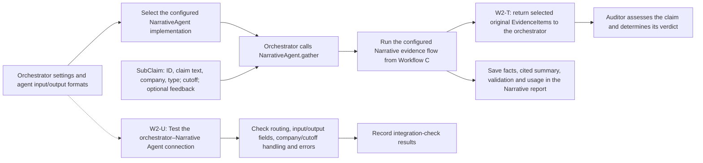

# Workflow E: Connect the orchestrator and Narrative Agent

[Back to the full Narrative workflow](summary_full_narrative_agent_flow.md) | [Shared setup](summary_full_narrative_agent_flow.md#3-before-running)

For saved results, see the [main summary](summary_full_narrative_agent_flow.md).

## Scripts and outputs

Paths in this table are relative to `finsight/agents/narrative/` unless stated otherwise. Steps start at 1 within this workflow. Use workflow letters A-E for the overall flow. See the [script inventory](../reference/narrative_script_inventory.md) for per-file descriptions.

| Step | Workflow blocks | Entry point / supporting modules | Main output |
|---|---|---|---|
| 1. Connect the Narrative Agent | W2-T | `stub.py:NarrativeAgent`, `retriever_stub.py:NarrativeRetriever`, shared registry and schemas | Selected original EvidenceItems returned for Auditor assessment |
| 2. Test the orchestrator–Narrative Agent connection | W2-U | `tests/test_narrative_entrypoints.py`, `tests/test_narrative_evidence_summary.py` (repository-root paths) | Routing, input/output contracts, company/cutoff and error-handling checks |

## Workflow and responsibilities

This workflow explains how the application calls Narrative. It reuses Workflow C
inside `NarrativeAgent.gather()`; it does not launch another standalone RAG
command or repeat its evidence preparation.



**Orchestrator settings:** choose the Narrative implementation, selected company
index/strategy, retrieval backend and evidence-preparation mode. The registry
is the component that reads those settings and provides the agent instance.

**Agent input/output formats:** the orchestrator supplies a `SubClaim`, cutoff
date and optional feedback. Narrative returns `list[EvidenceItem]`, preserving
the incoming claim ID and original passage/source metadata. The full factual
summary is saved in the report; the existing return contract does not pass it as
a new summary object to the Auditor. Internal `NEUTRAL` is an unassessed schema
placeholder, not a Narrative stance decision.

**W2-U — Test the orchestrator–Narrative Agent connection:** check that the
configured agent is called with the intended inputs and returns evidence in the
expected format, including how failures are handled. These checks may use
controlled fixtures or supported archived datasets. They do not establish
retrieval relevance, summary faithfulness or final-verdict accuracy; those require
their own evaluation. They are not a required extra stage for every live claim.

Entry classes, configuration examples and contracts are described below.
Other orchestrator agents
can still use stub implementations; wiring Narrative successfully does not
establish the quality of those components' assessments.

## Steps

### Step 1. Connect the Narrative Agent

Select the explicit implementations below when the orchestrator should use LLM evidence preparation. Importing these entry points does not download sources, build indexes, run experiments or call an LLM.

#### Integration entry files

| File / export | Responsibility |
|---|---|
| `stub.py:NarrativeAgent` | Collects candidates, then prepares exact facts, a cited summary and SUPPORTED/UNSUPPORTED/CONTRADICTING with a reason. The Auditor retains final-verdict authority. |
| `retriever_stub.py:NarrativeRetriever` | Implements the raw retrieval contract with an explicit or unambiguous company; supports the configured retrieval backend without generating a summary. |
| `__init__.py` | Exposes both classes and the standalone RAG helper through the package. |

**Registry defaults matter:** the current [`finsight/config.py`](../../../finsight/config.py) selects the raw `rag.collect_evidence:NarrativeEvidenceAgent` and lower-level `retrieval.retriever:CorpusRetriever`. To use this guide's LLM-preparing wrapper and scoped retriever, set `FINSIGHT_IMPL_NARRATIVE` and `FINSIGHT_IMPL_RETRIEVER` explicitly. Other registry slots keep their own implementations. Demo stub compatibility imports are separate from these real classes.

#### Input and output contracts

| Input | Meaning |
|---|---|
| `SubClaim.sub_claim_id` | Links every returned passage to the incoming claim. |
| `SubClaim.text` | Claim text used to construct the searches; confirm the orchestrator supplied the intended claim. |
| `SubClaim.company_ticker` | Required explicit company for the claim collector. |
| `SubClaim.sub_claim_type` | Shared claim category used by application routing. It is not a Narrative verdict. |
| `cutoff_date` | A `datetime.date`: latest permitted source publication date. |
| `feedback` | Optional string refining a subsequent search. It does not change company, cutoff, backend or index settings. |

`NarrativeAgent.gather(sub_claim, cutoff_date, feedback=None)` returns `list[EvidenceItem]`. It binds the incoming claim ID and preserves original passage text, source tier, document type, company, period, publication-date qualifications, URL and citation span. The internal required NEUTRAL stance remains unassessed. The selected facts/summary are saved in `last_analysis` and the report identified by `last_analysis_path`; they are not inserted into source text or added as a new return-contract field.

`NarrativeRetriever.retrieve(query, top_k, cutoff_date)` also returns `list[EvidenceItem]`, but only performs raw retrieval. Prefer an explicit constructor ticker or `FINSIGHT_NARRATIVE_TICKER`; without one, this adapter resolves one company named in the query. Unscoped queries return no evidence, and ambiguous multi-company queries raise an error. Unlike the lower-level `CorpusRetriever`'s NVDA default, this registry adapter does not silently choose a company.

The orchestrator owns routing and retry decisions. Narrative accepts feedback for another evidence pass; it does not run its own multi-step retry loop. Narrative's stance and reason are saved in its report, not inserted into EvidenceItem passage labels. The Auditor independently interprets original evidence and determines the claim verdict under the application's assessment rules. The two assessments may differ; see [Workflow C's definitions](workflow_c_rag.md#claim-stance-and-reason). A successfully connected collector alone does not prove final-verdict accuracy.

#### Default chunks and retrieval backend

The orchestrator uses saved indexes; it does not choose a chunking strategy or rebuild chunks for each claim.

| Setting | Code default when no override is set | Example command below |
|---|---|---|
| Chunk/index location | `data/narrative/processed/chunking_strategies/C1/full_v1/<TICKER>/indexes/index.json` | Same C1 location |
| Chunking | C1: 800-word target, 120-word overlap | C1 |
| Retrieval backend | `bm25` (R1) | `bm25` (R1) |
| Returned passages per search direction | `5` before deduplication and LLM selection | `3` |

These defaults apply when `AgentRegistry.from_config()` creates the built-in Narrative collector and retriever, including the LLM-preparing wrappers. Standalone RAG defaults remain unchanged. The C1 indexes must already exist; the application does not rebuild them or fall back to canonical indexes.

`FINSIGHT_NARRATIVE_CORPUS_ROOT` selects the saved chunk/index build, while `FINSIGHT_NARRATIVE_BACKEND` selects retrieval independently. Setting the backend to `r4` activates hybrid retrieval plus the cross-encoder; it does not select C4. An index template (`FINSIGHT_NARRATIVE_INDEX_TEMPLATE`) overrides the corpus-root index path. A Qdrant template overrides the corresponding vector path, so both must refer to matching artifacts. Existing environment overrides still take precedence. To use the defaults in a session with older settings, clear them before starting a new run:

```powershell
Remove-Item Env:FINSIGHT_NARRATIVE_CORPUS_ROOT, Env:FINSIGHT_NARRATIVE_BACKEND, Env:FINSIGHT_NARRATIVE_INDEX_TEMPLATE, Env:FINSIGHT_NARRATIVE_QDRANT_TEMPLATE, Env:FINSIGHT_NARRATIVE_INDEX, Env:FINSIGHT_NARRATIVE_QDRANT -ErrorAction SilentlyContinue
```

After an end-to-end run, inspect its recorded retrieval settings without calling a model:

```powershell
# Default search-log location; use FINSIGHT_NARRATIVE_SEARCH_LOG if configured.
$searchLog = if ($env:FINSIGHT_NARRATIVE_SEARCH_LOG) { $env:FINSIGHT_NARRATIVE_SEARCH_LOG } elseif ($env:FINSIGHT_LOGS_DIR) { Join-Path $env:FINSIGHT_LOGS_DIR 'narrative_searches.jsonl' } else { 'logs/narrative_searches.jsonl' }
$search = Get-Content -LiteralPath $searchLog -Tail 1 | ConvertFrom-Json
$search | Select-Object at, ticker, sub_claim_id, cutoff, backend, top_k
$search.index | Select-Object path, qdrant_dir, chunking | Format-List
```

This shows the latest recorded search, including retries; check its company, claim ID and timestamp against your run. R4 is recorded as `hybrid_cross_encoder`. Logging must be enabled, and a run that stops before Narrative retrieval has no new search record.

#### Orchestrator handoff

Select matching chunks/indexes using [Workflow C, Step 1](workflow_c_rag.md#step-1-select-chunks-and-indexes-for-a-rag-run), then configure the application connection:

```powershell
$env:FINSIGHT_IMPL_NARRATIVE = "finsight.agents.narrative.stub:NarrativeAgent"
$env:FINSIGHT_IMPL_RETRIEVER = "finsight.agents.narrative.retriever_stub:NarrativeRetriever"
$env:FINSIGHT_NARRATIVE_CORPUS_ROOT = "data/narrative/processed/chunking_strategies/C1/full_v1"
$env:FINSIGHT_NARRATIVE_BACKEND = "bm25"
$env:FINSIGHT_NARRATIVE_TOP_K = "3"
$env:FINSIGHT_NARRATIVE_CANDIDATE_K = "50"
$env:FINSIGHT_NARRATIVE_ANALYSIS = "evidence"
$env:FINSIGHT_NARRATIVE_ANALYSIS_MAX_TOKENS = "1500"
$env:FINSIGHT_LLM_PROVIDER = "openai"
$env:FINSIGHT_LLM_MODEL = "gpt-5.4"
python -m finsight run "META's performance is driven by strong demand." --company META --cutoff 2025-07-31 --stages --technical
```

The registry adapter calls the same helper on its already-retrieved passages.
It returns selected original EvidenceItems, not generated summary text, preserving
the existing gather return contract. The full summary, facts, validation and
usage are in its saved report and last_analysis attribute. A separate interface
extension would be needed to pass the summary itself directly to the auditor;
this change does not alter shared contracts or another workstream's auditor.

The mandatory internal `EvidenceItem.stance` uses NEUTRAL as an unassessed
placeholder; public evidence omits it. The configured Auditor must assess the
evidence rather than interpret that placeholder as an assessment. If other
components use mock/stub implementations, their output does not establish a
meaningful claim verdict; check the decomposed claim and configured agents.
`FINSIGHT_NARRATIVE_ANALYSIS=retrieval` explicitly skips the Narrative LLM step.

For local orchestrator evidence preparation, use
FINSIGHT_NARRATIVE_OLLAMA_MODEL, optional FINSIGHT_NARRATIVE_OLLAMA_HOST and
FINSIGHT_NARRATIVE_OLLAMA_CONTEXT; these configure this Narrative helper only,
not the shared client for all other agents.

#### Python calling example

After applying the connection/model settings above, the application can call the configured agent directly. This example uses the existing MSFT C1 index and does not require the evaluation CSV:

```python
from datetime import date
from finsight.config import AgentRegistry
from finsight.contracts.schemas import SubClaim, SubClaimType

registry = AgentRegistry.from_config()
claim = SubClaim(
    sub_claim_id="msft-azure-arc",
    text="Microsoft Azure Arc supports multi-cloud and on-premises management.",
    company_ticker="MSFT",
    sub_claim_type=SubClaimType.OTHER,
)
evidence = registry.narrative.gather(
    sub_claim=claim,
    cutoff_date=date(2024, 7, 30),
    feedback=None,
)
for item in evidence:
    print(item.model_dump(mode="json", exclude={"stance"}))
print(registry.narrative.last_analysis["stance"])
print(registry.narrative.last_analysis.get("stance_reason"))
print(registry.narrative.last_analysis_path)
```

The Python example makes a real evidence-preparation call when candidates exist; model settings must be configured first. The input claim here is supplied directly for testing the interface; the complete application obtains its own claims through its claim-source/extraction stages.

#### Required data and failure behavior

BM25 needs the selected company's `indexes/index.json`; dense/hybrid/R4 also need matching Qdrant storage and model dependencies. Restore the shared data snapshot separately from Git. Missing default company data can return no evidence; invalid input, missing explicit paths and mismatched vectors raise errors for application handling. [Workflow C](workflow_c_rag.md#empty-retrieval-and-configuration-errors) documents these distinctions.

An LLM output/validation failure preserves collected source passages instead of discarding them; it exposes no accepted facts/summary. Check `evidence_preparation_status` in `last_analysis` and the saved report. A retrieval-only setting explicitly skips preparation, whereas `assessment_status=NOT_ASSESSED` means Narrative has not made a claim assessment.

### Step 2. Test the orchestrator–Narrative Agent connection

Integration and regression tests are the checks used in this step. They verify routing, input/output contracts, company/cutoff handling and error behavior. Run them after interface/configuration changes; they are not a required stage for every standalone claim and do not measure RAG retrieval or summary quality.

Use the current registry and evidence-preparation regression tests:

```powershell
python -m pytest tests/test_narrative_entrypoints.py tests/test_narrative_evidence_summary.py -q
```

These tests use temporary indexes and controlled model responses to check registry wiring, company/cutoff handling, shared evidence fields, source-span/citation validation and preservation of original evidence on preparation failure. They do not establish live retrieval relevance, generated-summary quality or final-verdict accuracy. They were not rerun for this documentation edit.

Use the explicit implementation settings in [Step 1](#step-1-connect-the-narrative-agent) when checking the real application connection. They configure the Narrative-owned registry slots without replacing other application agents. The standalone RAG CLI is a separate entry point into the shared collection/preparation helpers.

For selecting a completed chunking-strategy build and retrieval backend, use the [shared runtime settings in Workflow C](workflow_c_rag.md#step-1-select-chunks-and-indexes-for-a-rag-run). The same settings apply to the orchestrator Narrative Agent. Build instructions are in [Workflow B](workflow_b_processing_and_indexes.md#chunk-and-index-storage).
